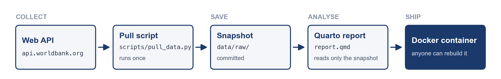
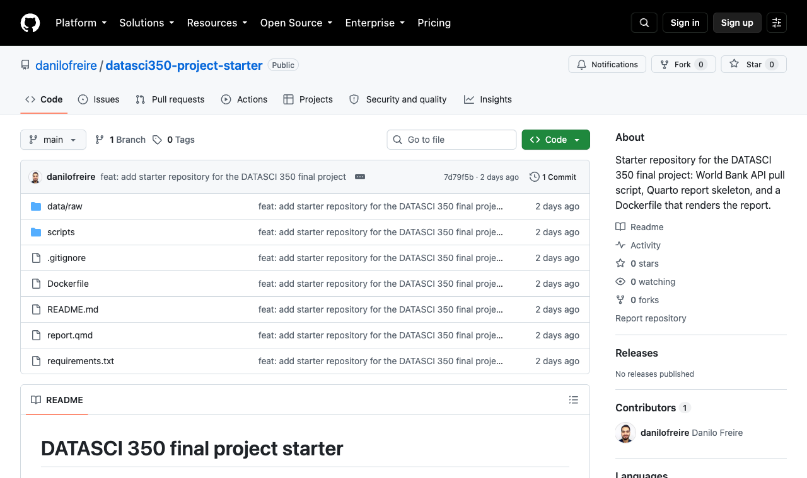

# [Hello! Great to see you again! 😊]{style="font-size: 0.8em;"} {background-color="#1B3A6B"}

# Brief recap {background-color="#1B3A6B"}

## Last class

:::{style="margin-top: 40px; font-size: 23px;"}
:::{.columns}
::::{.column width="55%"}
- An [API]{.alert} lets a program ask a server for data
- A URL has a [host]{.alert}, a [path]{.alert} (the data you want) and a [query string]{.alert} (your options)
- A `2xx` [status code]{.alert} means it worked, `4xx` a bad request, and `5xx` a server failure
- [JSON]{.alert} is made of objects `{ }` and arrays `[ ]`
- We get a value by following its keys, as in `current` → `temperature_2m`
- `python3 -m json.tool` makes the replies easier to read
- We save replies to files with `curl -o`
::::

::::{.column width="45%"}
:::{style="margin-top: 10px; background: rgba(27, 58, 107, 0.08); padding: 15px; border-radius: 10px; font-size: 23px;"}
[Today we do this in Python]{.alert}

- Read JSON from a file
- Get values with square brackets
- Send requests and check for errors
- Turn the reply into a [DataFrame]{.alert}
- Save it for your report
- Read your project's pull script
:::
::::
:::
:::

## Lecture overview

:::{style="margin-top: 40px; font-size: 24px;"}
:::{.columns}
::::{.column width="50%"}
[1. Reading JSON in Python]{.alert}

- Dictionaries and lists
- Opening a file
- Getting values from nested JSON

[2. The `requests` library]{.alert}

- The response from `requests.get`
- Building the URL with `params`
- Checking for errors
::::

::::{.column width="50%"}
[3. From JSON to a DataFrame]{.alert}

- Selecting fields with a loop
- Many countries in one request
- Missing values and CSV files

[4. Your project's pull script]{.alert}

- Reading `pull_data.py`
- API keys and pages
::::
:::
:::

# Reading JSON in Python {background-color="#1B3A6B"}

## Dictionaries and lists

:::{style="margin-top: 40px; font-size: 23px;"}
:::{.columns}
::::{.column width="52%"}
:::{style="font-size: 26px;"}
```python
course = {
    "code": "DATASCI 350",
    "enrolled": 40,
    "instructor": {"name": "Danilo Freire"},
}
years = [2023, 2024, 2025]

print(course["code"])
print(course["instructor"]["name"])
print(years[0], years[2])
print(type(course), type(years))
```

```text
DATASCI 350
Danilo Freire
2023 2025
<class 'dict'> <class 'list'>
```
:::
::::

::::{.column width="48%"}
- A [dictionary]{.alert} (`dict`) holds a JSON object in Python: `{"key": value}`
- You get a value by its key: `course["code"]`
- A [list]{.alert} holds a JSON array in Python: `[a, b]`
- You get a value by its position, from 0: `years[0]`
- Dictionaries and lists can hold each other, in any mix
- Each step of the path adds one pair of brackets
- JSON works in nearly any language because [most have these structures]{.alert}
::::
:::
:::

## Opening a file

:::{style="margin-top: 40px; font-size: 23px;"}
:::{.columns}
::::{.column width="52%"}
:::{style="font-size: 26px;"}
```python
import json

with open("data/wb_gdp_bra.json") as f:
    wb = json.load(f)

print(type(wb))
print(len(wb))
```

```text
<class 'list'>
2
```
:::

:::{style="font-size: 20px;"}
No file from last class? Save [`wb_gdp_bra.json`](https://github.com/danilofreire/datasci350/blob/main/lectures/lecture-19/data/wb_gdp_bra.json) in a `data/` folder next to your notebook, or run this there:

:::{style="font-size: 26px;"}
```bash
BASE="https://api.worldbank.org/v2"
DATA="country/BRA/indicator/NY.GDP.PCAP.KD"
Q="format=json&date=2014:2025"
curl --create-dirs -o data/wb_gdp_bra.json \
  "$BASE/$DATA?$Q"
```
:::
:::
::::

::::{.column width="48%"}
- `open(...)` finds the file and prepares it for reading
- `as f` names the [open file]{.alert} `f`
- The indented lines run while the file is open
- Python then [closes the file]{.alert}, even if there is an error
- We use `with` because an open file [may not save everything you write]{.alert}
- `json.load(f)` turns the JSON text into Python objects
- The reply is a list of two items, as we saw last class
::::
:::
:::

## `json.load` and `json.loads`
### Reading JSON from a file or from a string

:::{style="margin-top: 40px; font-size: 23px;"}
:::{.columns}
::::{.column width="55%"}
:::{style="font-size: 24px;"}
```python
import json

# The JSON is in a file
with open("data/wb_gdp_bra.json") as f:
    wb = json.load(f)

# The JSON is already in a string
text = """
{
  "city": "Atlanta",
  "temperature": 29.6,
  "raining": false
}
"""
data = json.loads(text)

print(type(text))
print(type(data))
print(data["city"], data["raining"])
```

```text
<class 'str'>
<class 'dict'>
Atlanta False
```
:::
::::

::::{.column width="45%"}
- Both functions turn JSON into Python objects
- Use [`json.load(f)`](https://docs.python.org/3/library/json.html#json.load) when the JSON is in a file on the disk
- Use [`json.loads(text)`](https://docs.python.org/3/library/json.html#json.loads) when it is already in your program as a string. The `s` stands for "string"
- `json.loads('{"city": "Atlanta"}')` also works, with no variable
- Three quotes let a string run over several lines
- `r.json()` does the same for an API reply
::::
:::
:::

## Getting values from nested JSON

:::{style="margin-top: 40px; font-size: 23px;"}
:::{.columns}
::::{.column width="52%"}
:::{style="font-size: 26px;"}
```python
import json

with open("data/wb_gdp_bra.json") as f:
    wb = json.load(f)

meta = wb[0]
records = wb[1]
first = records[0]

print(meta["total"])
print(first["date"], first["value"])
print(first["country"]["value"])
```

```text
12
2025 9747.99557762692
Brazil
```
:::
::::

::::{.column width="48%"}
- `wb[0]` is the metadata, and `wb[1]` is the list of records
- Naming each step, like `meta` and `records`, makes the code easier to read
- `records[0]` is the newest year, 2025
- `first["country"]["value"]` follows the path `country` → `value`
- `wb[1][0]["country"]["value"]` is the same path in one go
::::
:::
:::

## When a path is wrong
### Finding the right position or key

:::{style="margin-top: 40px; font-size: 22px;"}
:::{.columns}
::::{.column width="50%"}
:::{style="font-size: 26px;"}
```python
first["year"]
```

```text
KeyError: 'year'
```
:::

- A [`KeyError`]{.alert} means the dictionary has no such key

:::{style="font-size: 26px;"}
```python
wb[2]
```

```text
IndexError: list index out of range
```
:::

- An [`IndexError`]{.alert} means the list has no such position

:::{style="font-size: 26px;"}
```python
wb["total"]
```

```text
TypeError: list indices must be
integers or slices, not str
```
:::

- A [`TypeError`]{.alert} here means you used a name on a list, which only takes positions
::::

::::{.column width="50%"}
JSON has no `.head()`, so look at one level at a time

:::{style="font-size: 26px;"}
```python
print(type(wb), len(wb))
print(type(wb[1]), len(wb[1]))
print(wb[1][0].keys())
```

```text
<class 'list'> 2
<class 'list'> 12
dict_keys(['indicator', 'country',
'countryiso3code', 'date', 'value',
'unit', 'obs_status', 'decimal'])
```
:::

- `type()` tells you if you have a list or a dictionary
- `len()` tells you how many positions a list has
- `.keys()` lists the names in a dictionary
::::
:::
:::

## Try it yourself! 🤓 {#sec:exercise01}

:::{style="margin-top: 40px; font-size: 23px;"}
:::{.columns}
::::{.column width="55%"}
1. Use your Uruguay file from last class, or download [`wb_pop_ury.json`](https://github.com/danilofreire/datasci350/blob/main/lectures/lecture-19/data/wb_pop_ury.json) into a `data/` folder

Or replace `???` with Uruguay's country code (what is it? 😉) and `SP.POP.TOTL`, then run this:

:::{style="font-size: 26px;"}
```bash
BASE="https://api.worldbank.org/v2"
DATA="country/???/indicator/???"
Q="format=json&date=2014:2025"
curl --create-dirs -o data/wb_pop_ury.json \
  "$BASE/$DATA?$Q"
```
:::

:::{style="margin-top: 25px;"}
2. Open it with `with open(...) as f:` and `json.load(f)`
:::
::::

::::{.column width="45%"}
3. Print the [total]{.alert} number of records, using the key `total` in the metadata (position `0`)
4. Print the [year and population]{.alert} for 2020, using the keys `date` and `value`. Records run newest first
5. Print the [country name]{.alert}, under `country` and then `value`

:::{style="margin-top: 25px; background: rgba(27, 58, 107, 0.08); padding: 15px; border-radius: 10px; font-size: 20px;"}
You should get 12 records, a population of 3,398,968 in 2020, and the name Uruguay

[[Appendix 01]{.button}](#sec:appendix01)
:::
::::
:::
:::

# The `requests`{style="color: white; background: transparent;"} library {background-color="#1B3A6B"}

## What comes back from `requests.get`
### A response object, with the reply inside

:::{style="margin-top: 40px; font-size: 23px;"}
:::{.columns}
::::{.column width="55%"}
:::{style="font-size: 26px;"}
```python
import requests

url = ("https://api.open-meteo.com/v1/forecast"
       "?latitude=33.75&longitude=-84.39"
       "&current=temperature_2m")
r = requests.get(url, timeout=30)

print(type(r))
print(r.status_code)
print(r.text[:40])

data = r.json()
print(type(data))
```

```text
<class 'requests.models.Response'>
200
{"latitude":33.759865,"longitude":-84.39
<class 'dict'>
```
:::
::::

::::{.column width="45%"}
- `requests.get` returns a [response]{.alert}, which we call `r`
- `r.status_code` is the status code
- `r.text` is the reply as plain text. `[:40]` shows the first 40 characters
- `r.json()` turns that text into a dictionary, like `json.loads`
- [`timeout=30`]{.alert} gives up after 30 seconds. Without it, a silent server can make your script wait forever
- Install `requests` once with `pip install requests`
- Read more in the [`requests` documentation](https://requests.readthedocs.io/en/latest/)
::::
:::
:::

## Let `requests` build the URL
### Put the options in a dictionary called `params`

:::{style="margin-top: 40px; font-size: 23px;"}
:::{.columns}
::::{.column width="55%"}
:::{style="font-size: 26px;"}
```python
import requests

url = ("https://api.worldbank.org/v2/"
       "country/BRA/indicator/NY.GDP.PCAP.KD")
params = {
    "format": "json",
    "date": "2014:2025",
}

r = requests.get(url, params=params, timeout=30)
print(r.url)
print(r.status_code)
```

```text
https://api.worldbank.org/v2/country/BRA/
indicator/NY.GDP.PCAP.KD?format=json&
date=2014%3A2025
200
```
:::
::::

::::{.column width="45%"}
- The `url` holds only the path. No `?` and no `&`
- Each key in `params` becomes one option in the query string
- `requests` adds the `?` and the `&` for you
- It also encodes special characters, so `:` became `%3A`
- `r.url` shows the full URL that was sent. Paste it into your browser to check it
- To change the years, you edit one value in `params`
::::
:::
:::

## Checking for errors
### `raise_for_status()` stops the script on a bad status

:::{style="margin-top: 40px; font-size: 23px;"}
:::{.columns}
::::{.column width="55%"}
Here the path has a typo, `countryy` instead of `country`

:::{style="font-size: 26px;"}
```python
url = "https://api.worldbank.org/v2/countryy/BRA"
r = requests.get(url,
                 params={"format": "json"},
                 timeout=30)
print(r.status_code)
r.raise_for_status()
```

```text
404
requests.exceptions.HTTPError:
404 Client Error: Not Found for url:
https://api.worldbank.org/v2/
countryy/BRA?format=json
```
:::
::::

::::{.column width="45%"}
- `r.raise_for_status()` checks the status code
- If it is `4xx` or `5xx`, it [raises an error]{.alert}, so Python stops and prints a message
- If the status is `2xx`, it does nothing and the script carries on
- Stopping early shows you the line that caused the problem
- Put it right after every `requests.get`
::::
:::
:::

## An error with status `200`

:::{style="margin-top: 40px; font-size: 23px;"}
:::{.columns}
::::{.column width="55%"}
Here we ask for `XYZ`, a country code that does not exist

:::{style="font-size: 26px;"}
```python
url = ("https://api.worldbank.org/v2/"
       "country/XYZ/indicator/NY.GDP.PCAP.KD")
r = requests.get(url,
                 params={"format": "json"},
                 timeout=30)
r.raise_for_status()
payload = r.json()

print(r.status_code)
print(len(payload))
if len(payload) < 2:
    print("No data:", payload)
```

```text
200
1
No data: [{'message': [{'id': '120',
'key': 'Invalid value', 'value':
'The provided parameter value is not valid'}]}]
```
:::
::::

::::{.column width="45%"}
- The status is `200`, so `raise_for_status()` lets it pass
- A good World Bank reply has [two]{.alert} items, the metadata and the data
- This one has only one, holding an error message
- `if len(payload) < 2:` catches it
- [Check the data too]{.alert}, even when the status is `200`
::::
:::
:::

## A complete request

:::{style="margin-top: 40px; font-size: 23px;"}
:::{.columns}
::::{.column width="55%"}
:::{style="font-size: 26px;"}
```python
import json, requests

url = ("https://api.worldbank.org/v2/"
       "country/BRA/indicator/NY.GDP.PCAP.KD")
params = {"format": "json", "date": "2014:2025"}

r = requests.get(url, params=params, timeout=30)
r.raise_for_status()
payload = r.json()

if len(payload) < 2 or payload[1] is None:
    print("No data:", payload)
else:
    with open("data/wb_gdp_bra.json", "w") as f:
        json.dump(payload, f, indent=2)
    print("Saved", payload[0]["total"], "records")
```

```text
Saved 12 records
```
:::
::::

::::{.column width="45%"}
- This is the Python version of last class's `curl -o`
- `open(..., "w")` opens the file for [writing]{.alert}. It creates the file, or replaces it
- `json.dump` does the reverse of `json.load`, writing Python objects as JSON text
- `indent=2` makes the file readable, like `json.tool`
- `payload[1] is None` catches an empty reply, such as `[{...}, null]` for a year with no data
- The `else:` block runs only when the check passes, so a bad reply is never saved
::::
:::
:::

## Try it yourself! 🤓 {#sec:exercise02}

:::{style="margin-top: 40px; font-size: 23px;"}
:::{.columns}
::::{.column width="55%"}
1. Copy the code from the previous slide
2. Change it to fetch [Uruguay's population]{.alert}, 2014 to 2025
   - Country `URY`, indicator `SP.POP.TOTL`, file `data/wb_pop_ury.json`
3. Print `r.url`, and paste it into your browser
4. Print the number of records
5. Bonus: change the country to `XYZ`. What does your script print?
::::

::::{.column width="45%"}
:::{style="margin-top: 25px; background: rgba(27, 58, 107, 0.08); padding: 15px; border-radius: 10px; font-size: 20px;"}
You should get a URL ending in `?format=json&date=2014%3A2025` and 12 records. With `XYZ`, you should get the "No data" message and no new file

[[Appendix 02]{.button}](#sec:appendix02)
:::
::::
:::
:::

# From JSON to a DataFrame {background-color="#1B3A6B"}

## Selecting fields with a loop

:::{style="margin-top: 40px; font-size: 22px;"}
:::{.columns}
::::{.column width="55%"}
:::{style="font-size: 26px;"}
```python
# Reload Brazil, because Exercise 01 replaced wb
with open("data/wb_gdp_bra.json") as f:
    wb = json.load(f)

records = wb[1]  # the list of 12 records

rows = []
for record in records:
    row = {  # build a new, small dictionary
        "country": record["country"]["value"],
        "year": int(record["date"]),
        "value": record["value"],
    }
    rows.append(row)

print(len(rows))
print(rows[0])
```

```text
12
{'country': 'Brazil', 'year': 2025,
'value': 9747.99557762692}
```
:::
::::

::::{.column width="45%"}
- Each World Bank record has eight fields, some nested. We want three
- `rows = []` starts an empty list
- `for record in records:` runs the indented lines once per record
- Each time, we build a small dictionary with the [three fields we want]{.alert}
- `rows.append(row)` adds it to the end of the list
- `int(record["date"])` turns the year from text, `"2025"`, into a number, `2025`
::::
:::
:::

## Making the DataFrame

:::{style="margin-top: 40px; font-size: 22px;"}
:::{.columns}
::::{.column width="52%"}
:::{style="font-size: 26px;"}
```python
import pandas as pd

df = pd.DataFrame(rows)
df = df.sort_values("year")
df = df.reset_index(drop=True)

print(df.head())
print(df.shape)
```

```text
  country  year        value
0  Brazil  2014  9338.342783
1  Brazil  2015  8936.196617
2  Brazil  2016  8577.843767
3  Brazil  2017  8628.253089
4  Brazil  2018  8722.336303
(12, 3)
```
:::
::::

::::{.column width="48%"}
- `pd.DataFrame(rows)` makes one row per dictionary
- The keys, `country`, `year` and `value`, become the column names
- `sort_values("year")` puts the oldest year first
- `reset_index(drop=True)` renumbers the rows from 0 after sorting
- `df.shape` gives the rows and columns, here 12 and 3
- From here on, it is ordinary pandas
::::
:::
:::

## The `pd.json_normalize` shortcut

:::{style="margin-top: 40px; font-size: 22px;"}
:::{.columns}
::::{.column width="55%"}
:::{style="font-size: 26px;"}
```python
flat = pd.json_normalize(records)
print(flat.columns.tolist())

df = flat[["country.value", "date", "value"]]
print(df.head(3))
```

```text
['countryiso3code', 'date', 'value', 'unit',
 'obs_status', 'decimal', 'indicator.id',
 'indicator.value', 'country.id',
 'country.value']

  country.value  date        value
0        Brazil  2025  9747.995578
1        Brazil  2024  9566.745187
2        Brazil  2023  9288.027015
```
:::
::::

::::{.column width="45%"}
- `json_normalize` keeps [all]{.alert} the fields, ten columns here
- A nested field gets a dotted name, so `country` → `value` becomes `country.value`
- You then choose the columns you want with double brackets
- `date` is still text here. The loop turned it into a number
- Both ways work. The loop is longer, but you see every step
- Read more in the [`json_normalize` documentation](https://pandas.pydata.org/docs/reference/api/pandas.json_normalize.html)
::::
:::
:::

## Many countries in one request

:::{style="margin-top: 40px; font-size: 22px;"}
:::{.columns}
::::{.column width="58%"}
:::{style="font-size: 24px;"}
```python
url = ("https://api.worldbank.org/v2/country/"
       "BRA;IND;JPN;NGA;USA/indicator/SP.DYN.LE00.IN")
params = {"format": "json", "date": "2000:2024",
          "per_page": 1000}

r = requests.get(url, params=params, timeout=30)
r.raise_for_status()
payload = r.json()     # [metadata, records]
records = payload[1]   # just the records

rows = []
for record in records:
    rows.append({
        "country": record["country"]["value"],
        "year": int(record["date"]),
        "value": record["value"],
    })

df = pd.DataFrame(rows)
print(df.shape)
print(df["country"].value_counts())
```
:::
::::

::::{.column width="42%"}
:::{style="font-size: 24px;"}
```text
(125, 3)
country
Brazil           25
India            25
Japan            25
Nigeria          25
United States    25
Name: count, dtype: int64
```
:::

- `BRA;IND;JPN;NGA;USA` asks for five countries at once
- `SP.DYN.LE00.IN` is life expectancy at birth
- 5 countries × 25 years = [125 records]{.alert}
- The World Bank sends 50 records per page by default, so `per_page=1000` gets them all in one reply
::::
:::
:::

## Missing values

:::{style="margin-top: 40px; font-size: 22px;"}
:::{.columns}
::::{.column width="55%"}
:::{style="font-size: 24px;"}
```python
url = ("https://api.worldbank.org/v2/country/"
       "BRA;NGA/indicator/SP.DYN.LE00.IN")
params = {"format": "json", "date": "2022:2025"}

r = requests.get(url, params=params, timeout=30)
r.raise_for_status()
payload = r.json()
records = payload[1]

rows = []
for record in records:
    rows.append({
        "country": record["country"]["value"],
        "year": int(record["date"]),
        "value": record["value"],
    })

recent = pd.DataFrame(rows)
print(recent)

recent = recent.dropna()
print(len(recent))
```
:::
::::

::::{.column width="45%"}
:::{style="font-size: 24px;"}
```text
   country  year   value
0   Brazil  2025     NaN
1   Brazil  2024  76.023
2   Brazil  2023  75.848
3   Brazil  2022  74.872
4  Nigeria  2025     NaN
5  Nigeria  2024  54.635
6  Nigeria  2023  54.462
7  Nigeria  2022  54.079
6
```
:::

- The World Bank has not published 2025 life expectancy yet
- It sends those years with `"value": null`
- JSON `null` becomes Python `None`, and pandas shows it as [`NaN`]{.alert} ("not a number")
- `dropna()` removes the rows with missing values
- A missing value is [not a zero]{.alert}, so say in your report how you handled it
::::
:::
:::

## Analysing and saving the table

:::{style="margin-top: 40px; font-size: 22px;"}
:::{.columns}
::::{.column width="55%"}
:::{style="font-size: 26px;"}
```python
latest = df[df["year"] == 2024]
latest = latest.sort_values("value", ascending=False)
print(latest)

df.to_csv("data/life_expectancy.csv", index=False)
```

```text
           country  year      value
50           Japan  2024  84.036341
100  United States  2024  78.890244
0           Brazil  2024  76.023000
25           India  2024  72.235000
75         Nigeria  2024  54.635000
```
:::

The CSV starts like this:

:::{style="font-size: 26px;"}
```text
country,year,value
Brazil,2024,76.023
Brazil,2023,75.848
```
:::
::::

::::{.column width="45%"}
- `df[df["year"] == 2024]` keeps only the rows for 2024
- `ascending=False` puts the highest value first
- The numbers on the left are the original row labels
- `to_csv` writes the table to a file your report can read
- `index=False` leaves out those row labels, which are not data
- Parquet is a smaller, faster format. Lecture 21 covers it
::::
:::
:::

## Try it yourself! 🤓 {#sec:exercise03}

:::{style="margin-top: 40px; font-size: 23px;"}
:::{.columns}
::::{.column width="55%"}
1. Fetch [GDP per capita]{.alert} (`NY.GDP.PCAP.KD`) for `ARG;BRA;URY`, 2014 to 2025
2. Check the reply as we did in "A complete request"
3. Use today's loop to build a DataFrame with `country`, `year` and `value`
4. Print its shape, and count the missing values with `df["value"].isna().sum()`
5. Which country had the [highest GDP per capita in 2025]{.alert}?
6. Save the table to `data/gdp_south_america.csv`
::::

::::{.column width="45%"}
:::{style="margin-top: 25px; background: rgba(27, 58, 107, 0.08); padding: 15px; border-radius: 10px; font-size: 20px;"}
You should get 36 rows (3 countries × 12 years) and no missing values. Uruguay comes first, then Argentina, then Brazil

[[Appendix 03]{.button}](#sec:appendix03)
:::
::::
:::
:::

# Your project's pull script {background-color="#1B3A6B"}

## The project pipeline

:::{style="margin-top: 40px; font-size: 24px;"}
:::{style="text-align: center; margin-bottom: 20px;"}
[{width="85%"}](#){data-modal-type="image" data-modal-url="figures/project-pipeline-diagram.png"}
:::

- [Collect]{.alert} data from a web API with `requests`, as we did today
- [Save]{.alert} the raw reply and a tidy CSV in `data/raw/`
- [Analyse]{.alert} the data with pandas or DuckDB, and write the report in Quarto
- [Ship]{.alert} the report in a Docker container that runs on anyone's machine, later in the course
:::

## `pull_data.py`, part 1: the settings

:::{style="margin-top: 40px; font-size: 22px;"}
:::{.columns}
::::{.column width="55%"}
:::{style="font-size: 26px;"}
```python
# The World Bank indicator code. This one is
# life expectancy at birth.
INDICATOR = "SP.DYN.LE00.IN"

# The countries you want, as ISO three-letter
# codes, joined by ";".
COUNTRIES = "BRA;IND;NGA;USA"

# The years to cover, written as "first:last".
YEARS = "2000:2023"

# A short, readable name for the output files.
# If you change it, change the file name in
# report.qmd as well.
OUTPUT_NAME = "life_expectancy"
```
:::
::::

::::{.column width="45%"}
- The script is in the [starter repository](https://github.com/danilofreire/datasci350-project-starter), under `scripts/`
- These four settings sit at the top of the file
- Names in capital letters are [constants]{.alert}: values that stay the same while the script runs
- `COUNTRIES` uses the `;` you saw today
- Pick your indicators at [data.worldbank.org/indicator](https://data.worldbank.org/indicator)
- Everything below the settings rarely needs changing
::::
:::
:::

## `pull_data.py`, part 2: the request

:::{style="margin-top: 40px; font-size: 21px;"}
:::{.columns}
::::{.column width="57%"}
:::{style="font-size: 24px;"}
```python
def fetch_indicator(indicator, countries, years):
    url = (f"{BASE_URL}/country/{countries}"
           f"/indicator/{indicator}")
    params = {
        "format": "json",
        "date": years,
        "per_page": 20000,
    }
    response = requests.get(url, params=params, timeout=60)
    response.raise_for_status()

    payload = response.json()
    if not isinstance(payload, list) or len(payload) < 2:
        raise RuntimeError(
            f"Unexpected response from the API: {payload}")

    return payload
```
:::

:::{style="font-size: 17px;"}
Comments, type hints and a print line removed, and long lines split, to fit the slide. The file itself explains every line
:::
::::

::::{.column width="43%"}
- `def` creates a [function]{.alert}: a named block of code you can run later
- `return payload` hands the reply back to whoever called the function
- The `f"..."` string fills in the values inside `{ }`. `BASE_URL` is set near the top of the file: `https://api.worldbank.org/v2`
- `per_page=20000` fits everything on one page
- `raise RuntimeError(...)` stops the script with a message, like `raise_for_status()`
- The length check is the one we wrote today
::::
:::
:::

## `pull_data.py`, part 3: the table

:::{style="margin-top: 40px; font-size: 21px;"}
:::{.columns}
::::{.column width="52%"}
The starter's version

:::{style="font-size: 24px;"}
```python
rows = [
    {
        "country_code": record["countryiso3code"],
        "country": record["country"]["value"],
        "indicator": record["indicator"]["id"],
        "year": int(record["date"]),
        "value": record["value"],
    }
    for record in records
]
frame = pd.DataFrame(rows)
frame = frame.dropna(subset=["value"])
```
:::
::::

::::{.column width="48%"}
Today's version

:::{style="font-size: 24px;"}
```python
rows = []
for record in records:
    rows.append({
        "country_code": record["countryiso3code"],
        "country": record["country"]["value"],
        "indicator": record["indicator"]["id"],
        "year": int(record["date"]),
        "value": record["value"],
    })
```
:::

- The starter uses a [list comprehension]{.alert}, with the `for` inside the brackets
- Both build the same list. Use whichever you find easier to read
- `dropna(subset=["value"])` removes rows with no value
::::
:::
:::

## `pull_data.py`, part 4: running it

:::{style="margin-top: 40px; font-size: 22px;"}
:::{.columns}
::::{.column width="57%"}
Run it once, from the top folder of your repository:

:::{style="font-size: 24px;"}
```bash
python scripts/pull_data.py
```
:::

The output, with the folder paths shortened and the table cut to three rows:

:::{style="font-size: 24px;"}
```text
Requesting https://api.worldbank.org/v2/country/
BRA;IND;NGA;USA/indicator/SP.DYN.LE00.IN
Saved the raw response to
data/raw/life_expectancy_raw.json
Saved 96 tidy rows to
data/raw/life_expectancy.csv

First few rows:
  country_code country       indicator  year   value
0          BRA  Brazil  SP.DYN.LE00.IN  2000  69.584
1          BRA  Brazil  SP.DYN.LE00.IN  2001  69.980
2          BRA  Brazil  SP.DYN.LE00.IN  2002  70.396

Now commit both files in data/raw/
to your repository.
```
:::
::::

::::{.column width="43%"}
- The script saves [two files]{.alert}, the untouched reply as JSON and the tidy table as CSV
- The raw file lets you fix the tidying later without calling the API again
- [Commit both files]{.alert}. Your report reads the saved CSV, never the live API
- That is why the report gives the same numbers in December
- The last two lines of the file, starting with `if __name__ == "__main__":`, run the script only when you call it directly
::::
:::
:::

## If your API needs a key or sends pages {#sec:keys-pages}
### For Track B only

:::{style="margin-top: 40px; font-size: 23px;"}
:::{.columns}
::::{.column width="50%"}
#### API keys

- Some APIs need a key, a password for programs
- You used one in Lecture 14
- Keep it in a [`.env` file]{.alert}, and put `.env` in `.gitignore`
- [Never commit a key.]{.alert} Bots scan public repositories for them
- [Appendix 04](#sec:appendix04) has the details and code
::::

::::{.column width="50%"}
#### Pages

- Some APIs send long results in [pages]{.alert}
- The reply says how many pages there are
- You ask for page 1, then page 2, and so on, until the last one
- First try a bigger page, like `per_page=20000`. One request is simpler than a loop
- [Appendix 05](#sec:appendix05) has the details and code
::::
:::
:::

## What the project asks of you

:::{style="margin-top: 40px; font-size: 21px;"}
:::{.columns}
::::{.column width="56%"}
:::{style="font-size: 25px;"}
| File | What it does |
|---|---|
| `scripts/pull_data.py` | Run it once with `python scripts/pull_data.py` |
| `data/raw/<name>_raw.json` | The untouched API reply |
| `data/raw/<name>.csv` | The tidy table your report reads |
| `report.qmd` | Reads only the saved copy, 1,500 to 2,500 words |
| `Dockerfile` | Builds the image your report renders in |
| `requirements.txt` | Pinned versions, so the build stays the same in the future |
:::

- [Commit `data/raw/`]{.alert}. Do not put it in `.gitignore`
- The report never calls the API while it renders
::::

::::{.column width="44%"}
:::{style="text-align: center; margin-top: -10px;"}
[{width="95%"}](#){data-modal-type="image" data-modal-url="figures/project-starter-2026.png"}

:::{style="font-size: 17px;"}
The starter repository: [github.com/danilofreire/datasci350-project-starter](https://github.com/danilofreire/datasci350-project-starter)
:::
:::
::::
:::
:::

## The course panel {#sec:panel}

:::{style="margin-top: 40px; font-size: 23px;"}
:::{.columns}
::::{.column width="55%"}
- I built [`wdi_panel.parquet`](https://github.com/danilofreire/datasci350/raw/refs/heads/main/lectures/lecture-19/data/wdi_panel.parquet) with the same steps
- It has eight World Bank indicators for 217 countries, 1990 to 2023
- It has 59,024 rows, one per country, indicator and year
- [Parquet]{.alert} is a compact format, covered in Lecture 21
- We query this file with SQL in [Lecture 22]{.alert}
::::

::::{.column width="45%"}
:::{style="margin-top: 20px; background: rgba(27, 58, 107, 0.08); padding: 15px; border-radius: 10px; font-size: 21px;"}
The indicators include GDP per capita, population, life expectancy and CO2 emissions per person

The full list and the script are in the appendix

[[Appendix 06]{.button}](#sec:appendix06)
:::
::::
:::
:::

# Conclusion {background-color="#1B3A6B"}

## What we learned today

:::{style="margin-top: 40px; font-size: 23px;"}
:::{.columns}
::::{.column width="50%"}
- JSON objects become [dictionaries]{.alert}, and arrays become [lists]{.alert}
- `with open(...) as f:` opens a file and closes it for you
- `json.load` reads JSON, and `json.dump` writes it
- Square brackets follow a path, as in `wb[1][0]["value"]`
- `type()`, `len()` and `.keys()` show the shape of a reply
- `requests.get(url, params=..., timeout=30)` sends the request
- `raise_for_status()` and a check on the reply catch the errors
::::

::::{.column width="50%"}
- A `for` loop keeps the fields you need from each record
- `pd.DataFrame(rows)` turns the list into a table
- `;` asks for many countries, and `per_page` gets them in one reply
- `null` becomes `NaN`, and `dropna()` removes it
- `to_csv(..., index=False)` saves the table for your report
- Your project's `pull_data.py` does all of this, and you can now read every line
::::
:::
:::

## Next class

:::{style="margin-top: 40px; font-size: 23px;"}
:::{.columns}
::::{.column width="55%"}
- [Quiz 03]{.alert} is next class, covering Lectures 12, 14, 15, 16 and 17
- Revise the exercises from those lectures and you will be well prepared
- [Lecture 21]{.alert} starts parallel computing
- What if the data is on a web page, with no API?
- The optional [web-scraping tutorial](https://danilofreire.github.io/datasci350/tutorials/05-web-scraping-tutorial.html) covers that, from HTML tables in pandas to BeautifulSoup
::::

::::{.column width="45%"}
:::{style="margin-top: -15px;"}
[Before then]{.alert}

1. Email me your group's names, or I assign you a group at random
2. Clone the starter repository and run `python scripts/pull_data.py` once
3. Finish Exercise 03 if you did not have time in class
4. Revise Lectures 12 and 14 to 17 for the quiz
:::
::::
:::
:::

# And that's all for today! 🤓 {background-color="#1B3A6B"}

## Appendix 01 {#sec:appendix01}
### Exercise 01 solution

:::{style="margin-top: 40px; font-size: 23px;"}
:::{.columns}
::::{.column width="55%"}
:::{style="font-size: 24px;"}
```python
import json

with open("data/wb_pop_ury.json") as f:
    wb = json.load(f)

print(wb[0].keys())
print(wb[1][0].keys())

print(wb[0]["total"])
print(wb[1][5]["date"], wb[1][5]["value"])
print(wb[1][0]["country"]["value"])
```

```text
dict_keys(['page', 'pages', 'per_page', 'total',
'sourceid', 'lastupdated'])
dict_keys(['indicator', 'country',
'countryiso3code', 'date', 'value',
'unit', 'obs_status', 'decimal'])
12
2020 3398968
Uruguay
```
:::
::::

::::{.column width="45%"}
- `.keys()` shows the names you can use at each level
- `wb[0]` is the metadata, and `total` is one of its keys
- Records run newest first, so 2020 is at position `5` (2025 is at `0`)
- Last class's path `1` → `5` → `value` becomes `wb[1][5]["value"]`
- Every record holds the country, so `wb[1][0]` works as well as any other

:::{style="margin-top: 25px; background: rgba(27, 58, 107, 0.08); padding: 15px; border-radius: 10px; font-size: 20px;"}
[[Back to exercise]{.button}](#sec:exercise01)
:::
::::
:::
:::

## Appendix 02 {#sec:appendix02}
### Exercise 02 solution

:::{style="margin-top: 40px; font-size: 22px;"}
:::{.columns}
::::{.column width="57%"}
:::{style="font-size: 24px;"}
```python
import json, requests

url = ("https://api.worldbank.org/v2/"
       "country/URY/indicator/SP.POP.TOTL")
params = {"format": "json", "date": "2014:2025"}

r = requests.get(url, params=params, timeout=30)
r.raise_for_status()
payload = r.json()

if len(payload) < 2 or payload[1] is None:
    print("No data:", payload)
else:
    with open("data/wb_pop_ury.json", "w") as f:
        json.dump(payload, f, indent=2)
    print(r.url)
    print("Saved", payload[0]["total"], "records")
```

```text
https://api.worldbank.org/v2/country/URY/indicator/SP.POP.TOTL?format=json&date=2014%3A2025
Saved 12 records
```
:::
::::

::::{.column width="43%"}
- Only `URY`, `SP.POP.TOTL` and the file name changed. The `params` are the same for every indicator
- With `XYZ`, the length check prints the "No data" message, and no file is written
- If the `data/` folder does not exist, `open` fails. Create the folder first

:::{style="margin-top: 25px; background: rgba(27, 58, 107, 0.08); padding: 15px; border-radius: 10px; font-size: 20px;"}
[[Back to exercise]{.button}](#sec:exercise02)
:::
::::
:::
:::

## Appendix 03 {#sec:appendix03}
### Exercise 03 solution

:::{style="margin-top: 40px; font-size: 21px;"}
:::{.columns}
::::{.column width="57%"}
:::{style="font-size: 24px;"}
```python
import requests
import pandas as pd

url = ("https://api.worldbank.org/v2/"
       "country/ARG;BRA;URY/indicator/NY.GDP.PCAP.KD")
params = {"format": "json", "date": "2014:2025", "per_page": 1000}

r = requests.get(url, params=params, timeout=30)
r.raise_for_status()
payload = r.json()

rows = []
for record in payload[1]:
    rows.append({
        "country": record["country"]["value"],
        "year": int(record["date"]),
        "value": record["value"],
    })

df = pd.DataFrame(rows)
print(df.shape)
print(df["value"].isna().sum())

latest = df[df["year"] == 2025]
latest = latest.sort_values("value", ascending=False)
print(latest)

df.to_csv("data/gdp_south_america.csv", index=False)
```
:::
::::

::::{.column width="43%"}
:::{style="font-size: 24px;"}
```text
(36, 3)
0
      country  year         value
24    Uruguay  2025  19374.515843
0   Argentina  2025  13287.115953
12     Brazil  2025   9747.995578
```
:::

- 36 records fit in one reply, so there is one page
- The length check is left out here to fit the slide. Keep it in your own code
- Uruguay's GDP per capita is about twice Brazil's

:::{style="margin-top: 25px; background: rgba(27, 58, 107, 0.08); padding: 15px; border-radius: 10px; font-size: 20px;"}
[[Back to exercise]{.button}](#sec:exercise03)
:::
::::
:::
:::

## Appendix 04: API keys {#sec:appendix04}
### For Track B

:::{style="margin-top: 40px; font-size: 19px;"}
:::{.columns}
::::{.column width="50%"}
1. Sign up on the API's website. The key usually arrives by email in a minute
2. Put it in a file called [`.env`]{.alert}, one `NAME=value` per line, with no quotes

:::{style="font-size: 24px;"}
```
NASA_API_KEY=abc123def456
```
:::

3. Add `.env` to your [`.gitignore`]{.alert} [before]{.alert} your first commit
4. Read it in Python with `python-dotenv`, as in Lecture 14

:::{style="font-size: 24px;"}
```python
import os
from dotenv import load_dotenv

load_dotenv()
key = os.getenv("NASA_API_KEY")
```
:::
::::

::::{.column width="50%"}
5. Send it the way the documentation says:

:::{style="font-size: 24px;"}
```python
# In the query string
params = {"api_key": key}

# Or in a header, which is safer
# (some APIs, e.g. GitHub; NASA uses api_key)
headers = {"Authorization": f"Bearer {key}"}
r = requests.get(url, headers=headers, timeout=30)
```
:::

- Headers are safer because URLs get saved in logs and browser history
- GitHub found [more than 39 million leaked secrets](https://github.blog/security/application-security/next-evolution-github-advanced-security/) in 2024
- Committed a key by accident? [Revoke it at once]{.alert} and get a new one. Deleting the file does not help, because Git keeps the history

:::{style="margin-top: 10px; background: rgba(27, 58, 107, 0.08); padding: 10px; border-radius: 10px; font-size: 20px;"}
[[Back to the slide]{.button}](#sec:keys-pages)
:::
::::
:::
:::

## Appendix 05: pages {#sec:appendix05}

:::{style="margin-top: 40px; font-size: 19px;"}
:::{.columns}
::::{.column width="56%"}
:::{style="font-size: 20px;"}
```python
import time
import requests

url = ("https://api.worldbank.org/v2/"
       "country/all/indicator/NY.GDP.PCAP.KD")
records = []
page = 1

while True:
    params = {"format": "json", "date": 2023,
              "per_page": 100, "page": page}
    r = requests.get(url, params=params, timeout=30)
    r.raise_for_status()
    payload = r.json()

    records.extend(payload[1])
    print("page", page, "of", payload[0]["pages"])

    if page >= payload[0]["pages"]:
        break
    page = page + 1
    time.sleep(0.5)

print(len(records), "records")
```
:::
::::

::::{.column width="44%"}
:::{style="font-size: 20px;"}
```text
page 1 of 3
page 2 of 3
page 3 of 3
266 records
```
:::

- GDP per capita for every country and regional group in 2023, 100 records per page
- `while True:` repeats until a `break`
- The metadata's `pages` tells the loop when to stop
- `records.extend(...)` adds a whole page to the list
- `time.sleep(0.5)` waits half a second, to be polite to the server
- A `429` status means you are asking too fast. Wait and try again
- The saved pages are in [`data/`](https://github.com/danilofreire/datasci350/tree/main/lectures/lecture-19/data) (`wb_gdppc_2023_page1.json` to `page3`)

:::{style="margin-top: 10px; background: rgba(27, 58, 107, 0.08); padding: 10px; border-radius: 10px; font-size: 20px;"}
[[Back to the slide]{.button}](#sec:keys-pages)
:::
::::
:::
:::

## Appendix 06: how the course panel was built {#sec:appendix06}

:::{style="margin-top: 40px; font-size: 20px;"}
:::{.columns}
::::{.column width="50%"}
`data/wdi_panel.parquet` holds eight indicators for every country (regional and income groups such as "World" are dropped) from 1990 to 2023, in long format

| Column | Type | Meaning |
|---|---|---|
| `country` | category | Country name |
| `iso3` | category | Three-letter country code |
| `indicator` | category | Short name, one of the eight |
| `year` | int16 | 1990 to 2023 |
| `value` | float64 | The observation, `NaN` where missing |
::::

::::{.column width="50%"}
| Short name | WDI code |
|---|---|
| `gdp_per_capita` | `NY.GDP.PCAP.KD` |
| `population` | `SP.POP.TOTL` |
| `life_expectancy` | `SP.DYN.LE00.IN` |
| `co2_per_capita` | `EN.GHG.CO2.PC.CE.AR5` |
| `internet_users_pct` | `IT.NET.USER.ZS` |
| `urban_pop_pct` | `SP.URB.TOTL.IN.ZS` |
| `fertility_rate` | `SP.DYN.TFRT.IN` |
| `primary_enrolment_net` | `SE.PRM.NENR` |

The script is [`data/build_wdi_panel.py`](https://github.com/danilofreire/datasci350/blob/main/lectures/lecture-19/data/build_wdi_panel.py). It saves the raw replies in `data/raw/`, so a second run makes no network requests

[[Back to the panel slide]{.button}](#sec:panel)
::::
:::
:::
