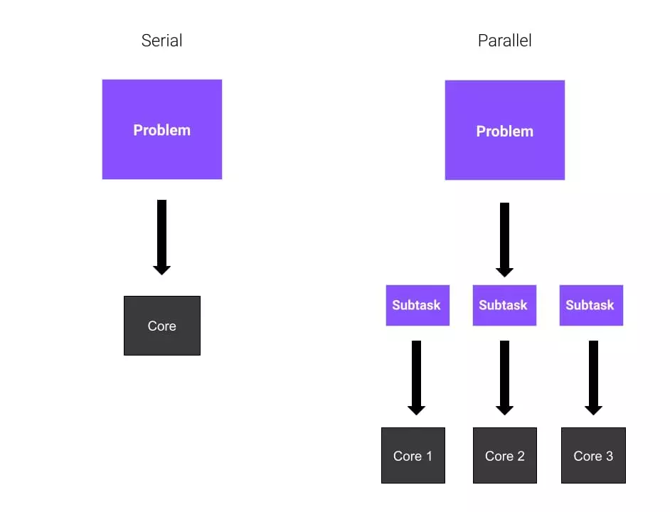
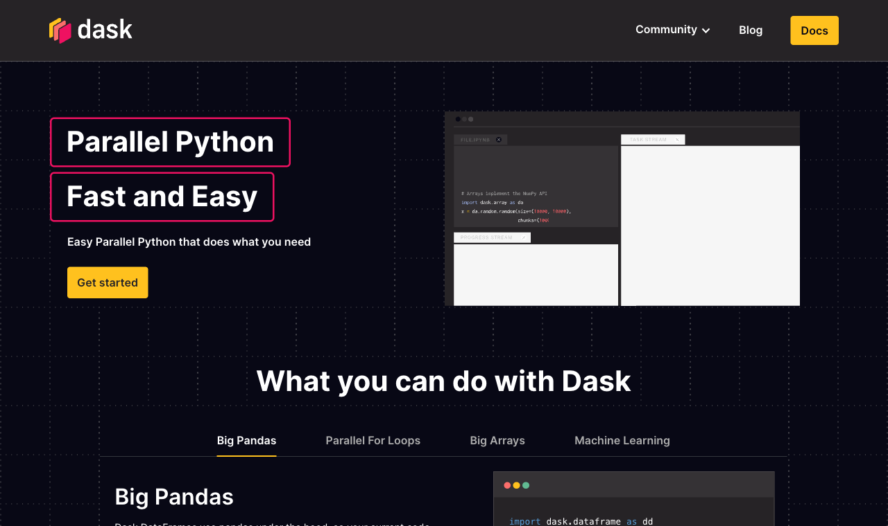
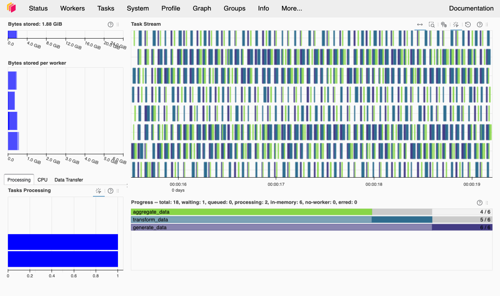

# Hello again, my friends! 😊 <br> {background-color="#1B3A6B"}

# Brief recap 📚 {background-color="#1B3A6B"}

## Module 06: getting data from the web
### Lectures 18 and 19

:::{style="margin-top: 50px; font-size: 24px;"}
:::{.columns}
:::{.column width="50%"}
- A web API is a [contract]{.alert} between your code and a server
- We built URLs, read status codes and followed [JSON]{.alert} paths
- `curl` and `requests` fetched the data
- A `for` loop turned the reply into a DataFrame
- A saved [snapshot]{.alert} gives the same numbers every time
:::

:::{.column width="50%"}
- Module 07: what if the data get [really big]{.alert}?
- Three possible fixes:
  - [Parallel code]{.alert}: several cores at once
  - A [better algorithm]{.alert}
  - A [faster engine]{.alert}, like DuckDB (next lecture)

:::{style="background: rgba(27, 58, 107, 0.08); padding: 15px; border-radius: 10px; font-size: 20px; margin-top: 20px;"}
Lecture 19's `wdi_panel.parquet` uses the parquet format we meet today
:::
:::
:::
:::

## Tweet of the day

:::{style="text-align: center; margin-top: 50px; font-size: 22px;"}
[{width="75%"}](#){data-modal-type="image" data-modal-url="figures/huang-tweet.png"}

[About Jensen Huang](https://www.nbcnews.com/tech/tech-news/nvidia-ceo-jensen-huang-investigation-rcna608148)

:::{style="font-size: 18px;"}
Source: [X](https://x.com/FangYi11101/status/2119586357853204813)
:::
:::

# Today's agenda {background-color="#1B3A6B"}

## Lecture outline

:::{style="margin-top: 50px; font-size: 22px;"}
:::{.columns}
:::{.column width="50%"}
- [Serial and parallel]{.alert} code, and the `map` function
- [`joblib`]{.alert} and [`concurrent.futures`]{.alert}: parallel work on your laptop
- [Big O notation]{.alert}: what parallelism can and cannot fix
- [Amdahl's law]{.alert}: the limit on speed-up
- [Dask]{.alert} for data bigger than your memory
  - Lazy arrays and DataFrames
  - CSV and parquet files
  - `dask.delayed` for your own functions
- [Best practices]{.alert}: when to parallelise, and when not to
:::

:::{.column width="50%"}
:::{style="text-align: center; margin-top: -30px;"}
[{width="80%"}](#){data-modal-type="image" data-modal-url="figures/cores.webp"}
[{width="55%"}](#){data-modal-type="image" data-modal-url="figures/dask.png"}
:::
:::
:::
:::

# Serial vs parallel algorithms  {background-color="#1B3A6B"}

## Serial execution and the `map` function

:::{style="margin-top: 50px; font-size: 22px;"}
:::{.columns}
:::{.column width="50%"}
- Python runs one line after another
- This loop calls `bar` on each number, one at a time:

:::{style="font-size: 1.1em;"}
```{python}
#| echo: true
#| eval: true
#| cache: true
import numpy as np

# An array of six numbers
foo = np.array([0, 1, 2, 3, 4, 5])

# A function that squares a number
def bar(x):
    return x * x

# Call bar on each element, in order
for element in foo:
    print(bar(element))
```
:::
:::

:::{.column width="50%"}
- [`map`]{.alert} applies one function to every element of a list
- My own version shows the loop inside:

:::{style="font-size: 1.1em;"}
```{python}
#| echo: true
#| eval: true
#| cache: true
def my_map(function, array):
    output = []           # empty list for the results
    for element in array:
        output.append(function(element))
    return output

my_map(bar, foo)
```
:::

- Python has a [built-in](https://www.w3schools.com/python/ref_func_map.asp) `map` (faster than mine):

:::{style="font-size: 1.1em;"}
```{python}
#| echo: true
#| eval: true
#| cache: true
list(map(bar, foo))
```
:::
:::
:::
:::

## Using `joblib` for parallel computing

:::{style="margin-top: 50px; font-size: 20px;"}
:::{.columns}
:::{.column width="50%"}
- Each call to `bar` is [independent]{.alert}, so the calls can run at once
- Your CPU has several [cores]{.alert}. Each runs one task at a time
- [`joblib`](https://joblib.readthedocs.io/) sends tasks to [worker processes]{.alert}: separate copies of Python
- `Parallel(n_jobs=6)` runs up to six tasks at once. `n_jobs=-1` uses all cores
- `delayed(bar)` wraps `bar`, so a worker runs it later
- `delayed(bar)(x) for x in foo` is a [generator expression](https://www.geeksforgeeks.org/python/generator-expressions/): a `for` loop inside parentheses that makes one task per element
- More information about joblib on their website: <https://joblib.readthedocs.io/en/stable/>
:::

:::{.column width="50%"}
- With `bar` and `foo` from before:

:::{style="font-size: 1.2em;"}
```{python}
#| echo: true
#| eval: true
#| cache: true
# Install joblib if you haven't done so yet
# !pip install joblib

from joblib import Parallel, delayed

results = Parallel(n_jobs=6)(
    delayed(bar)(x) for x in foo
)
results
```
:::

- Each worker gets a different element of `foo`
- The results match the serial version
:::
:::
:::

## Serial vs parallel execution

:::{style="margin-top: 50px; font-size: 20px;"}
:::{.columns}
:::{.column width="50%"}
- Our function `calculation` (below) runs ten heavy steps on ten million random numbers
- The calls are independent, so the problem is [embarrassingly parallel](https://en.wikipedia.org/wiki/Embarrassingly_parallel)
- [`%timeit`](https://ipython.readthedocs.io/en/stable/interactive/magics.html#magic-timeit) averages a line over several runs (Jupyter only)
- `%%timeit` (two `%` signs) times a whole cell
- [One call:]{.alert}

:::{style="font-size: 1.2em;"}
```{python}
#| echo: true
#| eval: true
#| cache: true
def calculation(size=10000000):
    # Create a large array and perform operations
    arr = np.random.rand(size)
    for _ in range(10):
        arr = np.sqrt(arr) + np.sin(arr)
    return np.mean(arr)

# Single run
%timeit calculation()
```
:::
:::

:::{.column width="50%"}
- [Four calls, one after another:]{.alert}
- `_` names a loop variable we do not use

:::{style="font-size: 1.2em;"}
```{python}
#| echo: true
#| eval: true
#| cache: true
# Sequential runs (4 times)
%timeit [calculation() for _ in range(4)]
```
:::

- [Four calls, in parallel:]{.alert}

:::{style="font-size: 1.2em;"}
```{python}
#| echo: true
#| eval: true
#| cache: true
%%timeit
# Parallel runs (4 times)
Parallel(n_jobs=4)(
    delayed(calculation)() for _ in range(4)
)
```
:::

- Not a full 4× speed-up, because [starting workers and collecting results takes time]{.alert}
:::
:::
:::

# concurrent.futures {background-color="#1B3A6B"}

## `concurrent.futures`: the standard-library option

:::{style="margin-top: 50px; font-size: 21px;"}
:::{.columns}
:::{.column width="50%"}
- [`concurrent.futures`](https://docs.python.org/3/library/concurrent.futures.html) comes with Python: nothing to install
- [Computing]{.alert} (maths, model training): [`ProcessPoolExecutor`](https://docs.python.org/3/library/concurrent.futures.html#concurrent.futures.ProcessPoolExecutor)
- [Waiting]{.alert} (downloads, API calls): [`ThreadPoolExecutor`](https://docs.python.org/3/library/concurrent.futures.html#concurrent.futures.ThreadPoolExecutor)
- Processes are separate copies of Python that compute at the same time
- Threads share one copy of Python, so they start fast. While one waits, the others keep working

:::{style="font-size: 1.1em;"}
```{python}
#| echo: true
#| eval: false
from concurrent.futures import ProcessPoolExecutor

with ProcessPoolExecutor(max_workers=4) as executor:
    results = list(executor.map(bar, foo))
```
:::

- In a notebook, [import `bar` from a `.py` file]{.alert}. Workers cannot see functions defined in a cell, but joblib can
:::

:::{.column width="50%"}
- Threads start fast and need no extra core to wait
- Each URL asks the [World Bank API](https://datahelpdesk.worldbank.org/knowledgebase/articles/898581-api-basic-call-structures) for one country's population

:::{style="font-size: 1.1em;"}
```{python}
#| echo: true
#| eval: false
from concurrent.futures import ThreadPoolExecutor
import requests

base = "https://api.worldbank.org/v2/country/"
end = "/indicator/SP.POP.TOTL?format=json&per_page=100"
urls = [base + "BRA" + end,
        base + "IND" + end,
        base + "USA" + end]

def fetch(url):
    return requests.get(url, timeout=30).json()

with ThreadPoolExecutor(max_workers=3) as executor:
    results = list(executor.map(fetch, urls))
```
:::

- All three requests wait at once (Lecture 19 sent one at a time)
:::
:::
:::

## When to use which?

:::{style="margin-top: 50px; font-size: 22px;"}
:::{.columns}
:::{.column width="50%"}
- [joblib](https://joblib.readthedocs.io/) suits numeric loops, and [scikit-learn](https://scikit-learn.org/stable/) uses it when you set `n_jobs=-1`
- [`load_digits()`](https://scikit-learn.org/stable/modules/generated/sklearn.datasets.load_digits.html) loads 1,797 small images of handwritten digits
- 6 combinations × 3 folds (`cv=3`) = 18 fits shared across the cores

:::{style="font-size: 1.1em;"}
```{python}
#| echo: true
#| eval: true
#| cache: true
from sklearn.datasets import load_digits
from sklearn.model_selection import GridSearchCV
from sklearn.svm import SVC
import time

digits = load_digits()
param_grid = {"C": [0.1, 1, 10], "gamma": [0.001, 0.01]}

start = time.time()
search = GridSearchCV(SVC(), param_grid, cv=3, n_jobs=-1)
search.fit(digits.data, digits.target)
elapsed = time.time() - start

print(f"Best score: {search.best_score_:.3f}")
print(f"Time: {elapsed:.2f}s (all cores)")
```
:::
:::

:::{.column width="50%"}
:::{style="margin-top: 30px; margin-bottom: 30px;"}
| Scenario | Tool |
|----------|------|
| sklearn / numeric loops | `joblib` (`n_jobs=-1`) |
| Download many files | `ThreadPoolExecutor` |
| CPU-heavy, no dependencies | `ProcessPoolExecutor` |
| Bigger than RAM, clusters | `Dask` (next section) |
:::

:::{style="background: rgba(27, 58, 107, 0.08); padding: 15px; border-radius: 10px; font-size: 20px; margin-top: 20px;"}
Every tool [splits the work, runs it on separate workers, then collects the results]{.alert}
:::
:::
:::
:::

# Big O notation {background-color="#1B3A6B"}

## Big O notation

:::{style="margin-top: 50px; font-size: 24px;"}
:::{.columns}
:::{.column width="50%"}
- [Big O notation](https://en.wikipedia.org/wiki/Big_O_notation) describes how runtime grows with input size
- [O(1)]{.alert} is constant: reading one array element takes the same time at any size
- A single loop is [O(n)]{.alert}, linear: double the input, double the time
- A nested loop is [O(n²)]{.alert}, quadratic: double the input, four times the time
- Calling `calculation` `n` times is [O(n)]{.alert}: 100 calls take 100 times as long as one
:::

:::{.column width="50%"}
<style>.plot-first .cell { display: flex; flex-direction: column-reverse; }.plot-first img { height: auto; }</style>

:::{.plot-first style="text-align: center;"}
```{python}
#| echo: true
#| code-fold: true
#| eval: true
#| cache: true
import matplotlib.pyplot as plt
import numpy as np

# Simulate processing times
num_images = np.array([1, 10, 50, 100, 200])
sequential_time = num_images * 2  # 2 seconds per image
parallel_time = (num_images * 2) / 4  # 4 cores, ideal speedup

plt.figure(figsize=(8, 5))
plt.plot(num_images, sequential_time, 'o-', label='Serial O(n)', linewidth=2, markersize=8)
plt.plot(num_images, parallel_time, 's-', label='Parallel on 4 cores (still O(n))', linewidth=2, markersize=8)
plt.xlabel('Number of Images', fontsize=12)
plt.ylabel('Time (seconds)', fontsize=12)
plt.title('O(n) Scaling: Serial vs Parallel', fontsize=14, fontweight='bold')
plt.legend(fontsize=11)
plt.grid(True, alpha=0.3)
plt.show()
```

:::
:::
:::
:::

## What parallelism does to complexity

:::{style="margin-top: 50px; font-size: 20px;"}
:::{.columns}
:::{.column width="50%"}
- With `p` cores, an O(n) task takes about [n/p time plus overhead]{.alert}. It is still O(n)
- Best candidates: [embarrassingly parallel O(n) tasks]{.alert}, which share no data and do not wait for each other

:::{style="background: rgba(230, 57, 70, 0.1); padding: 15px; border-radius: 10px; font-size: 20px; margin-top: 20px;"}
Parallelism divides the time by a constant but never changes the Big O class. [O(n²) on eight cores is still O(n²)]{.alert}
:::
:::

:::{.column width="50%"}
- Parallelism cannot fix this:

:::{style="font-size: 1.2em;"}
```{python}
#| echo: true
#| eval: true
#| cache: true
# O(n^2): every pair of elements
def pairwise_sum(data):
    n = len(data)
    results = []
    for i in range(n):
        for j in range(n):
            results.append(data[i] + data[j])
    return results

data = list(range(1_000))
print(f"{len(pairwise_sum(data)):,} operations")
```
:::

- 1,000 elements give 1 million operations
- `n = 100_000` gives 10 billion. Eight cores still leave 1.25 billion each
- Poor candidates for parallelism:
  - Steps that need results from a previous step
  - Tasks that share the same data
  - Tasks limited by memory, not by the CPU
:::
:::
:::

## Try it yourself! {#sec:exercise01}

:::{style="margin-top: 50px; font-size: 20px;"}
1. Run `pip install joblib numpy` if you have not already
2. Run the serial version below and write down the time it prints. `np.arange(1000000)` makes an array of the numbers 0 to 999,999

:::{style="font-size: 1.2em;"}
```{python}
#| echo: true
#| eval: false
import numpy as np

def square(x):
    return x**2

# Create a large array to process
numbers = np.arange(1000000)

# Sequential version
%timeit [square(x) for x in numbers]
```
:::

3. Run the parallel version and write down its time. It takes a few seconds

:::{style="font-size: 1.2em;"}
```{python}
#| echo: true
#| eval: false
from joblib import Parallel, delayed

# Parallel version
%timeit Parallel(n_jobs=4)(delayed(square)(x) for x in numbers)
```
:::

4. Compare the two times and decide which version you would use

[[Appendix 01]{.button}](#sec:appendix01)
:::

# Amdahl's law {background-color="#1B3A6B"}

## Amdahl's law: the speed-up ceiling

:::{style="margin-top: 50px; font-size: 24px;"}
:::{.columns}
:::{.column width="50%"}
- Some parts of a program [cannot run in parallel]{.alert}: setup, merging results, or steps that wait for the one before
- That part is the [serial share]{.alert} $s$. The rest, $p = 1 - s$, can be split across cores
- More cores only speed up $p$, so $s$ sets a ceiling ([Amdahl's law](https://en.wikipedia.org/wiki/Amdahl%27s_law))
- $\text{speedup} = \dfrac{1}{s + \dfrac{p}{N}}$, with $N$ = cores
- Example: 90% parallel ($s = 0.1$) on 8 cores gives $\frac{1}{0.1 + 0.9/8} = \frac{1}{0.2125} \approx 4.7\times$, not $8\times$
- With infinite cores, the limit is $1/0.1 = 10\times$
:::

:::{.column width="50%"}
:::{.plot-first style="text-align: center;"}
```{python}
#| echo: true
#| code-fold: true
#| eval: true
#| cache: true
import matplotlib.pyplot as plt
import numpy as np

cores = np.arange(1, 65)
serial_fracs = [0.05, 0.2, 0.5]
labels = ["95% parallel", "80% parallel", "50% parallel"]
colours = ["#1B3A6B", "#E07A24", "#2CA02C"]

plt.figure(figsize=(8, 5))
for s, lab, c in zip(serial_fracs, labels, colours):
    speedup = 1 / (s + (1 - s) / cores)
    plt.plot(cores, speedup, label=lab, linewidth=2, color=c)

plt.xlabel("Number of cores", fontsize=12)
plt.ylabel("Speed-up (×)", fontsize=12)
plt.title("Amdahl's law: speed-up vs core count",
          fontsize=14, fontweight="bold")
plt.legend(fontsize=11)
plt.grid(True, alpha=0.3)
plt.tight_layout()
plt.show()
```
:::

:::{style="background: rgba(27, 58, 107, 0.08); padding: 15px; border-radius: 10px; font-size: 20px; margin-top: 15px;"}
Ten people chop vegetables faster than one, but the oven still takes 10 minutes. Dinner can never be faster than the oven
:::
:::
:::
:::

# Dask {background-color="#1B3A6B"}

## Dask

:::{style="margin-top: 50px; font-size: 22px;"}
:::{.columns}
:::{.column width="52%"}
- [Dask](https://dask.org/) is a Python library for parallel computing
- It handles [data bigger than your RAM](https://docs.dask.org/en/stable/best-practices.html) and runs on [clusters](https://docs.dask.org/en/stable/deploying.html) of many machines
- You write [NumPy](https://numpy.org/) or [pandas](https://pandas.pydata.org/) code, and Dask runs it in parallel
- A [task scheduler](https://docs.dask.org/en/stable/scheduling.html) splits the work into small tasks and spreads them over your cores
- Dask offers [arrays](https://docs.dask.org/en/stable/array.html), [DataFrames](https://docs.dask.org/en/stable/dataframe.html) and [bags](https://docs.dask.org/en/stable/bag.html) (parallel lists)
- Latest release: [2026.8.0](https://github.com/dask/dask/releases/tag/2026.8.0) (August 2026)
- Next lecture times the same group-by in [DuckDB](https://duckdb.org/), pandas and Dask
:::

:::{.column width="48%"}
:::{style="text-align: center; margin-top: -10px;"}
[{width="88%"}](#){data-modal-type="image" data-modal-url="figures/dask-homepage-2026.png"}

:::{style="font-size: 17px;"}
<https://www.dask.org/>
:::
:::{style="background: rgba(27, 58, 107, 0.08); padding: 15px; border-radius: 10px; font-size: 20px; margin-top: 15px; text-align: left;"}
`joblib` splits the work into function calls. [Dask also splits the data into chunks]{.alert}, so the data can be bigger than your RAM
:::
:::
:::
:::
:::

## Dask arrays

:::{style="margin-top: 50px; font-size: 20px;"}
:::{.columns}
:::{.column width="50%"}
:::{style="font-size: 1.2em;"}
```{python}
#| echo: true
#| eval: true
#| cache: true
import dask.dataframe as dd
import dask.array as da
```
:::

- A [Dask array](https://docs.dask.org/en/stable/array.html) splits a large array into [chunks]{.alert}
- Each chunk is a [NumPy array](https://numpy.org/doc/stable/reference/generated/numpy.ndarray.html), processed in parallel
- Here each chunk is 100 by 100:

:::{style="font-size: 1.2em;"}
```{python}
#| echo: true
#| eval: true
#| cache: true
data = np.random.normal(size=100000).reshape(200, 500)
a = da.from_array(data, chunks=(100, 100))
a
```
:::
:::

:::{.column width="50%"}
- Dask arrays are [lazy](https://en.wikipedia.org/wiki/Lazy_evaluation): Dask plans the steps first, which [saves memory]{.alert}
- Slicing gives a plan, not numbers:

:::{style="font-size: 1.2em;"}
```{python}
#| echo: true
#| eval: true
#| cache: true
a[:10, 5] # first 10 rows of the 6th column
```
:::

- `.compute()` [runs the plan]{.alert}:

:::{style="font-size: 1.2em;"}
```{python}
#| echo: true
#| eval: true
#| cache: true
a[:10, 5].compute()
```
:::
:::
:::
:::

## Dask arrays

:::{style="margin-top: 50px; font-size: 21px;"}
- Maths (`+`, `*`, `exp`, `log`) and summaries (`sum()`, `mean()`, `std()`) work as in NumPy ([full list](https://docs.dask.org/en/stable/array-numpy-compatibility.html))

:::{style="font-size: 1.2em;"}
```{python}
#| echo: true
#| eval: true
#| cache: true
a.sum().compute()
```
:::

- `sqrt` plus `sin` on 100 million numbers, first in NumPy:

:::{style="font-size: 1.2em;"}
```{python}
#| echo: true
#| eval: true
#| cache: true
size = 100000000
np_arr = np.random.random(size)
%timeit np_result = np.sqrt(np_arr) + np.sin(np_arr)
```
:::

- Then in Dask, with automatic chunks:

:::{style="font-size: 1.2em;"}
```{python}
#| echo: true
#| eval: true
#| cache: true
da_arr = da.random.random(size, chunks='auto')
%timeit (da.sqrt(da_arr) + da.sin(da_arr)).compute()
```
:::

:::{style="background: rgba(230, 57, 70, 0.1); padding: 15px; border-radius: 10px; font-size: 20px; margin-top: 15px;"}
NumPy uses one core here and Dask uses several. On small data, Dask is often [slower]{.alert}
:::
:::

## Dask dataframes

:::{style="margin-top: 50px; font-size: 22px;"}
:::{.columns}
:::{.column width="50%"}
- A [Dask DataFrame](https://docs.dask.org/en/stable/dataframe.html) is many small [pandas DataFrames](https://pandas.pydata.org/docs/reference/api/pandas.DataFrame.html), [split by row](https://docs.dask.org/en/stable/dataframe-design.html)
- [`dask.datasets.timeseries()`](https://docs.dask.org/en/stable/api.html#dask.datasets.timeseries) makes random example data: one row per second from 1 to 30 January 2000

:::{style="font-size: 1.2em; margin-top: 20px; margin-bottom: 20px;"}
```{python}
#| echo: true
#| eval: true
#| cache: true
import dask
df = dask.datasets.timeseries()
```
:::

- Computed, it would take about 120 MB of memory
- Dask DataFrames are [lazy](https://docs.dask.org/en/stable/graphs.html), like Dask arrays
- The table shows `...`, because no rows have been computed yet
:::

:::{.column width="50%"}

:::{style="font-size: 22px;"}
```{python}
#| echo: true
#| eval: true
#| cache: true
df
```
:::

- Dask already knows the column names and [dtypes](https://pandas.pydata.org/docs/reference/api/pandas.DataFrame.dtypes.html) (column types)

:::{style="font-size: 26px;"}
```{python}
#| echo: true
#| eval: true
#| cache: true
df.dtypes
```
:::
:::
:::
:::

## Dask dataframes

:::{style="margin-top: 30px; font-size: 21px;"}
:::{.columns}
:::{.column width="50%"}
- Dask DataFrames support most of the pandas API ([full list](https://docs.dask.org/en/stable/dataframe-api.html))
- `head()` is not lazy: it computes the first rows straight away

:::{style="font-size: 1.2em;"}
```{python}
#| echo: true
#| eval: true
#| cache: true
import pandas as pd

pd.options.display.precision = 2
pd.options.display.max_rows = 10

df.head()
```
:::
:::

:::{.column width="50%"}
- Keep rows where `y > 0`, then take the standard deviation of `x` by `name`

:::{style="font-size: 1.2em;"}
```{python}
#| echo: true
#| eval: true
#| cache: true
df2 = df[df.y > 0]
df3 = df2.groupby("name").x.std()
df3
```
:::

- `df3` shows no numbers until `.compute()` [runs the plan]{.alert} and returns a pandas Series

:::{style="font-size: 1.2em;"}
```{python}
#| echo: true
#| eval: true
#| cache: true
df3.compute()
```
:::
:::
:::
:::

## Dask dataframes

:::{style="margin-top: 30px; font-size: 22px;"}
:::{.columns}
:::{.column width="50%"}
- Aggregations work the same way: the sum of `x` and the maximum of `y` for each `name`

:::{style="font-size: 1.2em;"}
```{python}
#| echo: true
#| eval: true
#| cache: true
df4 = df.groupby("name").aggregate({"x": "sum", "y": "max"})
df4.compute()
```
:::
:::

:::{.column width="50%"}
- `.persist()` [computes a result once and keeps it in memory]{.alert} for later steps
- Persist small results, not the full 120 MB table

:::{style="font-size: 1.2em;"}
```{python}
#| echo: true
#| eval: true
#| cache: true
df5 = df4.persist()
df5.head()
```
:::
:::
:::
:::

## Combining Dask and pandas

:::{style="margin-top: 50px; font-size: 22px;"}
:::{.columns}
:::{.column width="50%"}
- [Dask does the heavy work]{.alert} on data too big for memory
- Dask code reads like pandas, so switching is easy

:::{style="background: rgba(27, 58, 107, 0.08); padding: 15px; border-radius: 10px; font-size: 20px; margin-top: 15px;"}
Load and filter in Dask, aggregate to something small, call `.compute()`, then finish in pandas
:::
:::

:::{.column width="50%"}
:::{style="font-size: 1.1em;"}
```{python}
#| echo: true
#| eval: true
import dask
import dask.dataframe as dd

df = dask.datasets.timeseries()

# Step 1: filter with Dask
positive = df[df.x > 0]

# Step 2: aggregate with Dask
summary = positive.groupby("name").agg({"x": "mean", "y": "std"})

# Step 3: bring the small result to pandas
pdf = summary.compute()

# Step 4: use pandas normally
pdf.sort_values("x", ascending=False).head(5)
```
:::
:::
:::
:::

## Try it yourself! {#sec:exercise02}

:::{style="margin-top: 50px; font-size: 22px;"}
:::{.columns}
:::{.column width="55%"}
1. Install Dask with `pip install dask` if you have not already
2. Import `numpy` and `dask.array`
3. Set `size = 10_000_000` (smaller if your laptop is short on memory)
4. Build a Dask array of that many random numbers with `chunks=100_000`
5. Time `da.sqrt(x**2).mean().compute()` with `%timeit`
6. Repeat steps 4 and 5 with `chunks=2_000_000`, then with `chunks=5_000_000`
7. Write down the three timings before you look at the appendix
:::

:::{.column width="45%"}
:::{style="font-size: 22px; margin-top: 20px; margin-bottom: 20px;"}
```python
import numpy as np
import dask.array as da

size = 10_000_000

# Dask with SMALL chunks
da_data_small = da.random.random(size, chunks=100_000)  # 100 chunks
%timeit da.sqrt(da_data_small**2).mean().compute()

# Dask with MEDIUM chunks
da_data_medium = da.random.random(size, chunks=2_000_000)  # 5 chunks
%timeit da.sqrt(da_data_medium**2).mean().compute()

# Dask with LARGE chunks
da_data_large = da.random.random(size, chunks=5_000_000)  # 2 chunks
%timeit da.sqrt(da_data_large**2).mean().compute()
```
:::

[[Appendix 02]{.button}](#sec:appendix02)
:::
:::
:::

# Read and write data with Dask {background-color="#1B3A6B"}

## Reading and writing data

:::{style="margin-top: 50px; font-size: 22px;"}
:::{.columns}
:::{.column width="50%"}
- CSV is still the most common data format
- pandas loads the [whole file into memory]{.alert}, even if you need one column
- Dask reads and writes CSV in [partitions](https://docs.dask.org/en/latest/dataframe-create.html), pieces of the table
- Here, one partition per day. Dask replaces the `*` in `'data/*.csv'` with each name
- `name(i)` turns partition `i` into a date, giving 30 files (1 to 30 January 2000)
- `:02d` pads the day with a zero, so `1` becomes `01`
- The `;` hides the file list that `to_csv` returns
:::

:::{.column width="50%"}
:::{style="font-size: 22px; margin-top: 20px; margin-bottom: 20px;"}
```{python}
#| echo: true
#| eval: true
#| cache: true
df = dask.datasets.timeseries()
df
```
:::

:::{style="font-size: 22px;"}
```{python}
#| echo: true
#| eval: true
import os

# Create the data folder (no error if it already exists)
os.makedirs("data", exist_ok=True)

# Partition i becomes the file for day i + 1
# (2000-01-01.csv, 2000-01-02.csv, ...)
def name(i):
    return f"2000-01-{i + 1:02d}"

df.to_csv("data/*.csv", name_function=name);
```
:::
:::
:::
:::

## Reading and writing data

:::{style="margin-top: 50px; font-size: 22px;"}
:::{.columns}
:::{.column width="50%"}
- The `data` folder now has 30 CSV files, 182 MB in total
- `dd.read_csv` accepts a [glob pattern](https://en.wikipedia.org/wiki/Glob_(programming)) (the wildcards from Lecture 04): `2000-*-*.csv` matches them all
- Dask reads them as one DataFrame, a few files at a time and in parallel, so memory use stays low
:::

:::{.column width="50%"}
:::{style="font-size: 1.2em;"}
```{python}
#| echo: true
#| eval: true
#| cache: true
df = dd.read_csv('data/2000-*-*.csv')
df
```
:::

- A group-by across all 30 files:

:::{style="font-size: 1.2em;"}
```{python}
#| echo: true
#| eval: true
#| cache: true
%timeit df.groupby('name').x.mean().compute()
```
:::
:::
:::
:::

## Reading and writing data

:::{style="margin-top: 40px; font-size: 22px;"}
:::{.columns}
:::{.column width="50%"}
- [Parquet](https://parquet.apache.org/) is the usual format for large analytical data
- It stores data [by column]{.alert}, so a query can skip the columns it does not need
- It compresses too: 182 MB of CSV becomes 86 MB of parquet (53% smaller)

:::{style="font-size: 1.2em;"}
```{python}
#| echo: true
#| eval: true
#| cache: true
df.to_parquet('data/2000-01.parquet')
```
:::

:::{style="text-align: center; margin-top: 30px;"}
[{width="60%"}](https://github.com/apache/parquet-java)

[Apache Parquet on GitHub](https://github.com/apache/parquet-java) · [Documentation](https://parquet.apache.org/docs/)
:::
:::

:::{.column width="50%"}
- Read back [only the columns you need]{.alert}:

:::{style="font-size: 1.2em;"}
```{python}
#| echo: true
#| eval: true
#| cache: true
df = dd.read_parquet('data/2000-01.parquet',
                     columns=['name', 'x'])
df
```
:::

- The same group-by, on parquet:

:::{style="font-size: 1.2em;"}
```{python}
#| echo: true
#| eval: true
#| cache: true
%timeit df.groupby('name').x.mean().compute()
```
:::
:::
:::
:::

## Why parquet?

:::{style="margin-top: 50px; font-size: 22px;"}
:::{.columns}
:::{.column width="50%"}
- CSV is [row-based]{.alert}: reading one column still scans every row
- Parquet is [column-based]{.alert}: it reads only the columns you name

:::{style="display: flex; justify-content: center; font-size: 24px;"}
| Feature | CSV | Parquet |
|---------|-----|---------|
| Storage | Row-based | Column-based |
| Compression | None | Snappy/gzip |
| Column selection | Reads all | Reads only needed |
| Data types | Text only | Typed (int, float, date) |
| Our January 2000 data | 182 MB | 86 MB |
:::
:::

:::{.column width="50%"}
- pandas reads [parquet files](https://pandas.pydata.org/docs/reference/api/pandas.read_parquet.html) too:

:::{style="font-size: 1.2em;"}
```{python}
#| echo: true
#| eval: true
#| cache: true
import pandas as pd

# CSV: reads every column, guesses the types
one_day = pd.read_csv("data/2000-01-01.csv")
print(one_day.shape)

# Parquet: reads only the columns you name
month = pd.read_parquet("data/2000-01.parquet",
                        columns=["name", "x"])
print(month.shape)
```
:::

- CSV loads one day with all 5 columns. Parquet loads 30 days but [only the 2 columns we named]{.alert}

:::{style="background: rgba(230, 57, 70, 0.1); padding: 15px; border-radius: 10px; font-size: 20px; margin-top: 15px;"}
Use parquet for files over 100 MB, or with [many columns]{.alert} when you need only a few. Keep [CSV]{.alert} for small files and anything a colleague will open in Excel
:::
:::
:::
:::

# Dask delayed {background-color="#1B3A6B"}

## Dask delayed

:::{style="margin-top: 50px; font-size: 22px;"}
:::{.columns}
:::{.column width="50%"}
- [`dask.delayed`](https://docs.dask.org/en/stable/delayed.html) parallelises functions you already have
- No Dask DataFrame or array needed
- First, four calls in a row:

:::{style="font-size: 1.2em;"}
```{python}
#| echo: true
#| eval: true
#| cache: true
def calculation(size=10000000):
    arr = np.random.rand(size)
    for _ in range(10):
        arr = np.sqrt(arr) + np.sin(arr)
    return np.mean(arr)

%timeit [calculation() for _ in range(4)]
```
:::
:::

:::{.column width="50%"}
- A [decorator](https://docs.python.org/3/glossary.html#term-decorator) is an `@` line above a `def`. It changes what the function does
- With `@dask.delayed`, calling the function creates a task instead of running it

:::{style="font-size: 1.2em;"}
```{python}
#| echo: true
#| eval: true
#| cache: true
@dask.delayed
def delayed_calculation(size=10000000):
    arr = np.random.rand(size)
    for _ in range(10):
        arr = np.sqrt(arr) + np.sin(arr)
    return np.mean(arr)

results = []
for _ in range(4):
    results.append(delayed_calculation())

# Compute all results at once
%timeit final_results = dask.compute(*results)
```
:::

- `dask.compute(*results)` runs all four tasks. `*` unpacks the list into four arguments
:::
:::
:::

## Dask delayed

:::{style="margin-top: 20px; font-size: 21px;"}
:::{.columns}
:::{.column width="55%"}
- Three functions on three input sizes: nine tasks in three branches

:::{style="font-size: 1.1em;"}
```{python}
#| echo: true
#| eval: true
#| cache: true
@dask.delayed
def generate_data(size):
    return np.random.rand(size)

@dask.delayed
def transform_data(data):
    return np.sqrt(data) + np.sin(data)

@dask.delayed
def aggregate_data(data):
    return np.mean(data)

# Build the tasks (nothing runs yet)
dask_results = []
for size in [1_000_000, 2_000_000, 3_000_000]:
    data = generate_data(size)
    transformed = transform_data(data)
    dask_results.append(aggregate_data(transformed))

%timeit dask.compute(*dask_results)
```
:::
:::

:::{.column width="45%"}
<style>.taskgraph img { max-height: 280px; width: auto; }</style>

- `dask.visualize()` draws the plan without running it

:::{.taskgraph style="font-size: 1.2em; text-align: center;"}
```{python}
#| echo: true
#| eval: true
#| cache: true
# Needs graphviz: pip install graphviz
# plus brew/apt install graphviz
dask.visualize(*dask_results)
```
:::

:::{style="background: rgba(27, 58, 107, 0.08); padding: 15px; border-radius: 10px; font-size: 20px; margin-top: 10px;"}
Dask sees all nine tasks first. The branches are independent, so they can run on separate workers
:::
:::
:::
:::

## The Dask dashboard

:::{style="margin-top: 50px; font-size: 22px;"}
:::{.columns}
:::{.column width="52%"}
- `from dask.distributed import Client`, then `client = Client()`, opens a dashboard at `localhost:8787`
- Install it first: `pip install "dask[distributed]" bokeh`
- The picture shows our three-step pipeline, run in a loop
- Each row is one worker thread, and each coloured bar is one task
- Purple is `generate_data`, teal is `transform_data`, and green is `aggregate_data`
- Bars stacked on top of each other ran at the same time
- Use it to check that your work runs in parallel
:::

:::{.column width="48%"}
:::{style="text-align: center; margin-top: -10px;"}
[{width="100%"}](#){data-modal-type="image" data-modal-url="figures/dask-dashboard-task-stream-2026.png"}

:::{style="font-size: 17px;"}
Dashboard at `localhost:8787`, running on my laptop
:::
:::{style="background: rgba(27, 58, 107, 0.08); padding: 15px; border-radius: 10px; font-size: 20px; margin-top: 15px;"}
White space means an idle thread. Big gaps usually mean the chunks are too big, so there are fewer tasks than threads
:::
:::
:::
:::
:::

# Best practices {background-color="#1B3A6B"}

## Best practices

:::{style="margin-top: 50px; font-size: 22px;"}
:::{.columns}
:::{.column width="50%"}
- [Measure first]{.alert} with `%timeit`. Amdahl's law says what fixing the slow part is worth
- Check that tasks are [independent]{.alert} and big enough to be worth a worker
- A [better algorithm]{.alert} often beats parallel code on large inputs
- A [faster engine]{.alert} like DuckDB may beat parallel pandas (next lecture)
- NumPy or pandas may already have a fast [built-in]{.alert} function
- Do you need all the data? Try a [sample]{.alert} first
:::

:::{.column width="50%"}
- Our [parquet]{.alert} group-by was about 10× faster than CSV
- Call `.compute()` and `.persist()` [rarely]{.alert}: each call runs the whole plan
- [Try a few chunk sizes]{.alert}, or start with `chunks='auto'`
- More tips in the [Dask best practices](https://docs.dask.org/en/latest/best-practices.html)

:::{style="background: rgba(230, 57, 70, 0.1); padding: 15px; border-radius: 10px; font-size: 20px; margin-top: 15px;"}
The [most common mistake]{.alert} is parallelising before measuring. More cores will not fix a slow disk or an $O(n^2)$ loop
:::
:::
:::
:::

# Summary {background-color="#1B3A6B"}

## What we learned today

:::{style="margin-top: 50px; font-size: 22px;"}
:::{.columns}
:::{.column width="50%"}
- [Serial and parallel code]{.alert}: `map`, embarrassingly parallel problems, `joblib`
- [`concurrent.futures`]{.alert}: processes for CPU work, threads for waiting
- [Big O notation]{.alert}: parallelism divides the time, but the growth rate stays the same
- [Amdahl's law]{.alert}: the serial share caps the speed-up
- [Dask]{.alert}: lazy arrays and DataFrames for data bigger than RAM
- [`dask.delayed`]{.alert} parallelises your own functions, and `dask.visualize` shows the plan
- [Parquet]{.alert}: our data shrank from 182 MB to 86 MB, and the group-by ran about 10× faster
- [Best practices]{.alert}: measure before you parallelise
:::

:::{.column width="50%"}
- Next lecture, [SQL Revision with DuckDB]{.alert}: SQL on the WDI panel, and the same group-by in DuckDB, pandas and Dask

:::{style="display: flex; justify-content: center; font-size: 24px; margin-top: 30px; margin-bottom: 30px;"}
| Engine | Language | Parallel? | Bigger than RAM? |
|--------|----------|-----------|-------------|
| pandas | Python/C | Single-threaded | No |
| Polars | Rust | All cores | Yes (streaming) |
| DuckDB | C++ | All cores | Yes |
| Dask | Python | All cores + clusters | Yes |
:::

- Polars is covered in [tutorial 07](https://danilofreire.github.io/datasci350/07-polars-tutorial.html)
- SQL on DataFrames before then: [tutorial 04](https://danilofreire.github.io/datasci350/04-duckdb-sql-tutorial.html)
:::
:::
:::

# Thank you! 😊 {background-color="#1B3A6B"}

## Appendix 01 {#sec:appendix01}

:::{style="margin-top: 50px; font-size: 24px;"}
```{python}
#| echo: true
#| eval: true
#| cache: true
def square(x):
    return x**2

# Create a large array to process
numbers = np.arange(1000000)

# Sequential version
%timeit [square(x) for x in numbers]
```

```{python}
#| echo: true
#| eval: true
#| cache: true
from joblib import Parallel, delayed

# Parallel version
%timeit Parallel(n_jobs=4)(delayed(square)(x) for x in numbers)
```

- The parallel version is [slower]{.alert} here
- `square(x)` is so fast that sending a million tiny tasks to the workers costs more than the work
- Parallel computing pays off when each task is heavy

[[Back to exercise]{.button}](#sec:exercise01)
:::

## Appendix 02 {#sec:appendix02}

:::{style="margin-top: 50px; font-size: 22px;"}
- Ten million random numbers, computing `mean(sqrt(x^2))` at four chunk sizes
- Medium chunks (2 million) win on my laptop

```{python}
#| echo: true
#| eval: true
#| cache: true
size = 10_000_000

# Dask with SMALL chunks  # 100 chunks
da_data_small = da.random.random(size, chunks=100_000)
%timeit da.sqrt(da_data_small**2).mean().compute()
```

```{python}
#| echo: true
#| eval: true
#| cache: true
# Dask with MEDIUM chunks  # 5 chunks
da_data_medium = da.random.random(size, chunks=2_000_000)
%timeit da.sqrt(da_data_medium**2).mean().compute()
```

```{python}
#| echo: true
#| eval: true
#| cache: true
# Dask with LARGE chunks  # 2 chunks
da_data_large = da.random.random(size, chunks=5_000_000)
%timeit da.sqrt(da_data_large**2).mean().compute()
```

```{python}
#| echo: true
#| eval: true
#| cache: true
# Dask with AUTO chunks  # Dask picks
da_data_auto = da.random.random(size, chunks='auto')
%timeit da.sqrt(da_data_auto**2).mean().compute()
```

[[Back to exercise]{.button}](#sec:exercise02)
:::

## Appendix 02: why medium chunks win

:::{style="margin-top: 50px; font-size: 24px;"}
- Every chunk becomes a few tasks, and each task has a [fixed overhead]{.alert}: Dask plans it, sends it to a worker and collects the result
- [Small chunks]{.alert} (100): hundreds of tiny tasks, so most of the time goes on overhead
- [Large chunks]{.alert} (2): little overhead, but only 2 cores have work
- [Medium chunks]{.alert} (5): 5 cores busy, few tasks to manage
- [Auto]{.alert} aims for about 128 MB per chunk. Our 80 MB array becomes one chunk on one core
- Best size: big enough that overhead is small, small enough that every core gets work
- My laptop has 10 cores, so about 10-20 chunks would probably be faster still

[[Back to exercise]{.button}](#sec:exercise02)
:::
