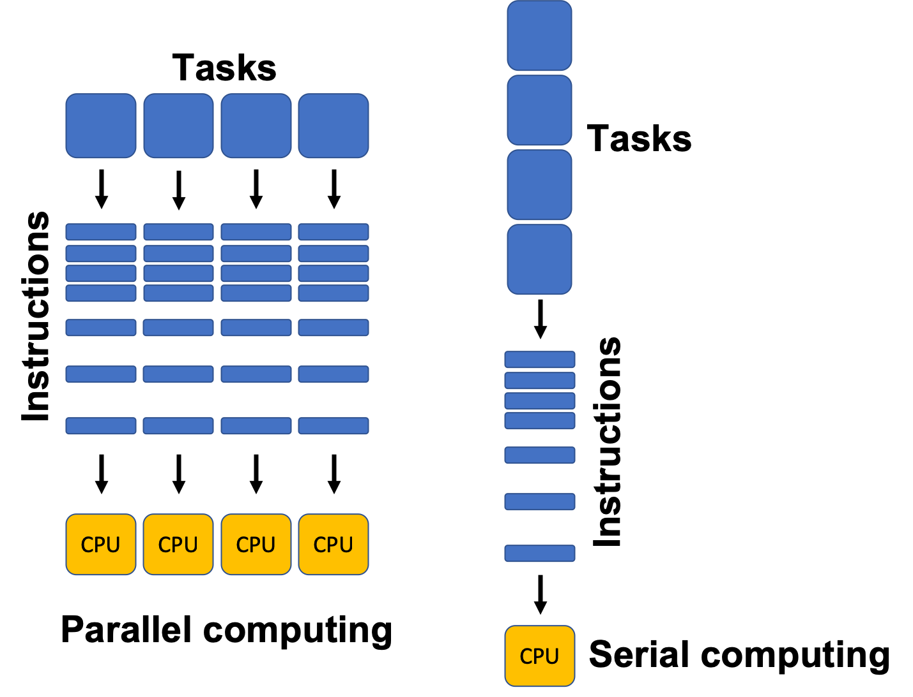
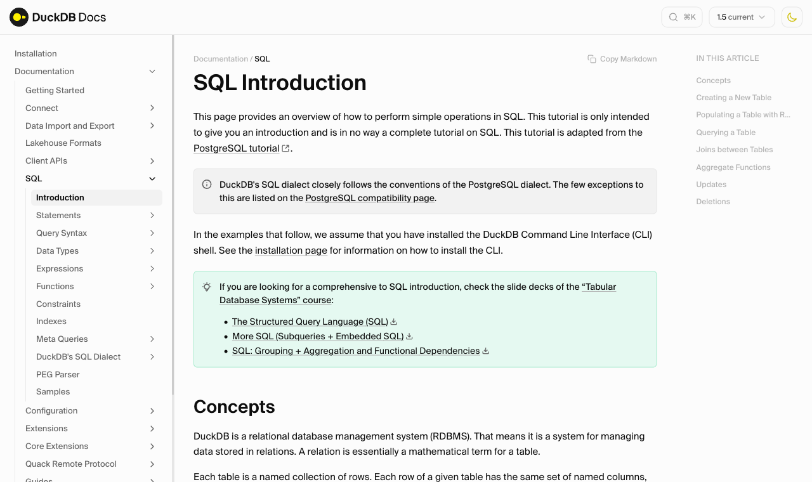
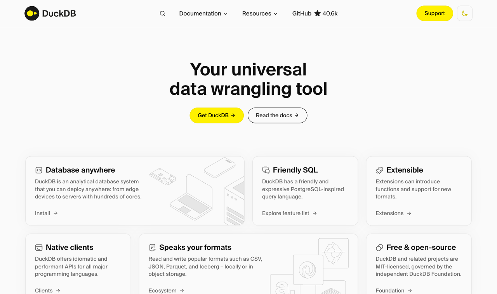
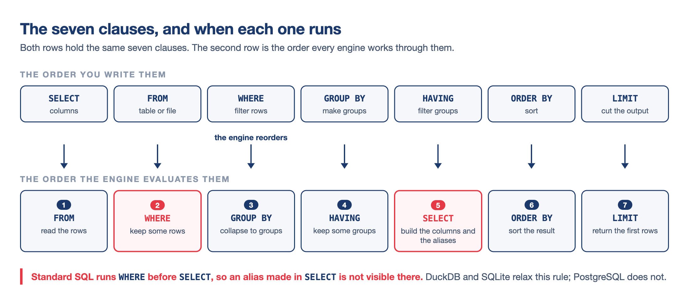
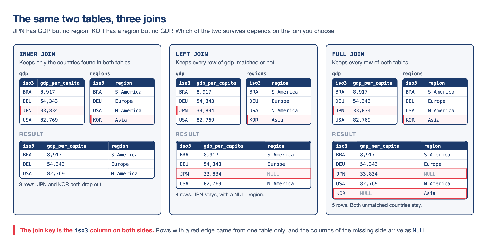

# Hello again! 😊 {background-color="#1B3A6B"}

# Brief recap 📚 {background-color="#1B3A6B"}

## Parallel computing fundamentals

:::{style="margin-top: 40px; font-size: 24px;"}
:::{.columns}
:::{.column width="50%"}
- Last class: [parallel and scalable computing]{.alert}
  - `map`, `joblib` and `concurrent.futures`
  - Parallelism divides the time, but not the [Big O]{.alert} growth rate
  - [Amdahl's law](https://en.wikipedia.org/wiki/Amdahl%27s_law): the serial share caps the speed-up
  - [Dask]{.alert}: lazy arrays and DataFrames bigger than RAM
  - [Parquet]{.alert} stores each column separately, so engines read only the columns you name
:::

:::{.column width="50%"}
- Some engines [use all your cores]{.alert} with no setup
- [DuckDB](https://duckdb.org/) is one, and today we use it to revise [SQL]{.alert}
- All queries run on the [WDI panel]{.alert} from Lecture 19
- [Download it here](https://github.com/danilofreire/datasci350/raw/refs/heads/main/lectures/lecture-19/data/wdi_panel.parquet) or use the path `../lecture-19/data/wdi_panel.parquet`

:::{style="text-align: center; margin-top: -10px;"}
[{width="52%"}](#){data-modal-type="image" data-modal-url="figures/parallel.png"}
:::
:::
:::
:::

## Lecture overview

:::{style="margin-top: 40px; font-size: 23px;"}
:::{.columns}
::::{.column width="50%"}
[1. Why SQL and why DuckDB]{.alert}

- You describe the answer, the engine plans the work
- `import duckdb` is the whole setup

[2. First queries]{.alert}

- `SELECT`, `WHERE`, `ORDER BY`, `LIMIT`
- `IN`, `BETWEEN`, `LIKE`, and the order a query runs in

[3. Aggregating]{.alert}

- `COUNT`, `AVG`, `GROUP BY`, `HAVING`
- What `COUNT` does when values are missing
::::

::::{.column width="50%"}
[4. NULLs, CASE and windows]{.alert}

- `IS NULL`, `COALESCE`, income bands with `CASE`
- Window functions: a group mean and a rank on every row

[5. Joins]{.alert}

- Primary keys, foreign keys, and the `ON` clause
- `INNER`, `LEFT`, `FULL OUTER` on two tiny tables

[6. DuckDB and pandas]{.alert}

- Querying a `pandas` DataFrame by name
- Handing a result back with `.df()`
::::
:::
:::

# Why SQL, why DuckDB 🦆 {background-color="#1B3A6B"}

## Why SQL

:::{style="margin-top: 40px; font-size: 24px;"}
:::{.columns}
:::{.column width="52%"}
- [SQL](https://en.wikipedia.org/wiki/SQL) queries [relational]{.alert} data: tables of rows and columns, linked by joins
- It is [declarative]{.alert}: you say what you want, and the engine decides how
  - No loops, variables or input/output code
  - The engine can reorder the query, skip columns, or use every core
- SQL is [about fifty years old](https://en.wikipedia.org/wiki/SQL), and job adverts list it [about as often as Python](https://oxylabs.io/press-area/most-in-demand-programming-languages)
- `SELECT`, `WHERE`, `GROUP BY` and `JOIN` work the same in [DuckDB](https://duckdb.org), [SQLite](https://www.sqlite.org), [PostgreSQL](https://www.postgresql.org), [BigQuery](https://cloud.google.com/bigquery) and [Snowflake](https://www.snowflake.com)
:::

:::{.column width="48%"}
:::{style="text-align: center; margin-top: -10px;"}
[{width="100%"}](#){data-modal-type="image" data-modal-url="figures/duckdb-docs-sql-2026.png"}

:::{style="font-size: 17px;"}
DuckDB's SQL introduction: <https://duckdb.org/docs/stable/sql/introduction>
:::
:::
:::
:::
:::

## Why DuckDB for a revision class

:::{style="margin-top: 40px; font-size: 24px;"}
:::{.columns}
:::{.column width="52%"}
- [Zero setup]{.alert}: `pip install duckdb`, then `import duckdb`{style="white-space: nowrap;"}
- [In-process]{.alert}: it runs inside Python, [like SQLite](https://www.sqlite.org/), with no server, user or password, unlike [PostgreSQL](https://www.postgresql.org/docs/current/admin.html)
- [Reads data by name]{.alert}: a Parquet or CSV path, or a pandas DataFrame, goes straight in `FROM`
- [Columnar]{.alert} and [parallel]{.alert}, so the same `GROUP BY` works on 200 million rows
- Version used here: [DuckDB 1.5.5](https://duckdb.org/2026/07/22/announcing-duckdb-155). Every query runs unchanged on [2.0](https://duckdb.org/2026/10/21/announcing-duckdb-200)
:::

:::{.column width="48%"}
:::{style="text-align: center; margin-top: -10px;"}
[{width="100%"}](#){data-modal-type="image" data-modal-url="figures/duckdb-home-2026.png"}

:::{style="font-size: 17px;"}
Source: <https://duckdb.org>
:::
:::
:::
:::
:::

# First queries {background-color="#1B3A6B"}

## What a table is

:::{style="margin-top: 40px; font-size: 23px;"}
:::{.columns}
:::{.column width="50%"}
- A [table]{.alert} is a grid: [rows]{.alert} are observations, [columns]{.alert} are variables
- Each column has [one type](https://duckdb.org/docs/2.0/sql/data_types/overview). Ours are `VARCHAR` (text), `SMALLINT` (whole numbers) and `DOUBLE` (decimals)
- Other common types: `BOOLEAN` (true or false), `DATE` (a day) and `TIMESTAMP` (a day and a time)
- Each cell holds one value, or `NULL`
- The [WDI panel]{.alert}: 217 countries, 8 indicators, 1990 to 2023
- `value` holds every number, and `indicator` says what it measures
- Filter on `indicator` first, or you mix dollars with years of life
- In pandas: a table is a DataFrame, a column a Series, and there is no index
:::

:::{.column width="50%"}
:::{style="text-align: center; font-size: 23px;"}
Six rows of the panel:

:::{style="margin-top: 20px; margin-bottom: 30px;"}
| country | iso3 | indicator | year | value |
|---|---|---|---|---|
| Brazil | BRA | gdp_per_capita | 2019 | 8771.44 |
| Brazil | BRA | gdp_per_capita | 2020 | 8435.01 |
| Brazil | BRA | internet_users_pct | 2019 | 73.91 |
| Brazil | BRA | internet_users_pct | 2020 | 81.34 |
| Brazil | BRA | life_expectancy | 2019 | 75.81 |
| Brazil | BRA | life_expectancy | 2020 | 74.51 |
:::
:::

:::{style="background: rgba(27, 58, 107, 0.08); padding: 12px; border-radius: 10px; font-size: 19px; margin-top: 15px;"}
No two rows share the same `country`, `indicator` and `year`. Together they identify a row: the idea behind a [primary key]{.alert}
:::
:::
:::
:::

## Querying a Parquet file

:::{style="margin-top: 40px; font-size: 24px;"}
:::{.columns}
:::{.column width="50%"}
- The WDI panel is a Parquet file with 59,024 rows
- [Download it here](https://github.com/danilofreire/datasci350/raw/refs/heads/main/lectures/lecture-19/data/wdi_panel.parquet) or use `../lecture-19/data/wdi_panel.parquet`
- `duckdb.sql()` runs a query string and returns a result you can print
- The path goes in [single quotes]{.alert}: single quotes mean text, double quotes a column name
- No `read_parquet`, connection or `fetchall()` needed
- The [column types]{.alert} under the names come from the file
:::

:::{.column width="50%"}
:::{style="font-size: 21px;"}
```{python}
#| echo: true
#| eval: true
#| cache: true
import duckdb

duckdb.sql("""
    SELECT *
    FROM '../lecture-19/data/wdi_panel.parquet'
    LIMIT 5
""")
```
:::
:::
:::
:::

## Creating a view

:::{style="margin-top: 40px; font-size: 24px;"}
:::{.columns}
:::{.column width="44%"}
- A [view]{.alert} is a saved query that behaves like a table
- `CREATE OR REPLACE VIEW wdi AS ...` names it, so later queries say `FROM wdi`
- A view holds no data: DuckDB re-reads the file each time
- It disappears when Python restarts
- `OR REPLACE` overwrites an old view, so the cell is safe to re-run
- [`COUNT(DISTINCT country)`]{.alert} counts the different values in a column
:::

:::{.column width="56%"}
:::{style="font-size: 23px;"}
```{python}
#| echo: true
#| eval: true
#| cache: true
duckdb.sql("""
    CREATE OR REPLACE VIEW wdi AS
    SELECT * FROM '../lecture-19/data/wdi_panel.parquet'
""")

duckdb.sql("""
    SELECT COUNT(*) AS n_rows,
           COUNT(DISTINCT country) AS countries,
           COUNT(DISTINCT indicator) AS indicators
    FROM wdi
""")
```
:::
:::
:::
:::

## DESCRIBE and SUMMARIZE

:::{style="margin-top: 40px; font-size: 21px;"}
:::{.columns}
:::{.column width="44%"}
- Run both before writing a query, to learn the column names
- [`DESCRIBE`]{.alert} lists the columns and their types
- `country`, `iso3` and `indicator` are `VARCHAR`, so filter them with single quotes
- [`SUMMARIZE`]{.alert} adds min, max, count and the share of missing values
- `value` is 11.06% missing. `country` and `year` have no gaps
- `value` mixes all eight indicators, so its min (0% internet use in 1990) and max (India's population in 2023) mean little
- Its result is a table, so we can `SELECT` from it
- In pandas: `df.dtypes` and `df.describe()`
:::

:::{.column width="56%"}
:::{style="font-size: 21px;"}
```{python}
#| echo: true
#| eval: true
#| cache: true
duckdb.sql("DESCRIBE SELECT * FROM wdi")
```

```{python}
#| echo: true
#| eval: true
#| cache: true
duckdb.sql("""
    SELECT column_name, min, max, null_percentage
    FROM (SUMMARIZE SELECT country, year, value FROM wdi)
""")
```
:::
:::
:::
:::

## SELECT, aliases, ORDER BY, LIMIT

:::{style="margin-top: 40px; font-size: 24px;"}
:::{.columns}
:::{.column width="48%"}
- [Upper case]{.alert} is a convention: keywords and column names ignore case, so `select` and `Country` work too
- `SELECT` lists the columns you want, and `*` means all of them
- It can compute new columns, like `ROUND(value, 0)`
- [`AS`]{.alert} gives a column a new name, called an [alias]{.alert}
- [`ORDER BY value DESC`]{.alert} sorts high to low. `ASC` (low to high) is the default
- [`LIMIT`]{.alert} keeps the first rows, like `.head()` in pandas
:::

:::{.column width="52%"}
:::{style="font-size: 24px;"}
```{python}
#| echo: true
#| eval: true
#| cache: true
duckdb.sql("""
    SELECT country, year,
           ROUND(value, 0) AS gdp_pc
    FROM wdi
    WHERE indicator = 'gdp_per_capita'
      AND year = 2020
    ORDER BY value DESC
    LIMIT 5
""")
```
:::
:::
:::
:::

## WHERE with AND, OR and NOT

:::{style="margin-top: 40px; font-size: 24px;"}
:::{.columns}
:::{.column width="48%"}
- [`WHERE`]{.alert} keeps rows where the condition is true, like boolean indexing in pandas
- Comparisons: `=`, `<>` (not equal), `<`, `<=`, `>`, `>=`
- [`AND`]{.alert} needs both sides true, [`OR`]{.alert} needs either
- [`NOT`]{.alert} flips a condition: `NOT country = 'Japan'` would keep only Brazil
- Text matches are case-sensitive
- The brackets matter, because `AND` runs before `OR`
:::

:::{.column width="52%"}
:::{style="font-size: 24px;"}
```{python}
#| echo: true
#| eval: true
#| cache: true
duckdb.sql("""
    SELECT country, year,
           ROUND(value, 0) AS gdp_pc
    FROM wdi
    WHERE indicator = 'gdp_per_capita'
      AND (year = 2000 OR year = 2020)
      AND (country = 'Brazil' OR country = 'Japan')
    ORDER BY country, year
""")
```
:::

:::{style="background: rgba(230, 57, 70, 0.1); padding: 12px; border-radius: 10px; font-size: 20px; margin-top: 10px;"}
Without the brackets, the query returns 496 rows: GDP for every country in 2000, all of Brazil's 2020 rows, and every Japanese row
:::
:::
:::
:::

## IN and BETWEEN

:::{style="margin-top: 40px; font-size: 24px;"}
:::{.columns}
:::{.column width="46%"}
- [`IN`]{.alert} replaces a chain of `OR`s on one column
- `country IN ('Brazil', 'China')` means `country = 'Brazil' OR country = 'China'`
- [`BETWEEN`]{.alert} includes both ends: 2018 to 2020 covers three years
- The low end goes first. `BETWEEN 2020 AND 2018` returns nothing
- In pandas: `.isin([...])` and `.between(2018, 2020)`
- Six countries × three years = 18 rows. `LIMIT 6` shows Brazil and China
:::

:::{.column width="54%"}
:::{style="font-size: 23px;"}
```{python}
#| echo: true
#| eval: true
#| cache: true
duckdb.sql("""
    SELECT country, year,
           ROUND(value, 0) AS gdp_pc
    FROM wdi
    WHERE indicator = 'gdp_per_capita'
      AND country IN ('Brazil', 'China', 'Germany',
                      'India', 'Japan', 'United States')
      AND year BETWEEN 2018 AND 2020
    ORDER BY country, year
    LIMIT 6
""")
```
:::
:::
:::
:::

## LIKE and ILIKE

:::{style="margin-top: 40px; font-size: 24px;"}
:::{.columns}
:::{.column width="44%"}
- [`LIKE`]{.alert} matches part of a text value
- `%` means any characters, or none. `_` means exactly one
- `'United%'` starts with United, `'%States'` ends with States, `'%King%'` contains King
- [`DISTINCT`]{.alert} removes duplicates. Without it, each country appears once per indicator and year
- `LIKE` is case-sensitive, so `'united%'` finds nothing. [`ILIKE`]{.alert} ignores case
- In pandas: `.str.startswith()` or `.str.contains()`
:::

:::{.column width="56%"}
:::{style="font-size: 23px;"}
```{python}
#| echo: true
#| eval: true
#| cache: true
duckdb.sql("""
    SELECT DISTINCT country
    FROM wdi
    WHERE country LIKE 'United%'
    ORDER BY country
""")
```

```{python}
#| echo: true
#| eval: true
#| cache: true
duckdb.sql("""
    SELECT DISTINCT country
    FROM wdi
    WHERE country ILIKE 'united%'
    ORDER BY country
""")
```
:::
:::
:::
:::

## Every clause in one query

:::{style="margin-top: 40px; font-size: 24px;"}
:::{.columns}
:::{.column width="45%"}
:::{style="text-align: center; font-size: 25px; margin-top: 10px; margin-bottom: 30px;"}
| Clause | What it does |
|---|---|
| `FROM wdi` | picks the table |
| `WHERE` | keeps 6 of 59,024 rows |
| `SELECT` | picks 3 columns, rounds one |
| `ORDER BY` | sorts by value |
| `LIMIT` | keeps 3 rows |
:::

- You have met every clause here
- Read a query from `FROM`, because that is where the engine starts
- Three rows survive: the United States (59,534), Germany (42,373) and Japan (35,363)
- We build on this query for the rest of the lecture
:::

:::{.column width="55%"}
:::{style="font-size: 23px;"}
```{python}
#| echo: true
#| eval: true
#| cache: true
duckdb.sql("""
    SELECT country, year, ROUND(value, 0) AS gdp_pc
    FROM wdi
    WHERE indicator = 'gdp_per_capita'
      AND country IN ('Brazil', 'China', 'Germany',
                      'India', 'Japan', 'United States')
      AND year = 2020
    ORDER BY value DESC
    LIMIT 3
""")
```
:::
:::
:::
:::

## How the engine evaluates a query

:::{style="margin-top: 40px; font-size: 20px;"}
:::{style="text-align: center;"}
[{width="80%"}](#){data-modal-type="image" data-modal-url="figures/sql-evaluation-order.png"}
:::

:::{.columns}
:::{.column width="50%"}
- You write `SELECT` first, but the engine runs it fifth
- `FROM` finds the rows, `WHERE` filters them, `GROUP BY` makes groups, `HAVING` filters groups, then `SELECT` builds the output
- `ORDER BY` sorts what `SELECT` produced, and `LIMIT` runs last of all
:::

:::{.column width="50%"}
- An aggregate cannot go in `WHERE`: the groups do not exist yet
- pandas writes the steps in this order: `df[mask].groupby(...).agg(...)`
:::
:::
:::

# Aggregating {background-color="#1B3A6B"}

## GROUP BY {#sec-group-by}

:::{style="margin-top: 40px; font-size: 23px;"}
:::{.columns}
:::{.column width="48%"}
- An [aggregate function](https://duckdb.org/docs/2.0/sql/functions/aggregates) turns many rows into one number: `COUNT`, `SUM`, `AVG` (mean), `MIN`, `MAX`
- Without `GROUP BY`, the whole table is one group, so one row
- [`GROUP BY country`]{.alert} makes six groups, so six rows
- Every column in `SELECT` must be in `GROUP BY` or inside an aggregate
  - `SELECT country, value ... GROUP BY country` fails: SQL will not pick one of 14 values
- `n` is 14: the years 2010 to 2023
- In pandas: `.groupby("country").agg(...)`
- Two grouping columns give one row per pair: [[Appendix 03]{.button}](#sec-appendix-03)
:::

:::{.column width="52%"}
:::{style="font-size: 23px;"}
```{python}
#| echo: true
#| eval: true
#| cache: true
duckdb.sql("""
    SELECT country,
           COUNT(value) AS n,
           ROUND(AVG(value), 0) AS mean_gdp
    FROM wdi
    WHERE indicator = 'gdp_per_capita'
      AND country IN ('Brazil', 'China', 'Germany',
                      'India', 'Japan', 'United States')
      AND year >= 2010
    GROUP BY country
    ORDER BY mean_gdp DESC
""")
```
:::
:::
:::
:::

## WHERE and HAVING

:::{style="margin-top: 40px; font-size: 24px;"}
:::{.columns}
:::{.column width="48%"}
- `WHERE` filters rows [before]{.alert} grouping. [`HAVING`]{.alert} filters groups [after]{.alert}
- `WHERE` cannot use an aggregate. `HAVING` can, because the groups exist by then
- "Which years count?" is about rows, so it goes in `WHERE`
- "Which countries qualify?" is about groups, so it goes in `HAVING`
- `HAVING AVG(value) > 30000` drops China (9,017), Brazil (8,923) and India (1,694)
- `ORDER BY` can use the alias `mean_gdp`, because it runs after `SELECT`
:::

:::{.column width="52%"}
:::{style="font-size: 23px;"}
```{python}
#| echo: true
#| eval: true
#| cache: true
duckdb.sql("""
    SELECT country,
           COUNT(value) AS n,
           ROUND(AVG(value), 0) AS mean_gdp
    FROM wdi
    WHERE indicator = 'gdp_per_capita'
      AND country IN ('Brazil', 'China', 'Germany',
                      'India', 'Japan', 'United States')
      AND year >= 2010
    GROUP BY country
    HAVING AVG(value) > 30000
    ORDER BY mean_gdp DESC
""")
```
:::
:::
:::
:::

## Try it yourself: fix the query {#sec-fix-query}

:::{style="margin-top: 40px; font-size: 24px;"}
:::{.columns}
:::{.column width="42%"}
1. Run the query on the right
2. Read the error message
3. Fix one thing, then run it again
4. Repeat until it works

- There are [five]{.alert} bugs: three easy, two harder
- Errors and answers: [[Appendix 09]{.button}](#sec-appendix-09)
:::

:::{.column width="58%"}
:::{style="font-size: 27px;"}
```python
duckdb.sql("""
    SELCT country ROUND(AVG(value), 0) AS mean_gdp
    FROM wdi
    WHERE indicator = "gdp_per_capita"
      AND year => 2010
      AND AVG(value) > 30000
    GROUP BY country
    ORDER BY mean_gdp DESC
    LIMIT 5
""")
```
:::
:::
:::
:::

## COUNT(\*) and COUNT(value)

:::{style="margin-top: 40px; font-size: 24px;"}
:::{.columns}
:::{.column width="48%"}
- [`COUNT(*)`]{.alert} counts rows, [`COUNT(value)`]{.alert} only rows where `value` is present
- The difference is the number of missing values
- `AVG`, `SUM`, `MIN` and `MAX` skip missing values without warning
- Missing GDP [falls]{.alert} over time: 25 of 217 countries in 1990, 18 in 2000, 9 in 2020
- In pandas: `len(df)` against `df["value"].count()`
- Check this before you trust a mean
:::

:::{.column width="52%"}
:::{style="font-size: 23px;"}
```{python}
#| echo: true
#| eval: true
#| cache: true
duckdb.sql("""
    SELECT year,
           COUNT(*) AS n_rows,
           COUNT(value) AS with_value,
           COUNT(*) - COUNT(value) AS missing
    FROM wdi
    WHERE indicator = 'gdp_per_capita'
      AND year IN (1990, 2000, 2020)
    GROUP BY year
    ORDER BY year
""")
```
:::
:::
:::
:::

# NULLs, CASE and windows {background-color="#1B3A6B"}

## Missing values

:::{style="margin-top: 40px; font-size: 24px;"}
:::{.columns}
:::{.column width="48%"}
- [NULL]{.alert} means "unknown", not zero or an empty string
- Any comparison with NULL gives NULL, so `NULL = NULL` never matches
- Test with [`IS NULL`]{.alert} or [`IS NOT NULL`]{.alert}
- [`COALESCE(a, b)`]{.alert} returns `a`, or `b` if `a` is NULL
- Yemen has no 2020 GDP figure, so it shows 0 here
- Filling with 0 is a choice, and a mean over this column would be wrong
- `COALESCE` fills a missing value. A missing [row]{.alert} needs a `LEFT JOIN`
- In pandas, NULL is `NaN`, and `.fillna(0)` does this
:::

:::{.column width="52%"}
:::{style="font-size: 23px;"}
```{python}
#| echo: true
#| eval: true
#| cache: true
duckdb.sql("""
    SELECT country,
           ROUND(COALESCE(value, 0), 0) AS gdp_filled
    FROM wdi
    WHERE indicator = 'gdp_per_capita' AND year = 2020
      AND country IN ('Brazil', 'China', 'Germany',
                      'India', 'Japan', 'United States',
                      'Yemen, Rep.')
    ORDER BY country
""")
```
:::
:::
:::
:::

## CASE

:::{style="margin-top: 40px; font-size: 24px;"}
:::{.columns}
:::{.column width="45%"}
- [`CASE`]{.alert} is an if-else ladder inside `SELECT`
- `WHEN` gives a condition, and `THEN` the value if it holds
- Tests run top to bottom, and the first true one wins
- `ELSE` catches the rest, and `END` closes the ladder
- Without `ELSE`, unmatched rows get NULL
- The cut-offs are the [World Bank's FY24 bands](https://blogs.worldbank.org/en/opendata/new-world-bank-group-country-classifications-income-level-fy24), set for GNI per capita, so here they are a rough guide
- Without the `IS NULL` line, Yemen would fall to `ELSE` as "Low income"
- The result is a new column you can group, join or export
:::

:::{.column width="55%"}
:::{style="font-size: 23px;"}
```{python}
#| echo: true
#| eval: true
#| cache: true
duckdb.sql("""
    SELECT country, ROUND(value, 0) AS gdp_pc,
        CASE
            WHEN value IS NULL  THEN 'No data'
            WHEN value >= 13846 THEN 'High income'
            WHEN value >= 4466  THEN 'Upper middle'
            WHEN value >= 1136  THEN 'Lower middle'
            ELSE 'Low income'
        END AS income_band
    FROM wdi
    WHERE indicator = 'gdp_per_capita' AND year = 2020
      AND country IN ('Brazil', 'China', 'Germany', 'India',
                      'Japan', 'United States', 'Yemen, Rep.')
    ORDER BY value DESC NULLS LAST
""")
```
:::
:::
:::
:::

## Window functions {#sec-windows}

:::{style="margin-top: 40px; font-size: 24px;"}
:::{.columns}
:::{.column width="45%"}
- A [window function]{.alert} keeps every row and adds a group number beside it
- [`OVER`]{.alert} turns an aggregate into a window function
- [`PARTITION BY year`]{.alert} makes one [window]{.alert}, a set of rows, per year
- `GROUP BY year` would collapse these 12 rows into 2. Here, no rows are lost
- `year_mean` repeats on each row of its year: 20,885 in 2000, 26,347 in 2020
- In pandas: `.groupby("year")["value"].transform("mean")`
:::

:::{.column width="55%"}
:::{style="font-size: 23px;"}
```{python}
#| echo: true
#| eval: true
#| cache: true
duckdb.sql("""
    SELECT country, year, ROUND(value, 0) AS gdp_pc,
           ROUND(AVG(value) OVER (PARTITION BY year), 0)
               AS year_mean
    FROM wdi
    WHERE indicator = 'gdp_per_capita'
      AND country IN ('Brazil', 'China', 'Germany',
                      'India', 'Japan', 'United States')
      AND year IN (2000, 2020)
    ORDER BY year, value DESC
""")
```
:::
:::
:::
:::

## Ranking with a window

:::{style="margin-top: 40px; font-size: 23px;"}
:::{.columns}
:::{.column width="45%"}
- [`RANK()`]{.alert} numbers rows by the `ORDER BY` inside `OVER`
- The inner `ORDER BY` sets the ranks, the outer one sorts the printed table
- No `PARTITION BY`, so one window covers the whole result. Add `PARTITION BY year` to rank within each year
- Ties share a rank and skip the next: 1, 2, 2, 4
- There are [variants](https://duckdb.org/docs/stable/sql/functions/window_functions) that handle ties differently. `RANK()` is the one you'll use most
- The United States ranks 1 (59,534), and India 6 (1,807)
- `WHERE` runs first, so only these six countries are ranked
:::

:::{.column width="55%"}
:::{style="font-size: 23px;"}
```{python}
#| echo: true
#| eval: true
#| cache: true
duckdb.sql("""
    SELECT country, ROUND(value, 0) AS gdp_pc,
           RANK() OVER (ORDER BY value DESC) AS rank_2020
    FROM wdi
    WHERE indicator = 'gdp_per_capita'
      AND country IN ('Brazil', 'China', 'Germany',
                      'India', 'Japan', 'United States')
      AND year = 2020
    ORDER BY rank_2020
""")
```
:::
:::
:::
:::

# Joins {background-color="#1B3A6B"}

## Two small tables

:::{style="margin-top: 40px; font-size: 20px;"}
:::{.columns}
:::{.column width="42%"}
- A [table]{.alert} stores its data, unlike the `wdi` view
- `CREATE TABLE ... AS SELECT` builds `gdp2020` from a query
- `CREATE TABLE (col TYPE, ...)` declares empty columns
- `INSERT INTO ... VALUES` adds rows
- A [primary key]{.alert} identifies each row, with no duplicates or NULLs: `iso3` in `regions`
- A [foreign key]{.alert} points at another table's primary key. `iso3` in `gdp2020` plays that role
- We never declare it, so `JPN` can sit there with no partner
- Six rows in `gdp2020`, seven in `regions`
- Mismatches: [`JPN`]{.alert} is not in `regions`. [`KOR`]{.alert} and [`AUS`]{.alert} are not in `gdp2020`
- East Asia holds two codes, which matters in the exercise
:::

:::{.column width="58%"}
:::{style="font-size: 19px;"}
```{python}
#| echo: true
#| eval: true
#| cache: true
duckdb.sql("""
    CREATE OR REPLACE TABLE gdp2020 AS
    SELECT country, iso3, ROUND(value, 0) AS gdp_per_capita
    FROM wdi
    WHERE indicator = 'gdp_per_capita' AND year = 2020
      AND iso3 IN ('USA','BRA','CHN','IND','DEU','JPN')
""")

duckdb.sql("""
    CREATE OR REPLACE TABLE regions
        (iso3 VARCHAR PRIMARY KEY, region VARCHAR)
""")

duckdb.sql("""
    INSERT INTO regions VALUES
        ('USA', 'North America'), ('BRA', 'Latin America'),
        ('CHN', 'East Asia'),     ('IND', 'South Asia'),
        ('DEU', 'Europe'),        ('KOR', 'East Asia'),
        ('AUS', 'Oceania')
""")

duckdb.sql("SELECT * FROM regions ORDER BY iso3")
```
:::
:::
:::
:::

## INNER JOIN

:::{style="margin-top: 40px; font-size: 20px;"}
:::{.columns}
:::{.column width="46%"}
- A [`JOIN`]{.alert} combines two tables: each matching pair of rows becomes one output row
- [`ON`]{.alert} says which columns must match: `iso3` on both sides
- `AS g` and `AS r` are [table aliases]{.alert}. `g.country` means "`country` from `gdp2020`", so prefix every column this way
- The join type goes before `JOIN`. An [`INNER JOIN`]{.alert}, the default, keeps only the codes in both tables
- Six rows on the left, seven on the right, [five]{.alert} out
- Japan drops out (`JPN` is not in `regions`), and so do Korea and Australia (not in `gdp2020`)
- An inner join drops rows without warning, so check your row count after a join
- In pandas: `pd.merge(gdp2020, regions, on="iso3")`, where `how="inner"` is the default
:::

:::{.column width="54%"}
:::{style="font-size: 21px;"}
```{python}
#| echo: true
#| eval: true
#| cache: true
duckdb.sql("""
    SELECT g.country, r.region, g.gdp_per_capita
    FROM gdp2020 AS g
    INNER JOIN regions AS r ON g.iso3 = r.iso3
    ORDER BY g.country
""")
```
:::
:::
:::
:::

## LEFT JOIN

:::{style="margin-top: 40px; font-size: 24px;"}
:::{.columns}
:::{.column width="46%"}
- A [`LEFT JOIN`]{.alert} keeps every row of the left table, the one in `FROM` (`gdp2020` here)
- [Six]{.alert} rows: Japan is back, with `NULL` for `region`
- That NULL means "no partner found". Japan's 35,363 is unchanged
- Korea and Australia are still missing: they exist only on the right
- The join you will use most: it adds labels without losing rows
- Swap the tables and you get a different answer, as in the exercise
- In pandas: `pd.merge(..., how="left")`
:::

:::{.column width="54%"}
:::{style="font-size: 21px;"}
```{python}
#| echo: true
#| eval: true
#| cache: true
duckdb.sql("""
    SELECT g.country, r.region, g.gdp_per_capita
    FROM gdp2020 AS g
    LEFT JOIN regions AS r ON g.iso3 = r.iso3
    ORDER BY g.country
""")
```
:::
:::
:::
:::

## FULL OUTER JOIN {#sec-full-outer}

:::{style="margin-top: 40px; font-size: 24px;"}
:::{.columns}
:::{.column width="45%"}
- A [`FULL OUTER JOIN`]{.alert} keeps every row from both tables, with NULLs where there is no partner
- [Eight]{.alert} rows: five pairs, plus Japan, Korea and Australia
- Korea and Australia have NULL `country` and `gdp_per_capita`. Japan has NULL region columns
- On these tables: 5 rows from `INNER`, 6 from `LEFT`, 8 from `FULL OUTER`
- To choose a join, ask which table must survive whole, and what to do with rows that have no partner
- All three joins side by side: [[Appendix 05]{.button}](#sec-appendix-05)
:::

:::{.column width="55%"}
:::{style="font-size: 23px;"}
```{python}
#| echo: true
#| eval: true
#| cache: true
duckdb.sql("""
    SELECT g.country, r.iso3 AS region_iso3,
           r.region, g.gdp_per_capita
    FROM gdp2020 AS g
    FULL OUTER JOIN regions AS r ON g.iso3 = r.iso3
    ORDER BY r.region NULLS LAST, r.iso3
""")
```
:::
:::
:::
:::

## Try it yourself: predict the rows {#sec-predict-rows}

:::{style="margin-top: 40px; font-size: 24px;"}
How many rows does each query return? Which rows get a NULL?

:::{.columns}
:::{.column width="23%"}
:::{style="font-size: 25px;"}
`regions`

| iso3 | region |
|---|---|
| AUS | Oceania |
| BRA | Latin America |
| CHN | East Asia |
| DEU | Europe |
| IND | South Asia |
| KOR | East Asia |
| USA | North America |
:::
:::

:::{.column width="19%"}
:::{style="font-size: 25px;"}
`gdp2020`

| iso3 | country |
|---|---|
| BRA | Brazil |
| CHN | China |
| DEU | Germany |
| IND | India |
| JPN | Japan |
| USA | United States |
:::
:::

:::{.column width="58%"}
:::{style="font-size: 27px;"}
```sql
-- Query 1
SELECT r.region, g.country
FROM regions AS r
INNER JOIN gdp2020 AS g ON g.iso3 = r.iso3
```

```sql
-- Query 2
SELECT r.iso3, r.region, g.gdp_per_capita
FROM regions AS r
LEFT JOIN gdp2020 AS g ON g.iso3 = r.iso3
```

```sql
-- Query 3
SELECT g.country, r.region
FROM gdp2020 AS g
INNER JOIN regions AS r ON g.iso3 = r.iso3
WHERE r.region = 'East Asia'
```
:::
:::
:::

:::{style="text-align: center; margin-top: 10px;"}
Answers: [[Appendix 10]{.button}](#sec-appendix-10)
:::
:::

# DuckDB and pandas 🐼 {background-color="#1B3A6B"}

## Querying a DataFrame by name

:::{style="margin-top: 40px; font-size: 23px;"}
:::{.columns}
:::{.column width="45%"}
- DuckDB finds `df` among your Python variables and reads it in memory
- `SELECT COUNT(*) FROM df` gives 59,024, like the Parquet file
- The same `SELECT` works on a file, a view or a DataFrame
- It works with [Polars](https://pola.rs) DataFrames too
- You can join two DataFrames in one query (right)
:::

:::{.column width="55%"}
:::{style="font-size: 21px;"}
```{python}
#| echo: true
#| eval: true
#| cache: true
import pandas as pd

df = pd.read_parquet(
    "../lecture-19/data/wdi_panel.parquet"
)

duckdb.sql("SELECT COUNT(*) AS n FROM df")
```

```{python}
#| echo: true
#| eval: true
#| cache: true
regions_df = pd.DataFrame({
    "iso3": ["BRA", "JPN"],
    "region": ["Latin America", "East Asia"]
})

duckdb.sql("""
    SELECT r.iso3, r.region, ROUND(d.value, 0) AS gdp_pc
    FROM df AS d
    JOIN regions_df AS r ON d.iso3 = r.iso3
    WHERE d.indicator = 'gdp_per_capita' AND d.year = 2020
""")
```
:::
:::
:::
:::

## Handing the result back to pandas {#sec-pandas}

:::{style="margin-top: 40px; font-size: 24px;"}
:::{.columns}
:::{.column width="45%"}
- [`.df()`]{.alert} turns a DuckDB result into a pandas DataFrame
- Without it, you get a DuckDB result that prints as a text table
- `.pl()` gives a Polars DataFrame, and `.to_arrow_table()` an Arrow table
- SQL returns 18 rows, and `pivot` reshapes them into 6 rows by 3 columns
- DuckDB has `PIVOT` too, but reshaping reads more easily in pandas
- After `.df()`, it is ordinary pandas: `.plot()`, `.to_csv()`, `seaborn`, `statsmodels`
- SQL or pandas? [[Appendix 06]{.button}](#sec-appendix-06)
:::

:::{.column width="55%"}
:::{style="font-size: 21px;"}
```{python}
#| echo: true
#| eval: true
#| cache: true
long = duckdb.sql("""
    SELECT country, indicator,
           ROUND(value, 1) AS value
    FROM df
    WHERE year = 2020
      AND iso3 IN ('USA', 'BRA', 'CHN',
                   'IND', 'DEU', 'JPN')
      AND indicator IN ('gdp_per_capita',
                        'life_expectancy',
                        'internet_users_pct')
""").df()

long.pivot(index="country", columns="indicator",
           values="value")
```
:::
:::
:::
:::

# Summary {background-color="#1B3A6B"}

## What we learned today {#sec-summary}

:::{style="margin-top: 40px; font-size: 23px;"}
:::{.columns}
:::{.column width="50%"}
- [SQL]{.alert} is declarative: you describe the answer and the engine plans the work
- [DuckDB]{.alert} needs one import and reads a Parquet file or a pandas DataFrame by name
- A [view]{.alert} names a query. `DESCRIBE` and `SUMMARIZE` show what is in it
- [`WHERE`]{.alert} filters rows, [`GROUP BY`]{.alert} forms groups, [`HAVING`]{.alert} filters groups. No aggregate in `WHERE`
- `COUNT(*)` minus `COUNT(value)` is the number of missing values
:::

:::{.column width="50%"}
- A [NULL]{.alert} means unknown. `COALESCE` fills one in, and a missing row needs a join instead
- [`CASE`]{.alert} builds a category column from an if-else ladder
- A [window function]{.alert} keeps every row: `AVG ... OVER (PARTITION BY year)` adds the year mean, `RANK()` a position
- Joins: 5 rows from `INNER`, 6 from `LEFT`, 8 from `FULL OUTER` on the same two tables
- On 200 million rows, DuckDB runs the same query in [0.53 seconds]{.alert}: [[Appendix 07]{.button}](#sec-benchmark)
:::
:::

:::{style="text-align: center; margin-top: 20px;"}
Practice at home: [[GROUP BY]{.button}](#sec-appendix-02) [[Joins]{.button}](#sec-exercise-01)
:::
:::

# Thank you very much! 😊 {background-color="#1B3A6B"}

# Appendix 📚 {background-color="#1B3A6B"}

## Practice at home: GDP by region {#sec-exercise-01}

:::{style="margin-top: 40px; font-size: 21px;"}
:::{.columns}
:::{.column width="52%"}
How rich is each region, and how much data is it based on?

1. Use the `gdp2020` and `regions` tables from the joins section
2. Report one row per region
3. Count how many of that region's countries have a 2020 GDP figure
4. Compute the mean GDP per capita of that region
5. Keep every region, including the one with no GDP data at all
6. Sort by mean GDP, highest first
7. Send the region with no data to the bottom of the list
:::

:::{.column width="48%"}
What to look for:

- Which table goes on the left if every region must survive?
- East Asia has two codes but one GDP figure, so `COUNT(*)` and `COUNT(g.country)` differ
- Oceania has no GDP figure at all
- Six regions come back

:::{style="background: rgba(27, 58, 107, 0.08); padding: 12px; border-radius: 10px; font-size: 19px; margin-top: 12px;"}
Solution: [[Appendix 01]{.button}](#sec-appendix-01)
:::
:::
:::

:::{style="text-align: center; margin-top: 15px;"}
[[Back to the summary]{.button}](#sec-summary)
:::
:::

## Appendix 01: Solution to the exercise {#sec-appendix-01}

:::{style="margin-top: 40px; font-size: 19px;"}
:::{.columns}
:::{.column width="46%"}
- `regions` goes on the left, because every region must survive
- East Asia has two rows in `regions`, but `COUNT(g.country)` is 1: Korea's row has a NULL country
- `COUNT(*)` would count that row and report 2
- Oceania has no GDP figure: its count is 0 and its mean is NULL
- `NULLS LAST` sends Oceania to the bottom
- Six regions, from North America (59,534) down to South Asia (1,807), then Oceania
- Codes that appear in only one table? [[Appendix 04]{.button}](#sec-appendix-04)

[[Back to the exercise]{.button}](#sec-exercise-01)
:::

:::{.column width="54%"}
:::{style="font-size: 20px;"}
```{python}
#| echo: true
#| eval: true
#| cache: true
duckdb.sql("""
    SELECT r.region,
           COUNT(g.country) AS countries_with_gdp,
           ROUND(AVG(g.gdp_per_capita), 0) AS mean_gdp
    FROM regions AS r
    LEFT JOIN gdp2020 AS g ON g.iso3 = r.iso3
    GROUP BY r.region
    ORDER BY mean_gdp DESC NULLS LAST
""")
```
:::
:::
:::
:::

## Appendix 02: GROUP BY and HAVING practice {#sec-appendix-02}

:::{style="margin-top: 40px; font-size: 20px;"}
:::{.columns}
:::{.column width="46%"}
Which countries have had the highest life expectancy since 2010?

1. Create the `wdi` view over the panel
2. Keep only the `life_expectancy` rows
3. Keep only the years from 2010 onwards
4. Compute the mean of `value` for each country
5. Keep the countries whose mean is above 82
6. Sort from highest to lowest
7. Return the top five, rounded to two decimals

- `WHERE` drops rows, `HAVING AVG(value) > 82` tests the group
- `ORDER BY` names `mean_life_exp`, the alias created in `SELECT`
- Hong Kong and Japan are the only places in the top five with more than a million people
:::

:::{.column width="54%"}
:::{style="font-size: 20px;"}
```{python}
#| echo: true
#| eval: true
#| cache: true
duckdb.sql("""
    SELECT country,
           ROUND(AVG(value), 2) AS mean_life_exp
    FROM wdi
    WHERE indicator = 'life_expectancy'
      AND year >= 2010
    GROUP BY country
    HAVING AVG(value) > 82
    ORDER BY mean_life_exp DESC
    LIMIT 5
""")
```
:::

:::
:::

:::{style="text-align: center; margin-top: 15px;"}
[[Back to the summary]{.button}](#sec-summary)
:::
:::
## Appendix 03: Grouping by two columns {#sec-appendix-03}

:::{style="margin-top: 40px; font-size: 21px;"}
:::{.columns}
:::{.column width="50%"}
- Name two columns and you get one row for each pair that appears in the filtered rows
- Two countries and two indicators give four rows here
- Combinations with no rows never appear. SQL does not invent empty groups
- Japan's mean life expectancy since 2010 is nine years above Brazil's. Its CO2 per person is almost four times higher
- A mean over years like this weights every year equally. Say so when you report it
:::

:::{.column width="50%"}
:::{style="font-size: 22px;"}
```{python}
#| echo: true
#| eval: true
#| cache: true
duckdb.sql("""
    SELECT country, indicator,
           ROUND(AVG(value), 1) AS mean_value
    FROM wdi
    WHERE year >= 2010
      AND country IN ('Brazil', 'Japan')
      AND indicator IN ('life_expectancy',
                        'co2_per_capita')
    GROUP BY country, indicator
    ORDER BY country, indicator
""")
```
:::
:::
:::

:::{style="text-align: center; margin-top: 15px;"}
[[Back to GROUP BY]{.button}](#sec-group-by)
:::
:::

## Appendix 04: Anti-joins and UNION {#sec-appendix-04}

:::{style="margin-top: 40px; font-size: 19px;"}
:::{.columns}
:::{.column width="44%"}
- An [anti-join]{.alert} asks which rows on the left have no partner on the right
- `NOT EXISTS` runs a small query for each row and keeps the row when it returns nothing
- Japan is the only such row here, because `JPN` is missing from `regions`
- A join adds columns. [`UNION`]{.alert} stacks rows from two results that have the same columns
- `UNION` removes duplicate rows, `UNION ALL` keeps them and is faster
- The tagged result has five rows: Germany, Japan and the United States rich, Brazil and India poor
- China falls in neither band, so it appears in no row at all
:::

:::{.column width="56%"}
:::{style="font-size: 20px;"}
```{python}
#| echo: true
#| eval: true
#| cache: true
duckdb.sql("""
    SELECT g.country, g.iso3
    FROM gdp2020 AS g
    WHERE NOT EXISTS (
        SELECT 1 FROM regions AS r
        WHERE r.iso3 = g.iso3
    )
""")
```

```{python}
#| echo: true
#| eval: true
#| cache: true
duckdb.sql("""
    SELECT country, 'rich' AS tag FROM gdp2020
    WHERE gdp_per_capita > 30000
    UNION
    SELECT country, 'poor' AS tag FROM gdp2020
    WHERE gdp_per_capita < 10000
    ORDER BY country
""")
```
:::
:::
:::

:::{style="text-align: center; margin-top: 15px;"}
[[Back to the exercise solution]{.button}](#sec-appendix-01)
:::
:::

## Appendix 05: The three joins side by side {#sec-appendix-05}

:::{style="margin-top: 20px; text-align: center;"}
[{width="88%"}](#){data-modal-type="image" data-modal-url="figures/sql-joins.png"}
:::

:::{style="text-align: center; margin-top: 10px;"}
[[Back to FULL OUTER JOIN]{.button}](#sec-full-outer)
:::

## Appendix 06: When SQL beats a DataFrame {#sec-appendix-06}

:::{style="margin-top: 40px; font-size: 21px;"}
:::{.columns}
:::{.column width="50%"}
Reach for SQL when:

- You are joining two or more tables
- You are filtering and aggregating a file that is larger than your RAM
- The question is a `GROUP BY` with a couple of conditions
- Someone else has to read the query. A colleague who has never seen pandas can still read your `SELECT`
- The data already lives in a database
:::

:::{.column width="50%"}
Stay in pandas when:

- You need row-by-row logic that has no set-based version
- You are plotting, or feeding a model
- You want many small inspectable steps, each one a variable you can look at
- The reshaping is the hard part, as in the `pivot` in the DuckDB and pandas section

:::{style="background: rgba(27, 58, 107, 0.08); padding: 12px; border-radius: 10px; font-size: 19px; margin-top: 12px;"}
Want more practice? The course website has a full self-study [DuckDB SQL tutorial](https://danilofreire.github.io/datasci350/04-duckdb-sql-tutorial.html) covering everything on these slides in more depth
:::
:::
:::

:::{style="text-align: center; margin-top: 15px;"}
[[Back to the pandas slide]{.button}](#sec-pandas)
:::
:::

## Appendix 07: DuckDB on 200 million rows {#sec-benchmark}

:::{style="margin-top: 40px; font-size: 20px;"}
:::{.columns}
:::{.column width="55%"}
:::{style="text-align: center;"}
```{python}
#| echo: false
#| eval: true
#| cache: true
import pandas as pd
import matplotlib.pyplot as plt

res = pd.read_csv("data/benchmark_results.csv")
res = res[res["tool"] != "polars"].sort_values("seconds")

colours = {"pandas": "#888888", "dask": "#F2A93B",
           "duckdb": "#2CA02C"}
bar_colours = [colours[t] for t in res["tool"]]

fig, ax = plt.subplots(figsize=(7, 4.2))
bars = ax.barh(res["tool"], res["seconds"], color=bar_colours)
ax.set_xlabel("Wall-clock time (seconds, lower is better)", fontsize=12)
ax.set_title("Mean value by indicator and decade\n200 million rows, one machine",
             fontsize=13, fontweight="bold")
ax.bar_label(bars, fmt="%.2f s", padding=4, fontsize=11)
ax.margins(x=0.15)
ax.invert_yaxis()
plt.tight_layout()
plt.show()
```
:::
:::

:::{.column width="45%"}
:::{style="font-size: 20px;"}
- Task: mean `value` by indicator and decade, on `wdi_big.parquet`, a synthetic panel of [200,681,600 rows]{.alert}
- [DuckDB]{.alert}: 0.53 s. [Dask]{.alert}: 5.39 s. [pandas]{.alert}: 9.65 s
- pandas loads every column into RAM. DuckDB reads only the three columns the query uses
- Why: columnar storage, vectorised execution, and all cores by default
- MacBook Pro, Apple M5, 10 cores, 24 GB RAM, macOS 26.6
- Your seconds will differ, but the ranking usually holds
- [Polars]{.alert} is in the same range as DuckDB (Tutorial 07)
- The query and scripts: [[Appendix 08]{.button}](#sec-appendix-08)
:::
:::
:::
:::

:::{style="text-align: center; margin-top: 15px;"}
[[Back to the summary]{.button}](#sec-summary)
:::

## Appendix 08: The benchmark query {#sec-appendix-08}

:::{style="margin-top: 40px; font-size: 20px;"}
:::{.columns}
:::{.column width="50%"}
- The DuckDB version is the query you already know, with a file path in `FROM` and a `GROUP BY` at the end
- The data is `wdi_big.parquet`, a synthetic panel of 200,681,600 rows built by cloning the small panel many times
- The file is not committed, and the script that rebuilds it is in [`data/make_big_parquet.py`](https://github.com/danilofreire/datasci350/blob/main/lectures/lecture-22/data/make_big_parquet.py)
- The timings were measured once and saved to [`data/benchmark_results.csv`](https://raw.githubusercontent.com/danilofreire/datasci350/main/lectures/lecture-22/data/benchmark_results.csv). The deck reads that file rather than re-running anything
- pandas loads the whole thing and calls `groupby`, Dask uses a parallel DataFrame, and DuckDB runs SQL straight over the file
:::

:::{.column width="50%"}
:::{style="font-size: 22px;"}
```{python}
#| echo: true
#| eval: false
import duckdb

duckdb.sql("""
    SELECT indicator,
           (year // 10) * 10 AS decade,
           AVG(value) AS mean_value
    FROM 'data/wdi_big.parquet'
    WHERE year >= 1990
    GROUP BY indicator, decade
""").df()
```
:::
:::
:::

:::{style="text-align: center; margin-top: 15px;"}
[[Back to the benchmark]{.button}](#sec-benchmark)
:::
:::

## Appendix 09: Fixing the query {#sec-appendix-09}

:::{style="margin-top: 40px; font-size: 21px;"}
:::{.columns}
:::{.column width="52%"}
1. `syntax error at or near "SELCT"`: write `SELECT`
2. `syntax error at or near "("`: add a comma after `country`
3. `syntax error at or near "=>"`: write `>=`
4. `column "gdp_per_capita" not found`: use single quotes, because double quotes mean a column name
5. `WHERE clause cannot contain aggregates`: move `AVG(value) > 30000` to `HAVING`, after `GROUP BY`

- Bugs 1 to 3 are [parser errors]{.alert}: the grammar is wrong
- Bugs 4 and 5 are [binder errors]{.alert}: the grammar is fine, but the meaning is not
- Bug 2's error points at `(`, one word after the missing comma
:::

:::{.column width="48%"}
:::{style="font-size: 21px;"}
```{python}
#| echo: true
#| eval: true
#| cache: true
duckdb.sql("""
    SELECT country, ROUND(AVG(value), 0) AS mean_gdp
    FROM wdi
    WHERE indicator = 'gdp_per_capita'
      AND year >= 2010
    GROUP BY country
    HAVING AVG(value) > 30000
    ORDER BY mean_gdp DESC
    LIMIT 5
""")
```
:::
:::
:::

:::{style="text-align: center; margin-top: 15px;"}
[[Back to the exercise]{.button}](#sec-fix-query)
:::
:::

## Appendix 10: Predicting the rows {#sec-appendix-10}

:::{style="margin-top: 40px; font-size: 20px;"}
:::{.columns}
:::{.column width="50%"}
- Query 1: [5 rows]{.alert}. An inner join keeps the same rows whichever table comes first
- Query 2: [7 rows]{.alert}. Every region survives, and `KOR` and `AUS` get NULL GDP
- Query 3: [1 row]{.alert}. East Asia has two codes, but `KOR` is not in `gdp2020`

:::{style="font-size: 18px;"}
```{python}
#| echo: true
#| eval: true
#| cache: true
# Query 1: INNER JOIN, regions on the left
duckdb.sql("""
    SELECT r.region, g.country
    FROM regions AS r
    INNER JOIN gdp2020 AS g ON g.iso3 = r.iso3
""")
```
:::
:::

:::{.column width="50%"}
:::{style="font-size: 18px;"}
```{python}
#| echo: true
#| eval: true
#| cache: true
# Query 2: LEFT JOIN, regions on the left
duckdb.sql("""
    SELECT r.iso3, r.region, g.gdp_per_capita
    FROM regions AS r
    LEFT JOIN gdp2020 AS g ON g.iso3 = r.iso3
""")
```

```{python}
#| echo: true
#| eval: true
#| cache: true
# Query 3: INNER JOIN, East Asia only
duckdb.sql("""
    SELECT g.country, r.region
    FROM gdp2020 AS g
    INNER JOIN regions AS r ON g.iso3 = r.iso3
    WHERE r.region = 'East Asia'
""")
```
:::
:::
:::

:::{style="text-align: center; margin-top: 15px;"}
[[Back to the exercise]{.button}](#sec-predict-rows)
:::
:::
