# Hello again! 😊 {background-color="#1B3A6B"}

# Brief recap 📚 {background-color="#1B3A6B"}

## SQL with DuckDB

:::{style="margin-top: 40px; font-size: 24px;"}
:::{.columns}
:::{.column width="52%"}
- SQL is [declarative]{.alert}: you describe the result and the engine plans the work
- [DuckDB](https://duckdb.org/) reads a Parquet file or a pandas DataFrame by name
- `WHERE` filters rows, `GROUP BY` forms groups, `HAVING` filters groups
- [NULL]{.alert} means unknown, and `COALESCE` replaces it with another value
- A [window function]{.alert} adds a group statistic and keeps every row
- `INNER JOIN` keeps matches, `LEFT JOIN` every left row, `FULL OUTER JOIN` all rows
- Now that your pipeline works, [let's make it run anywhere!]{.alert} 🤓
:::

:::{.column width="48%"}
:::{style="text-align: center; margin-top: 0px;"}
[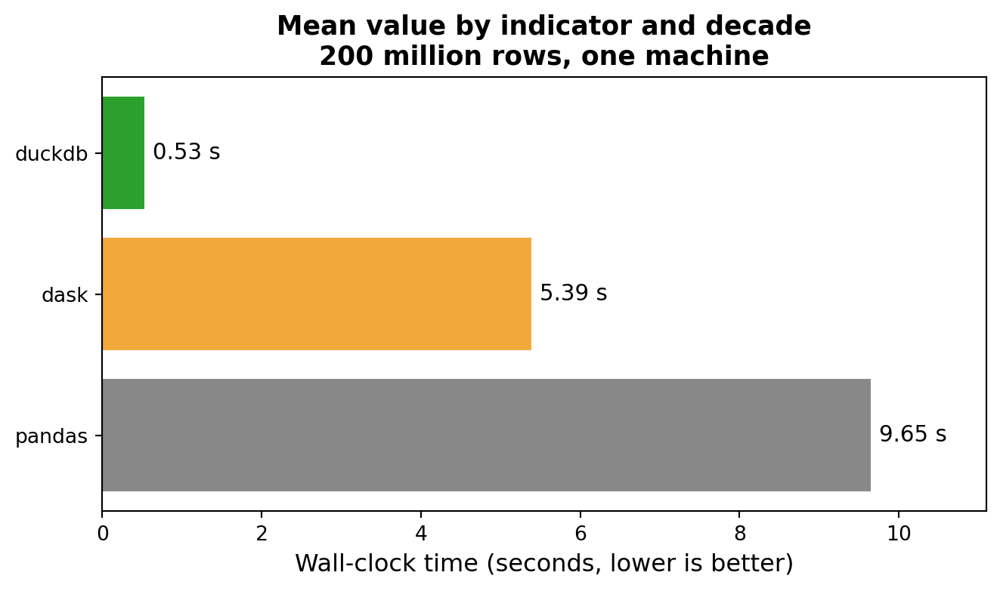{width="100%"}](#){data-modal-type="image" data-modal-url="figures/duckdb-benchmark-l22.png"}
:::
:::{style="font-size: 17px; text-align: center;"}
Source: [Lecture 22, Appendix 07](https://danilofreire.github.io/datasci350/lectures/lecture-22/22-sql-revision.html#/sec-benchmark)
:::
:::
:::
:::

# Today's agenda {background-color="#1B3A6B"}

## Lecture overview
### Will your code run anywhere else?

:::{style="margin-top: 40px; font-size: 24px;"}

:::{.columns}
:::{.column width="50%"}
[1. Dependency management]{.alert}

- Why working code breaks
- How to write down what your code needs

[2. Virtual environments]{.alert}

- `venv`, `pip` and `requirements.txt`
- `conda` for non-Python software, `uv` for speed
:::

:::{.column width="50%"}
[3. Containers]{.alert}

- Docker images and containers
- Docker Desktop's licence and free alternatives

[4. Your first image]{.alert}

- A six-line Dockerfile, built, run and pushed to Docker Hub
- A container that renders your report is 30% of the [final project]{.alert} grade
- Project starter: [github.com/danilofreire/datasci350-project-starter](https://github.com/danilofreire/datasci350-project-starter)
:::
:::
:::

# Dependency management 📦 {background-color="#1B3A6B"}

## Congratulations! 🎉
### You have a project 🥳

:::{style="margin-top: 50px; font-size: 28px;"}
:::{.columns}
:::{.column width="50%"}
- Your code lives on GitHub, pulls data with `requests`, runs fast with DuckDB, and renders in Quarto
- Will it run on a new machine, on a colleague's laptop, or in six months?
- It depends on [the software installed on your laptop]{.alert}, which you never wrote down
- [Dependency management]{.alert} records every package and its version, so others can rebuild the same setup
:::

:::{.column width="50%"}
:::{style="text-align: center; margin-top: -20px;"}
[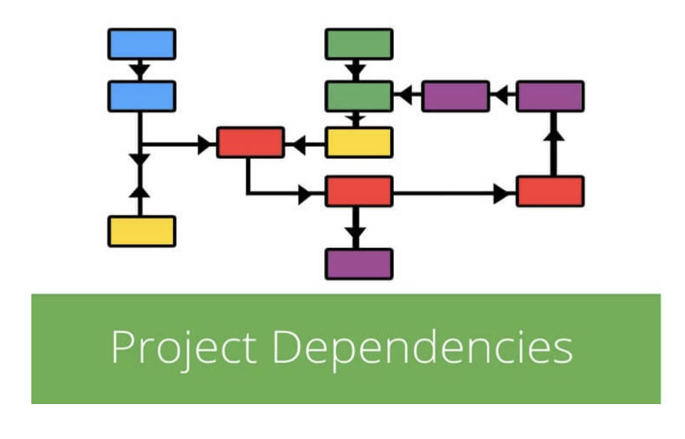{width="100%"}](#){data-modal-type="image" data-modal-url="figures/dependencies.png"}
:::
:::
:::
:::

## Why do we need dependency management?

:::{style="margin-top: 50px; font-size: 25px;"}
:::{.columns}
:::{.column width="50%"}
### Software changes

- [Libraries change constantly]{.alert}, and even simple code breaks after an update
- Python 2 to 3 (`-c` runs a command):

:::{style="font-size: 21px; margin-top: 20px; margin-bottom: 20px;"}
```text
python2 -c 'print "Hello, DATASCI350!"'
Hello, DATASCI350!

python3 -c 'print "Hello, DATASCI350!"'

  File "<string>", line 1
    print "Hello, DATASCI350!"
    ^^^^^^^^^^^^^^^^^^^^^^^^^^
SyntaxError: Missing parentheses in call to
'print'. Did you mean print(...)?
```
:::
:::

:::{.column width="50%"}
### Definitions

:::{style="font-size: 25px;"}
- [Dependencies]{.alert} are the libraries and software your code needs
- Each [package]{.alert} has a name, a version, and possibly its own dependencies
- A [package registry]{.alert} stores packages and metadata: [CRAN](https://cran.r-project.org/), [PyPI](https://pypi.org/), [Conda](https://docs.conda.io/en/latest/)
- [Dependency management]{.alert} tools ([`pip`](https://pip.pypa.io/), [`conda`](https://docs.conda.io/projects/conda/)) install and record them, so your code still runs later
- Every tool today writes that list down and replays it elsewhere
:::
:::
:::
:::

## The reproducibility crisis

:::{style="margin-top: 40px; font-size: 23px;"}
:::{.columns}
:::{.column width="50%"}
- [Reproducibility crisis]{.alert}: many published results [cannot be replicated](https://en.wikipedia.org/wiki/Replication_crisis)
- It affects [computer science](https://dl.acm.org/doi/10.1145/2812803), [statistics](https://doi.org/10.1080/00031305.2016.1154108), [psychology](https://www.science.org/doi/10.1126/science.aac4716) and [medicine](https://doi.org/10.1371/journal.pmed.0020124)
- A 2016 [Nature survey](https://www.nature.com/articles/533452a) of 1,576 researchers found:
  - [More than 70%]{.alert} had failed to reproduce another scientist's experiment
  - [More than half]{.alert} had failed to reproduce their own
- Some causes are statistical: [p-hacking](https://doi.org/10.1371/journal.pbio.1002106), [publication bias](https://www.science.org/doi/10.1126/science.1255484), [low power](https://www.nature.com/articles/nrn3475)
- Others are technical: [missing documentation and unrecorded dependencies](https://www.nature.com/articles/s41597-022-01143-6)
- Today's tools fix the technical ones
:::

:::{.column width="50%"}
:::{style="text-align: center; margin-top: -20px;"}
[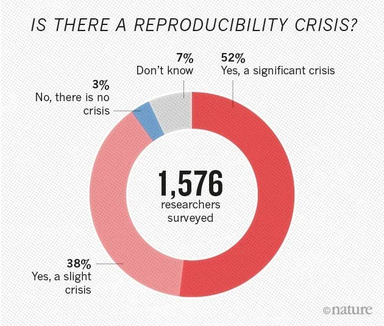{width="85%"}](#){data-modal-type="image" data-modal-url="figures/reproducibility.webp"}
:::
:::{style="font-size: 17px; text-align: center;"}
Source: [Baker (2016), Nature](https://www.nature.com/articles/533452a)
:::
:::
:::
:::

## The reproducibility trade-off

:::{style="margin-top: 40px; font-size: 23px;"}
:::{style="text-align: center; margin-top: 10px;"}
[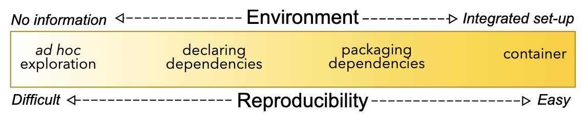{width="72%"}](#){data-modal-type="image" data-modal-url="figures/trade-off.png"}
:::
:::{style="font-size: 17px; text-align: center; margin-top: -10px;"}
Source: [Utrecht University, Computational reproducibility workshop](https://utrechtuniversity.github.io/workshop-computational-reproducibility/chapters/dependency-management.html)
:::

- How far to go [depends on who has to rerun your code]{.alert}
- At minimum, [declare]{.alert} your dependencies so others know what you used
- [Manage]{.alert} them with [`conda`](https://docs.conda.io/projects/conda/), [`pip`](https://pip.pypa.io/) or [`uv`](https://docs.astral.sh/uv/)
- [Pin]{.alert} exact versions with [`renv`](https://rstudio.github.io/renv/) (R) or [`uv`](https://docs.astral.sh/uv/) (Python)
- [Host]{.alert} them online with [Code Ocean](https://codeocean.com/) ($$$) or [Binder](https://mybinder.org/) (free, limited)
- [Containerise]{.alert} with [Docker](https://www.docker.com/) or [Apptainer](https://apptainer.org/) for full portability
- Your final project goes all the way, to a container
:::

## How to declare dependencies?

:::{style="margin-top: 40px; font-size: 24px;"}
Your analysis uses, e.g., Python, NumPy, pandas and matplotlib. Ask:

:::{.incremental}
- Which packages do I need?
- Will this work on my collaborator's operating system?
- Can someone else reproduce my results?
:::

:::{.fragment}
- A package manager declares your dependencies in [plain text files]{.alert}
- Keep them in the [repository root]{.alert}, so collaborators install everything in one step
- The files depend on the tool:
  - `pip` (Python only): [`requirements.txt`](https://pip.pypa.io/en/stable/reference/requirements-file-format/)
  - `conda` (Python and R): [`environment.yml`](https://docs.conda.io/projects/conda/en/latest/user-guide/tasks/manage-environments.html#creating-an-environment-from-an-environment-yml-file)
  - `uv` (Python only): [`pyproject.toml`](https://packaging.python.org/en/latest/guides/writing-pyproject-toml/) and [`uv.lock`](https://docs.astral.sh/uv/concepts/projects/layout/#the-lockfile)
- Most Python Dockerfiles read [`requirements.txt`]{.alert}, including the project starter's
:::
:::

# Virtual environments {background-color="#1B3A6B"}

## `venv` and `pip`: an isolated Python

:::{style="margin-top: 40px; font-size: 20px;"}
:::{.columns}
:::{.column width="52%"}
- [`venv`]{.alert} ships with Python and [creates a folder]{.alert} with its own `python` and `site-packages`
- Installs stay inside it, so two projects can keep two versions of one package
- Create, activate, install:

:::{style="margin-top: 20px; margin-bottom: 20px; font-size: 18px;"}
```{verbatim}
mkdir venv-demo && cd venv-demo  # any project folder

python3 -m venv .venv            # create the environment

source .venv/bin/activate        # macOS and Linux
.venv\Scripts\activate           # Windows

pip install requests polars
```
:::

- The folder stays out of git (Python 3.13+ adds its own `.gitignore`). [Only the package list is committed]{.alert}
:::

:::{.column width="48%"}
- `which python` shows which interpreter is active:

:::{style="font-size: 20px;"}
```{verbatim}
which python
~/venv-demo/.venv/bin/python
```
:::

- A path ending in `.venv/bin/python` means the environment is on. `pip list` shows what is installed:

:::{style="font-size: 20px;"}
```{verbatim}
pip list
Package            Version
------------------ ----------
certifi            2026.10.23
charset-normalizer 3.5.2
idna               3.20
pip                26.0.1
polars             2.1.0
polars-runtime-32  2.1.0
requests           2.34.2
urllib3            2.8.0
```
:::

- [Docker images do this too]{.alert}: the project starter runs `python3 -m venv /opt/venv`, then sets `ENV PATH="/opt/venv/bin:$PATH"` so later steps use it without activating
:::
:::
:::

## `requirements.txt`: the file you commit

:::{style="margin-top: 40px; font-size: 21px;"}
:::{.columns}
:::{.column width="50%"}
- [`pip freeze`]{.alert} prints every installed package with its exact version:

```{verbatim}
pip freeze > requirements.txt
cat requirements.txt

certifi==2026.10.23
charset-normalizer==3.5.2
idna==3.20
polars==2.1.0
polars-runtime-32==2.1.0
requests==2.34.2
urllib3==2.8.0
```

- Two packages became seven lines because `pip` also lists your dependencies' dependencies
- The [`==` pins]{.alert} mean "these exact versions"
:::

:::{.column width="50%"}
- Your collaborator creates an environment and [installs from the file]{.alert}:

```{verbatim}
python3 -m venv .venv
source .venv/bin/activate
pip install -r requirements.txt
```

- To leave the environment and [delete it]{.alert}:

```{verbatim}
deactivate
rm -rf .venv
```

- The [project starter](https://github.com/danilofreire/datasci350-project-starter) pins every package by hand, with a comment for each:

```{verbatim}
# Talking to web APIs
requests==2.32.5

# Data processing (use either, or both)
pandas==3.0.5
duckdb==1.5.5
```
:::
:::
:::

## Conda in one slide

:::{style="margin-top: 40px; font-size: 18px;"}
:::{.columns}
:::{.column width="50%"}
- [Conda](https://docs.conda.io/) [manages environments and packages]{.alert}, including non-Python software: compilers, R, CUDA

:::{style="margin-top: 10px; margin-bottom: 10px;"}
```{verbatim}
conda create --name l23-demo \
  python=3.14 numpy pandas -y
conda activate l23-demo
```
:::

- [`--from-history`]{.alert} exports only the packages you asked for:

:::{style="margin-top: 10px; margin-bottom: 10px;"}
```{verbatim}
conda env export --name l23-demo \
  --from-history > environment.yml
```
:::

- Others rebuild it from the file:

:::{style="margin-top: 10px; margin-bottom: 10px;"}
```{verbatim}
conda env create --file environment.yml
conda activate l23-demo
```
:::

- To [delete it]{.alert}, run `conda deactivate` first, then:

:::{style="margin-top: 10px; margin-bottom: 10px;"}
```{verbatim}
conda env remove --name l23-demo
```
:::

- Inside conda, `pip freeze` can write `name @ file:///...` lines that fail elsewhere. Use [`pip list --format=freeze`]{.alert}
:::

:::{.column width="50%"}
- The resulting file:

:::{style="font-size: 20px; margin-top: 10px; margin-bottom: 20px;"}
```{verbatim}
name: l23-demo
channels:
  - conda-forge
  - defaults
dependencies:
  - pandas
  - numpy
  - python=3.14
prefix: ~/miniconda3/envs/l23-demo
```
:::

- Without `--from-history`, it lists every package, including dependencies of dependencies:

:::{style="font-size: 20px; margin-top: 20px; margin-bottom: 20px;"}
```{verbatim}
  - _openmp_mutex=4.5=7_kmp_llvm
  - bzip2=1.0.8=h4e30115_10
  - libblas=3.11.0=9_h51639a9_openblas
  - libcxx=23.1.0=h55c6f16_0
  [...]
```
:::

- That full list describes one machine exactly but [rarely installs on another]{.alert}
:::
:::
:::

## What are build strings?

:::{style="margin-top: 40px; font-size: 22px;"}
:::{.columns}
:::{.column width="50%"}
- A conda [build](https://docs.conda.io/projects/conda-build/en/stable/concepts/package-naming-conv.html) is [one compiled binary of a package]{.alert}
- The same version is compiled separately for each platform, Python version and feature set
- A full package specification:

:::{style="margin-top: 20px; margin-bottom: 20px; font-size: 18px;"}
```{verbatim}
numpy=1.21.5=py39h12345_0
└──┬─┘└─┬──┘ └────┬───┘└┬┘
   │    │         │     │
   │    │         │     └─ Build number (0)
   │    │         └─────── Build string (py39h12345_0)
   │    └───────────────── Version (1.21.5)
   └────────────────────── Package name (numpy)
```
:::

- `--no-builds` strips build strings, but macOS-only packages stay in the file
- For a file that [works on other platforms]{.alert}, use `--from-history`
:::

:::{.column width="50%"}
- The build string (`py39h12345_0`) encodes metadata and ends in the build number:
  - Python version (`py39`, `py310`)
  - Compiler (`gcc9`, `clang`)
  - Features (`nomkl`, `cuda`)

- The platform (`linux-64`, `osx-arm64`) is stored separately
- So `libblas=3.11.0=9_h51639a9_openblas` from the previous slide [will not resolve on Linux]{.alert}
:::
:::
:::

## `uv`: a fast Python package manager

:::{style="margin-top: 40px; font-size: 21px;"}
:::{.columns}
:::{.column width="50%"}
- [uv](https://docs.astral.sh/uv/) is a Python package and project manager from [Astral](https://astral.sh/), the makers of the [Ruff](https://docs.astral.sh/ruff/) linter
- Written in [Rust](https://www.rust-lang.org/), it replaces `pip`, `pip-tools`, `pipx`, `poetry`, `pyenv` and `virtualenv`
- `--python 3.14` picks the version, and uv [downloads it]{.alert} if it is missing
- Install it:

:::{style="font-size: 19px;"}
```{verbatim}
# macOS and Linux: download and run the installer
curl -LsSf https://astral.sh/uv/install.sh | sh

# or with Homebrew
brew install uv

uv --version    # check that it worked
uv 0.11.7 (9d177269e 2026-04-15
aarch64-apple-darwin)
```
:::

:::

:::{.column width="50%"}
- [`uv init`]{.alert} creates a project folder with a `pyproject.toml`, a `main.py` and a git repository:

:::{style="margin-top: 10px; margin-bottom: 10px;"}
```{verbatim}
uv init l23-uv-demo --python 3.14
cd l23-uv-demo
```
:::

- [`uv add`]{.alert} creates `.venv`, installs the packages and records them in `pyproject.toml` and `uv.lock`:

:::{style="margin-top: 10px; margin-bottom: 10px;"}
```{verbatim}
uv add polars requests

Creating virtual environment at: .venv
Resolved 8 packages in 279ms
Installed 7 packages in 8ms
 + polars==2.1.0
 [...]
 + requests==2.34.2
```
:::

- uv [updates both files for you]{.alert}, so you do not need `activate` or `pip freeze`
- More information: <https://docs.astral.sh/uv/>
:::
:::
:::

## `uv`: project files and sharing

:::{style="margin-top: 40px; font-size: 20px;"}
:::{.columns}
:::{.column width="50%"}
- [`pyproject.toml`]{.alert} lists your direct dependencies, for humans to read. Mine after `uv add`:

```{verbatim}
[project]
name = "l23-uv-demo"
version = "0.1.0"
description = "Add your description here"
readme = "README.md"
requires-python = ">=3.14"
dependencies = [
    "polars>=2.1.0",
    "requests>=2.34.2",
]
```

- [TOML](https://toml.io/en/) is a config format of key-value pairs and `[sections]`, close to the [YAML](https://yaml.org/) in Quarto headers
- [Tom Preston-Werner](https://en.wikipedia.org/wiki/Tom_Preston-Werner), a GitHub co-founder, created it ("Tom's Obvious Minimal Language")
- `uv init` also writes `.gitignore`, `.python-version`, `README.md` and `main.py`, and starts a git repository
:::

:::{.column width="50%"}
- [`uv.lock`]{.alert} records the exact version and hash of every package. Mine is 182 lines
- uv writes it for you. [Never edit it by hand]{.alert}
- Commit and push both files. Your collaborator clones [the repository]{.alert} and runs [`uv sync`]{.alert}:

```{verbatim}
uv sync
Resolved 8 packages in 2ms
Checked 7 packages in 1ms

uv run python -c \
  "import polars; print(polars.__version__)"
2.1.0
```

- `uv run` runs inside the project environment, with nothing to activate
- `uv python install 3.14` and `uv python pin 3.14` manage Python versions
- [More about `uv`](https://docs.astral.sh/uv/)
:::
:::
:::

## `uv`: handing a project to Docker

:::{style="margin-top: 40px; font-size: 21px;"}
:::{.columns}
:::{.column width="52%"}
- [`uv export`]{.alert} writes a `requirements.txt` from your lock file, for Dockerfiles that expect one:

```{verbatim}
uv export --format requirements-txt --no-hashes

Resolved 8 packages in 2ms
# This file was autogenerated by uv via the
# following command:
#    uv export --format requirements-txt
#      --no-hashes
certifi==2026.10.23
    # via requests
charset-normalizer==3.5.2
    # via requests
[...]
polars==2.1.0
    # via l23-uv-demo
[...]
requests==2.34.2
    # via l23-uv-demo
[...]
```

- Without `--no-hashes`, each line also carries a SHA-256 hash that `pip` verifies
:::

:::{.column width="48%"}
- Redirect it into the file your Dockerfile copies:

```{verbatim}
uv export --format requirements-txt \
  --no-hashes > requirements.txt
```

- The `# via` comments show which package pulled each dependency in. `pip freeze` has none
- Already have a `requirements.txt`? [`uv pip`]{.alert} is a faster drop-in for `pip`:

```{verbatim}
uv venv
source .venv/bin/activate
uv pip install -r requirements.txt
```

- For a new project, `uv init`, `uv add` and `uv run` are simpler
:::
:::
:::

# Containers 🚢 {background-color="#1B3A6B"}

## The matrix from hell

:::{style="margin-top: 40px; font-size: 22px;"}
:::{style="text-align: center;"}
[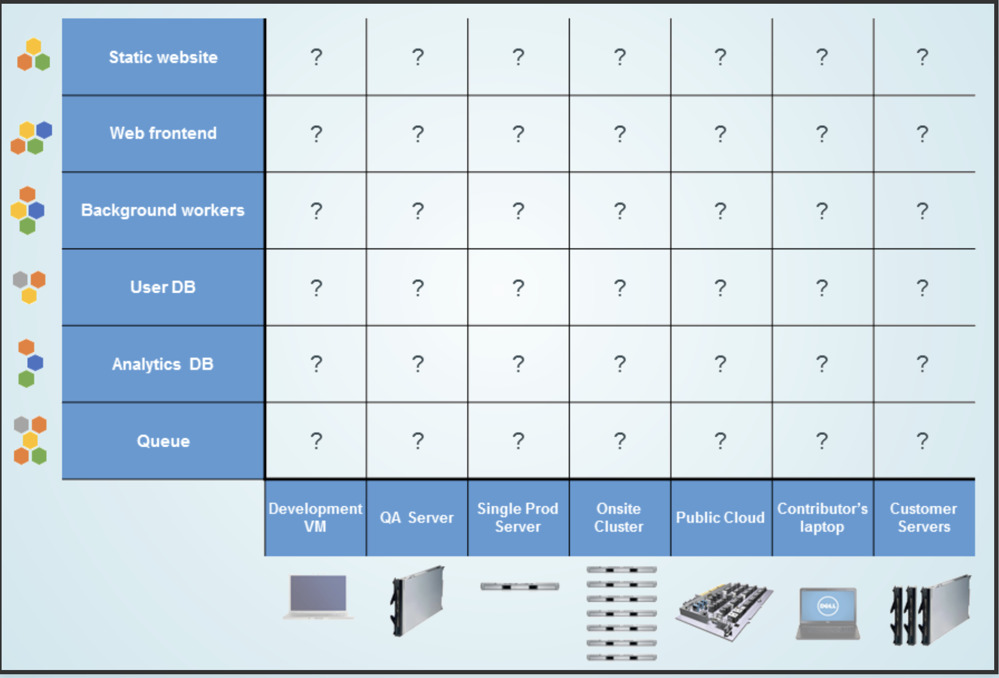{width="65%"}](#){data-modal-type="image" data-modal-url="figures/p02.png"}
:::
:::{style="font-size: 17px; text-align: center;"}
Each cell is one combination someone has to test by hand

Source: [dotCloud (2013), Docker introduction](https://www.slideshare.net/slideshow/docker-intro-november/28618034)
:::
:::

## Cargo transport before 1960

:::{style="margin-top: 40px; font-size: 22px;"}
:::{style="text-align: center;"}
[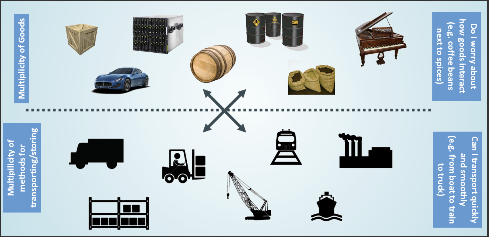{width="88%"}](#){data-modal-type="image" data-modal-url="figures/p03.png"}
:::
:::{style="font-size: 17px; text-align: center;"}
Sacks, barrels, and crates, each loaded differently at every port

Source: [dotCloud (2013), Docker introduction](https://www.slideshare.net/slideshow/docker-intro-november/28618034)
:::
:::

## Also a matrix from hell

:::{style="margin-top: 40px; font-size: 22px;"}
:::{style="text-align: center;"}
[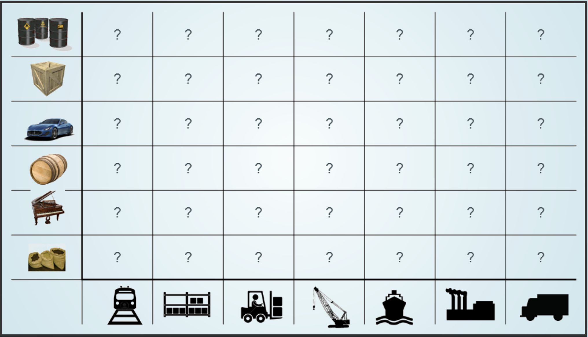{width="77%"}](#){data-modal-type="image" data-modal-url="figures/p04.png"}
:::
:::{style="font-size: 17px; text-align: center;"}
Shipping had the same combinatorial problem

Source: [dotCloud (2013), Docker introduction](https://www.slideshare.net/slideshow/docker-intro-november/28618034)
:::
:::

## The solution: intermodal containers

:::{style="margin-top: 40px; font-size: 22px;"}
:::{style="text-align: center;"}
[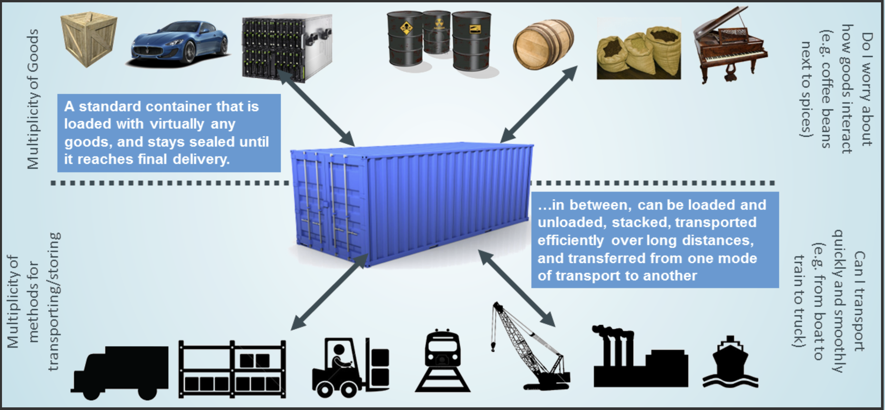{width="88%"}](#){data-modal-type="image" data-modal-url="figures/p05.png"}
:::
:::{style="font-size: 17px; text-align: center;"}
A standard box fits every ship, train, and lorry, and nobody opens it in transit

Source: [dotCloud (2013), Docker introduction](https://www.slideshare.net/slideshow/docker-intro-november/28618034)
:::
:::

## Docker is a container for your code

:::{style="margin-top: 40px; font-size: 22px;"}
:::{style="text-align: center;"}
[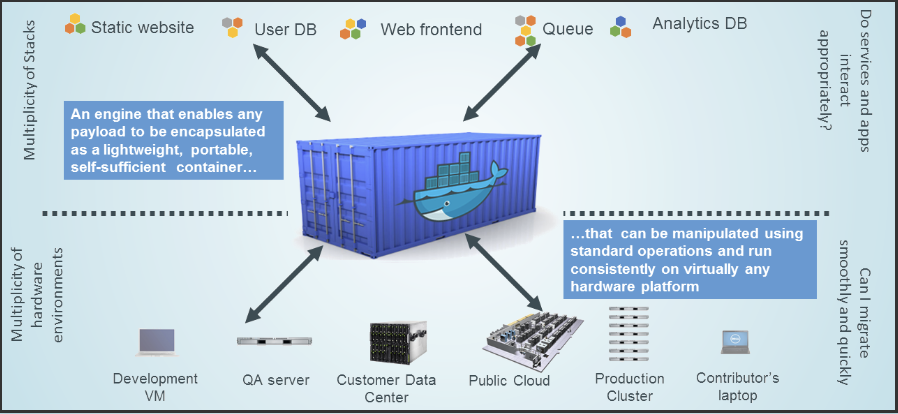{width="88%"}](#){data-modal-type="image" data-modal-url="figures/p06.png"}
:::
:::{style="font-size: 17px; text-align: center;"}
Your code, its libraries, and its Python version inside a container
:::
:::

## Docker eliminates the matrix from hell

:::{style="margin-top: 40px; font-size: 22px;"}
:::{style="text-align: center;"}
[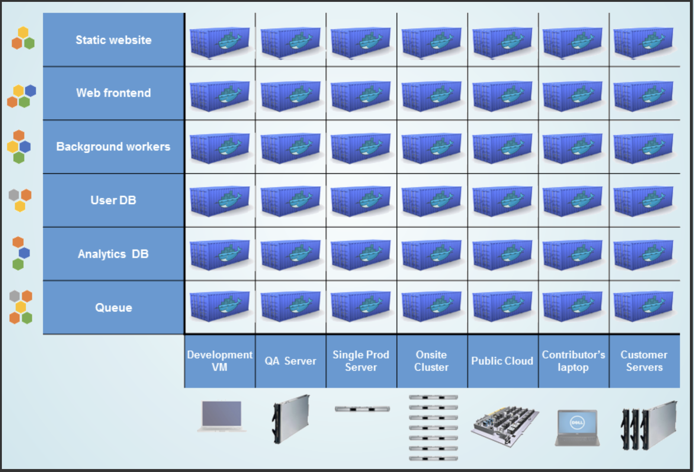{width="65%"}](#){data-modal-type="image" data-modal-url="figures/p07.png"}
:::
:::{style="font-size: 17px; text-align: center;"}
The host only needs Docker, and the image carries everything else
:::
:::

## What are software containers?

:::{style="margin-top: 40px; font-size: 24px;"}
:::{.columns}
:::{.column width="50%"}
- [Containers](https://www.docker.com/resources/what-container) package software so it runs on any system
- A [virtual machine](https://www.vmware.com/topics/virtual-machine) boots a whole operating system. A container carries only [the libraries the app needs]{.alert}, so it starts in a second
- A virtual environment isolates Python packages. A container also holds the system libraries, the interpreter and system tools
- It runs on [any machine with Docker]{.alert} if the image matches the chip: `amd64` (Intel/AMD) or `arm64` (Apple Silicon)
:::

:::{.column width="50%"}
- Built with [Docker](https://www.docker.com/) or [Apptainer](https://apptainer.org/)
- Usually [a stripped-down Linux]{.alert} ([Ubuntu](https://ubuntu.com/), [Alpine](https://alpinelinux.org/)), the most widely used open-source server system
- Shared through [container registries](https://docs.docker.com/get-started/docker-concepts/the-basics/what-is-a-registry/) like [Docker Hub](https://hub.docker.com/)
- [More about Docker](https://docs.docker.com/get-started/overview/)

:::{style="background: rgba(27, 58, 107, 0.08); padding: 15px; border-radius: 10px; font-size: 20px; margin-top: 15px;"}
Lecture 10's four ingredients of reproducibility: code, data, environment, documentation. [A container ships the environment with the code]{.alert}
:::
:::
:::
:::

## What is Docker?

:::{style="margin-top: 40px; font-size: 24px;"}
:::{.columns}
:::{.column width="52%"}
- [Docker](https://www.docker.com/) is the leading container platform
- An [image]{.alert} is a read-only template: operating system, libraries, code and configuration. You [build]{.alert} it from a `Dockerfile`
- A [container]{.alert} is a running instance of an image, and one image can start many
- A [registry]{.alert} such as [Docker Hub](https://hub.docker.com/) stores images for you to pull
- Image is to container as recipe is to dish, or class to object ([more here](https://stackoverflow.com/questions/23735149/what-is-the-difference-between-a-docker-image-and-a-container))
- The syntax borrows from Git (`docker pull`, `docker push`) and Linux (`docker ps`, `docker rm`)
- The `docker` command is a client. A background [daemon]{.alert} does the building and running
:::

:::{.column width="48%"}
:::{style="text-align: center; margin-top: -10px;"}
[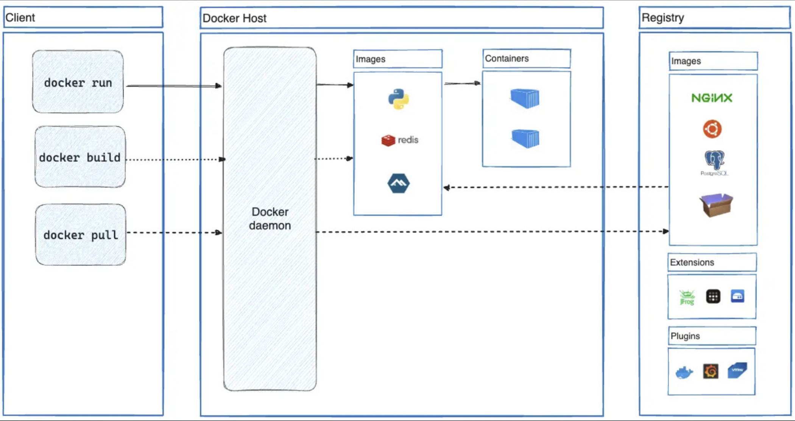{width="100%"}](#){data-modal-type="image" data-modal-url="figures/docker-architecture.png"}
:::
:::{style="font-size: 17px; text-align: center;"}
Client, daemon, and registry

Source: [Docker documentation](https://docs.docker.com/get-started/docker-overview/)
:::
:::
:::
:::

## Docker Desktop and the alternatives

:::{style="margin-top: 40px; font-size: 22px;"}
:::{.columns}
:::{.column width="55%"}
- [Docker Desktop](https://www.docker.com/products/docker-desktop) runs Docker on macOS and Windows. Most of you will install it
- It is free for personal use, education, non-commercial open source, and companies under 250 employees and $10M revenue
- Docker Hub allows [200 pulls every six hours]{.alert} with a free account, 100 without
- [Docker Engine](https://docs.docker.com/engine/) is open source and free, but runs [only on Linux]{.alert} (including WSL)
- On macOS, an app runs it inside a Linux virtual machine. Docker Desktop, [Podman](https://podman.io/) (as `podman`), [Colima](https://github.com/abiosoft/colima), [OrbStack](https://orbstack.dev/) (free for personal use) and [Rancher Desktop](https://rancherdesktop.io/) all take the same `docker` commands

:::{style="background: rgba(230, 57, 70, 0.1); padding: 10px 15px; border-radius: 10px; font-size: 19px; margin-top: 8px;"}
I ran every `docker` command on these slides through OrbStack. Docker Desktop takes the same commands
:::
:::

:::{.column width="45%"}
:::{style="text-align: center; margin-top: -10px;"}
[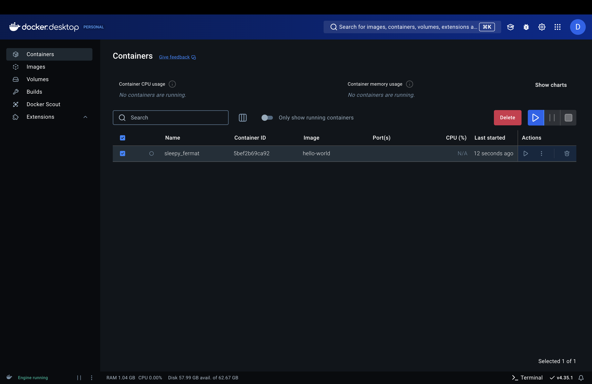{width="60%"}](#){data-modal-type="image" data-modal-url="figures/docker-desktop.png"}
:::
:::{style="font-size: 17px; text-align: center;"}
Docker Desktop on macOS
:::

:::{style="text-align: center; margin-top: 10px;"}
[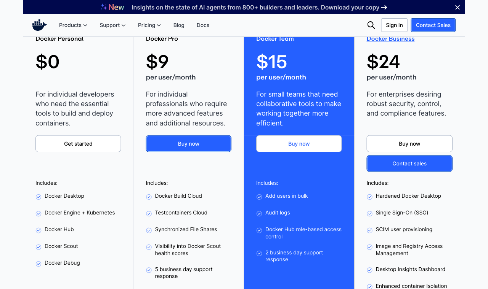{width="60%"}](#){data-modal-type="image" data-modal-url="figures/docker-pricing-2026.png"}
:::
:::{style="font-size: 17px; text-align: center;"}
<https://www.docker.com/pricing/>
:::
:::
:::
:::

## Check your installation with `hello-world` {#sec-hello-world}

:::{style="margin-top: 40px; font-size: 22px;"}
:::{.columns}
:::{.column width="55%"}
- Install [Docker Desktop](https://docs.docker.com/get-docker/) (Docker Engine on Linux), open it once, and run:

:::{style="font-size: 20px;"}
```text
docker run hello-world

Unable to find image 'hello-world:latest' locally
latest: Pulling from library/hello-world
58dee6a49ef1: Pull complete
Digest: sha256:5dd0d3e6e255...
Status: Downloaded newer image for hello-world:latest

Hello from Docker!
This message shows that your installation appears to be
working correctly.
[...]
```
:::

```text
docker -v

Docker version 29.8.2, build 7fc2dff
```

- On Windows, turn on WSL Integration in Docker Desktop: [[Appendix 03]{.button}](#sec-appendix-03)
:::

:::{.column width="45%"}
- The image was not on my laptop, so Docker [pulled it from Docker Hub]{.alert}
- The output lists [four steps]{.alert}:
  - The client contacts the [daemon](https://en.wikipedia.org/wiki/Daemon_(computing)) (Docker's background service)
  - The daemon pulls the image
  - It creates a container
  - It streams the output to your terminal
- Create a free [Docker Hub](https://hub.docker.com/) account now. You will need it!

:::{style="background: rgba(230, 57, 70, 0.1); padding: 15px; border-radius: 10px; font-size: 19px; margin-top: 15px;"}
A daemon error means the Docker application is not running: [[Appendix 02]{.button}](#sec-appendix-02)
:::
:::
:::
:::

## Let's create our first container

:::{style="margin-top: 40px; font-size: 24px;"}
:::{.columns}
:::{.column width="52%"}
- A [`Dockerfile`](https://docs.docker.com/reference/dockerfile/) is a plain-text recipe that rebuilds everything a project needs
- Name it `Dockerfile`, with no extension, and commit it
- [More about Dockerfiles](https://docs.docker.com/build/concepts/dockerfile/)
- [Docker Hub](https://hub.docker.com/) holds base images for almost anything, so you [rarely start from scratch]{.alert}
- Its [Data Science category](https://hub.docker.com/categories/data-science) showed 9,400+ packages (August 2026)
- We build one now from the three files on the right. Your project's has the same shape
- Demo files: [`lectures/lecture-23/docker/`](https://github.com/danilofreire/datasci350/tree/main/lectures/lecture-23/docker)
:::

:::{.column width="48%"}
:::{style="font-size: 20px;"}
- File 1, `requirements.txt`: the packages to install

```{verbatim}
numpy==2.5.2
pandas==3.0.5
```

- File 2, `hello.py`: the script the container runs

```{verbatim}
import numpy as np
import pandas as pd

print("Hello, DATASCI350!")
print(f"numpy  {np.__version__}")
print(f"pandas {pd.__version__}")
```

- File 3, the `Dockerfile`, puts them together (next slide)
:::
:::{style="text-align: center; margin-top: 10px;"}
[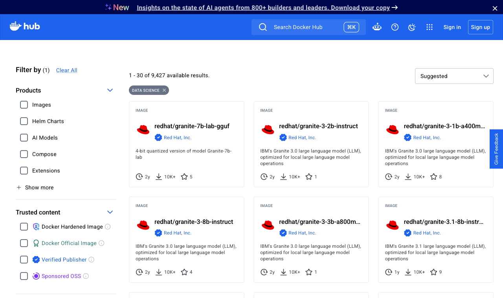{width="39%"}](#){data-modal-type="image" data-modal-url="figures/docker-hub-datascience-2026.png"}
:::
:::{style="font-size: 17px; text-align: center;"}
[Docker Hub](https://hub.docker.com/categories/data-science)
:::
:::
:::
:::

## The Dockerfile

:::{style="margin-top: 15px; font-size: 20px;"}
:::{.columns}
:::{.column width="52%"}
```{verbatim}
# Start from an official Python image on Docker Hub
FROM python:3.14-slim

# Create /app inside the image and move into it
WORKDIR /app

# Copy requirements.txt from your folder to /app
# First, so editing hello.py won't reinstall
COPY requirements.txt .
RUN pip install --no-cache-dir -r requirements.txt

# Copy hello.py from your folder into /app
COPY hello.py .

# The command that runs when the container starts
CMD ["python", "hello.py"]
```

- `-r` installs from the file, and `--no-cache-dir` keeps no copy of the downloads
- [Build it]{.alert}: `-t` tags the image `datasci350-example`, and `.` is the folder holding the `Dockerfile`:

:::{style="font-size: 24px;"}
```{verbatim}
docker build -t datasci350-example .
```
:::
:::

:::{.column width="48%"}
- `docker build` runs the instructions [in order]{.alert}. `COPY` and `RUN` add layers, while `CMD` only records the start command

:::{style="text-align: center; font-size: 17px; margin-top: 10px; margin-bottom: 10px;"}
| Instruction | What it does | Runs when |
|---|---|---|
| `FROM` | Picks the base image | Build |
| `WORKDIR` | Sets the folder for every later step | Build |
| `COPY` | Brings a file from your folder into the image | Build |
| `RUN` | Executes a command inside the image | Build |
| `CMD` | Names the command the container starts with | Start |
:::

- [Full reference](https://docs.docker.com/reference/dockerfile/)

:::{style="text-align: center; margin-top: 10px;"}
[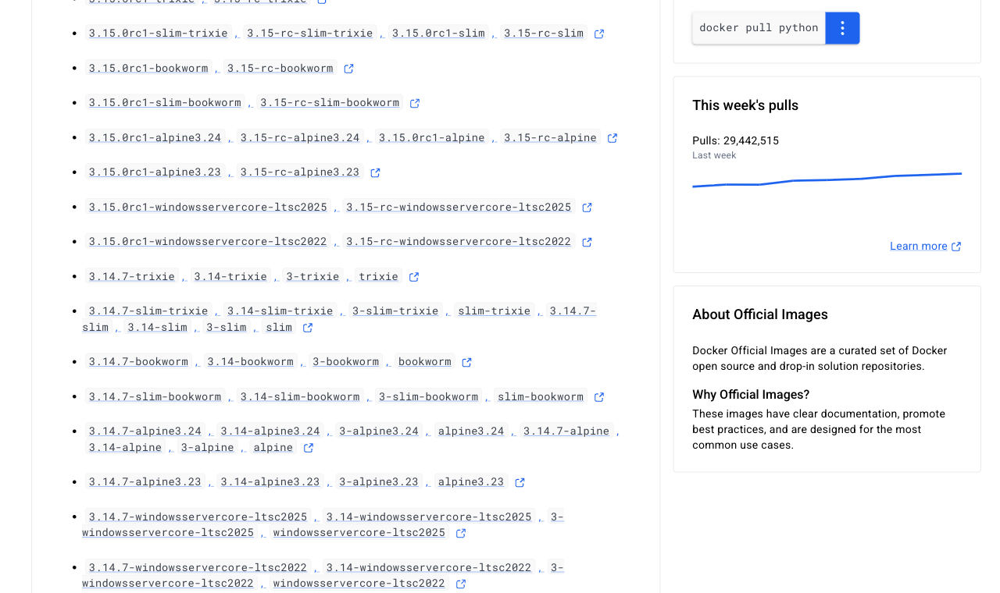{width="50%"}](#){data-modal-type="image" data-modal-url="figures/docker-hub-python-2026.png"}
:::
:::{style="font-size: 19px; text-align: center;"}
Official Python image: <https://hub.docker.com/_/python>
:::
:::
:::
:::

## Building the image

:::{style="margin-top: 20px; font-size: 22px;"}
:::{.columns}
:::{.column width="56%"}
:::{style="font-size: 20px;"}
```text
docker build -t datasci350-example .

#5 [1/5] FROM docker.io/library/python:3.14-slim
#5 sha256:acd43e9beb 30.21MB / 30.21MB 1.8s done
#5 DONE 2.6s

#7 [2/5] WORKDIR /app
#7 DONE 0.4s

#8 [3/5] COPY requirements.txt .
#8 DONE 0.0s

#9 [4/5] RUN pip install --no-cache-dir -r
    requirements.txt
#9 5.262 Successfully installed numpy-2.5.2
    pandas-3.0.5 [...]
#9 DONE 5.6s

#10 [5/5] COPY hello.py .
#10 DONE 0.0s

#11 exporting to image
#11 DONE 3.2s
```
:::
:::

:::{.column width="44%"}
- `[1/5]` to `[5/5]` are the instructions before `CMD`
- `[1/5]` downloads the base image: [2.6 seconds]{.alert}, once per machine
- `[4/5]` installs the packages: [5.6 seconds]{.alert}
- The whole build took [13 seconds]{.alert}, most of it downloading
- `docker images` shows the result:

:::{style="font-size: 19px;"}
```{verbatim}
docker images datasci350-example

IMAGE                DISK USAGE  CONTENT SIZE
datasci350-example        409MB        88.2MB
```
:::

- It holds Debian, Python, NumPy, pandas and your code
:::
:::
:::

## Layer caching

:::{style="margin-top: 40px; font-size: 22px;"}
:::{.columns}
:::{.column width="52%"}
- Rebuild without changing anything:

:::{style="font-size: 20px;"}
```text
docker build -t datasci350-example .

#5 [1/5] FROM docker.io/library/python:3.14-slim
#5 DONE 0.0s

#6 [2/5] WORKDIR /app
#6 CACHED

#7 [3/5] COPY requirements.txt .
#7 CACHED

#8 [4/5] RUN pip install --no-cache-dir -r
    requirements.txt
#8 CACHED

#9 [5/5] COPY hello.py .
#9 CACHED

#10 exporting to image
#10 DONE 0.1s
```
:::
:::

:::{.column width="48%"}
- Every layer says [`CACHED`]{.alert}, and the build takes [0.79 seconds]{.alert}
- Docker reuses a layer when its instruction and inputs are unchanged
- Once one layer misses, [every layer below it rebuilds]{.alert}
- So `COPY requirements.txt` sits above `COPY hello.py`. Editing your script rebuilds only the last layer, and `pip install` stays cached
- With `COPY . .` (copy everything) at the top, any edit reinstalls every package
- The project starter's `Dockerfile` uses the same order
:::
:::
:::

## Let's run and share the container

:::{style="margin-top: 20px; font-size: 22px;"}
:::{.columns}
:::{.column width="50%"}
- [`docker run`]{.alert} starts a container from the image and runs its `CMD`:
  - `--rm` deletes the container when it stops

```text
docker run --rm datasci350-example

Hello, DATASCI350!
numpy  2.5.2
pandas 3.0.5
```

- These versions come from inside the image, so every machine prints the same
- [You can now hand the image to someone]{.alert} 🤓

- Log in to [Docker Hub](https://hub.docker.com/):

```{verbatim}
docker login
```

- Tag the image with your own username (the part before the slash):

```{verbatim}
docker tag datasci350-example \
  danilofreire/datasci350-example:latest
```
:::

:::{.column width="50%"}
- Push it:

```text
docker push \
  danilofreire/datasci350-example:latest

bf7af0229701: Pushed
c66215f6ebe7: Pushed
latest: digest: sha256:b24fd8fc20ef...
    size: 856
```

- Optional, not needed for the final project: [`buildx`](https://docs.docker.com/build/building/multi-platform/) builds for Intel and Apple chips at once, so anyone can pull it

```{verbatim}
docker buildx build \
  --platform linux/amd64,linux/arm64 \
  -t danilofreire/datasci350-example:latest \
  --push .
```
:::
:::
:::

## The image on Docker Hub

:::{style="margin-top: 20px; font-size: 20px; text-align: center;"}
[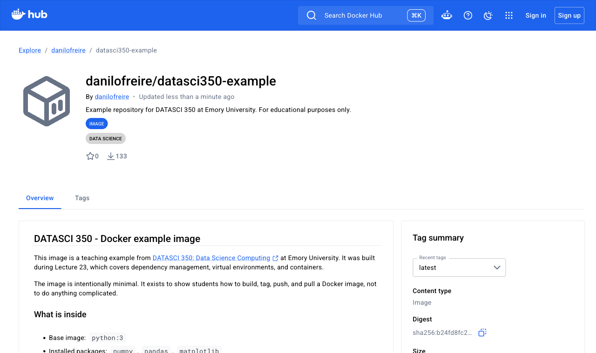{width="68%"}](#){data-modal-type="image" data-modal-url="figures/docker-hub-image-2026.png"}

<https://hub.docker.com/r/danilofreire/datasci350-example>
:::

## Docker pull

:::{style="margin-top: 20px; font-size: 22px;"}
- Anyone can now download the image from Docker Hub with [`docker pull`]{.alert}, then run it:

```text
docker pull danilofreire/datasci350-example:latest

latest: Pulling from danilofreire/datasci350-example
Digest: sha256:0e5a94a5aebd...
Status: Downloaded newer image

docker run --rm danilofreire/datasci350-example:latest

Hello, DATASCI350!
numpy  2.5.2
pandas 3.0.5
```

- Python, NumPy and pandas come inside the image, so they only need Docker
- It runs on Windows, Linux and any Mac, because it is published for `amd64` (Intel/AMD) and `arm64` (Apple Silicon)
- Your project works the same way. [I build and run it on a clean machine, and if your report appears, we both celebrate]{.alert} 🎉
- [Lecture 25]{.alert} builds the project container line by line

:::{style="text-align: center; margin-top: 15px;"}
[[Try it at home]{.button}](#sec-exercise-01)
:::
:::

## Try it at home {#sec-exercise-01}

:::{style="margin-top: 40px; font-size: 23px;"}
1. Copy the [`docker/`](https://github.com/danilofreire/datasci350/tree/main/lectures/lecture-23/docker) folder from the course repository: <https://github.com/danilofreire/datasci350/tree/main/lectures/lecture-23/docker>
2. Open a terminal inside that folder
3. Run `docker build -t datasci350-example .`
4. Run `docker run --rm datasci350-example`. Three lines appear
5. Open `requirements.txt`. Add the line `polars==2.1.0`
6. Open `hello.py`. Import `polars` and print `pl.__version__`
7. Run `docker build -t datasci350-example .` again
8. Read the output. Note which steps say `CACHED`
9. Run `docker run --rm datasci350-example`. Four lines now
10. If you have time, swap the two `COPY` lines and rebuild

:::{style="margin-top: 15px; margin-left: 30px;"}
Solution: [[Appendix 01]{.button}](#sec-appendix-01)
:::
:::

# Summary {background-color="#1B3A6B"}

## What we learned today

:::{style="margin-top: 40px; font-size: 24px;"}
:::{.columns}
:::{.column width="50%"}
- [Dependency management]{.alert} records what your code needs
- Code breaks when the environment changes (the Python 2 `print` script)
- `pip freeze` writes [`==` pins]{.alert}, and `pip install -r` reads them
- Export [conda]{.alert} with `--from-history` to work on other platforms
:::

:::{.column width="50%"}
- Commit `pyproject.toml` and `uv.lock`, then [`uv sync`]{.alert} rebuilds the environment
- An [image]{.alert} is a template, a container runs it, a registry stores it
- [Layer caching]{.alert} cut a 13-second build to 0.79 seconds
- Docker Desktop, Podman, Colima and OrbStack run the [same commands]{.alert}
:::
:::

:::{style="background: rgba(27, 58, 107, 0.08); padding: 15px; border-radius: 10px; font-size: 23px; margin-top: 15px;"}
[Your container is the deliverable]{.alert}: if `docker build` and `docker run` show your report on my machine, you're done 🚀
:::
:::

## Next class

:::{style="margin-top: 40px; font-size: 25px;"}
:::{.columns}
:::{.column width="50%"}
- [Quiz 04]{.alert} (19 November): web APIs and JSON, Lectures 18 and 19
- [Assignment 09]{.alert} is due the same day
- [Lecture 25]{.alert} (24 November): the project starter's `Dockerfile`, with Python and Quarto
- Today's `Dockerfile` is a small version of it
:::

:::{.column width="50%"}
<p style="margin-top: 0;">Before then:</p>

1. Install [Docker Desktop](https://www.docker.com/products/docker-desktop) or an alternative, and run `docker run hello-world`
2. Create a free [Docker Hub](https://hub.docker.com/) account
3. Clone the [project starter](https://github.com/danilofreire/datasci350-project-starter) and run `docker build` once on your own wifi

:::{style="background: rgba(27, 58, 107, 0.08); padding: 15px; border-radius: 10px; font-size: 23px; margin-top: 15px;"}
[Quiz 05]{.alert} covers Lectures 21, 22, 23 and 25. The [final project]{.alert} is due on the last day of classes
:::
:::
:::
:::

# And that's all for today! 🎉 {background-color="#1B3A6B"}

# Appendix 📚 {background-color="#1B3A6B"}

## Appendix 01: Exercise solution {#sec-appendix-01}

:::{style="margin-top: 5px; font-size: 18px;"}
:::{.columns}
:::{.column width="50%"}
[Steps 5 and 6]{.alert}, the two edited files:

```{verbatim}
# requirements.txt
numpy==2.5.2
pandas==3.0.5
polars==2.1.0
```

```{verbatim}
# hello.py
import numpy as np
import pandas as pd
import polars as pl

print("Hello, DATASCI350!")
print(f"numpy  {np.__version__}")
print(f"pandas {pd.__version__}")
print(f"polars {pl.__version__}")
```

[Step 9]{.alert}, the run:

```text
docker run --rm datasci350-example

Hello, DATASCI350!
numpy  2.5.2
pandas 3.0.5
polars 2.1.0
```

- The image grew from 409MB to [639MB]{.alert} on disk
:::

:::{.column width="50%"}
[Steps 7 and 8]{.alert}, the rebuild on my laptop:

```text
#6 [2/5] WORKDIR /app
#6 CACHED

#7 [3/5] COPY requirements.txt .
#7 DONE 0.1s

#8 [4/5] RUN pip install --no-cache-dir -r
    requirements.txt
#8 7.711 Successfully installed numpy-2.5.2
    pandas-3.0.5 polars-2.1.0 [...]
#8 DONE 8.1s

#9 [5/5] COPY hello.py .
#9 DONE 0.0s
```

- One layer stayed cached and three rebuilt. The miss at `#7` forced every later layer to run again
- `pip install` reran in full (8.1 seconds), downloading NumPy and pandas again along with `polars`
- [Step 10]{.alert}: with the `COPY` lines swapped, editing `hello.py` alone invalidates `COPY hello.py` and re-runs `pip install` for nothing

:::{style="margin-top: 15px;"}
[[Back to the exercise]{.button}](#sec-exercise-01)
:::
:::
:::
:::

## Appendix 02: When something goes wrong {#sec-appendix-02}

:::{style="margin-top: 20px; font-size: 20px;"}
:::{.columns}
:::{.column width="50%"}
[`Cannot connect to the Docker daemon`]{.alert}

Docker Desktop is not running. Start the application, wait for the whale icon to settle, and try again. On my laptop OrbStack was stopped, and `docker info` answered `failed to connect to the docker API at unix://~/.orbstack/run/docker.sock`.

[`permission denied ... /var/run/docker.sock`]{.alert}

On Linux, your user is not in the `docker` group. Run `sudo usermod -aG docker $USER`, then log out and back in.

[`pip: command not found`]{.alert}

Your virtual environment is not active. Run `source .venv/bin/activate` and check with `which python`, which should print a path ending in `.venv/bin/python`.
:::

:::{.column width="50%"}
[`No matching distribution found for numpy==2.5.2`]{.alert}

That version does not exist for your Python. Check the pin against [PyPI](https://pypi.org/project/numpy/), or loosen it to `numpy>=2.0`.

[`toomanyrequests: You have reached your pull rate limit`]{.alert}

Docker Hub allows 100 anonymous pulls every six hours from one address. Run `docker login` with your free account (200 pulls) and pull again.

[`failed to read dockerfile: open Dockerfile: no such file or directory`]{.alert}

You are in the wrong folder. The `.` at the end of `docker build -t name .` is where Docker looks, so `cd` into the folder holding the `Dockerfile`

:::{style="margin-top: 15px;"}
[[Back to hello-world]{.button}](#sec-hello-world)
:::
:::
:::
:::

## Appendix 03: Docker on Windows with WSL {#sec-appendix-03}

:::{style="margin-top: 20px; font-size: 20px;"}
:::{.columns}
:::{.column width="50%"}
[With Docker Desktop (recommended)]{.alert}

1. Install [WSL](https://learn.microsoft.com/en-us/windows/wsl/install): open PowerShell as administrator, run `wsl --install` and restart. You get Ubuntu by default
2. Install [Docker Desktop for Windows](https://docs.docker.com/desktop/setup/install/windows-install/) and keep "Use WSL 2" ticked
3. In Docker Desktop, open Settings → Resources → [WSL Integration](https://docs.docker.com/desktop/features/wsl/), turn on Ubuntu, then Apply & restart
4. Open Ubuntu and check:

```{verbatim}
docker run hello-world
```

- Keep your projects inside Ubuntu (`~/...`), not in `/mnt/c/...`. Builds are much faster there
:::

:::{.column width="50%"}
[Without Docker Desktop]{.alert}

Install [Docker Engine](https://docs.docker.com/engine/install/ubuntu/) inside Ubuntu, then let your user run `docker` without `sudo`:

```{verbatim}
curl -fsSL https://get.docker.com -o get-docker.sh
sudo sh get-docker.sh
sudo usermod -aG docker $USER
```

Close and reopen the terminal. If `docker` cannot connect, start the engine with `sudo service docker start`. Use one route only, not both.

[`The command 'docker' could not be found in this WSL 2 distro`]{.alert}

WSL Integration is off for your distribution. Turn it on as in step 3

:::{style="margin-top: 15px;"}
[[Back to hello-world]{.button}](#sec-hello-world)
:::
:::
:::
:::
