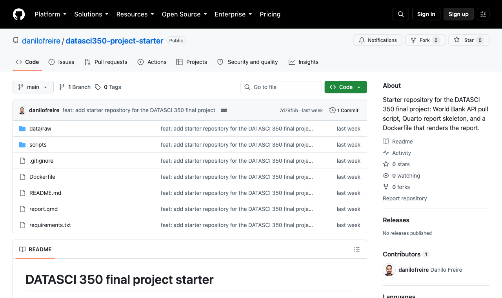
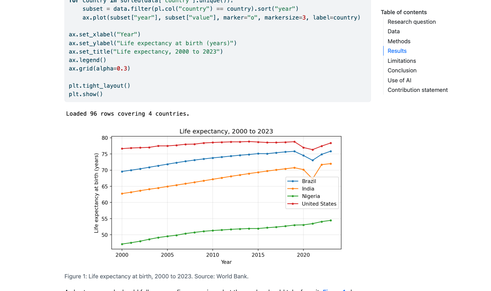
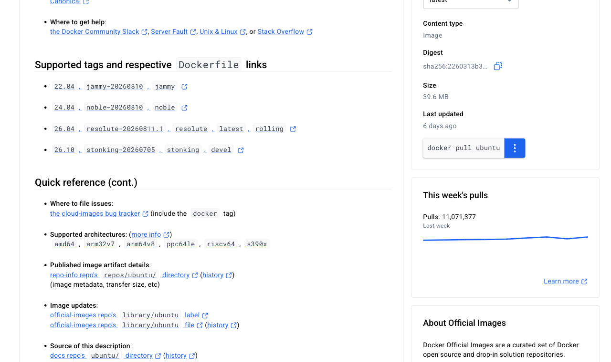
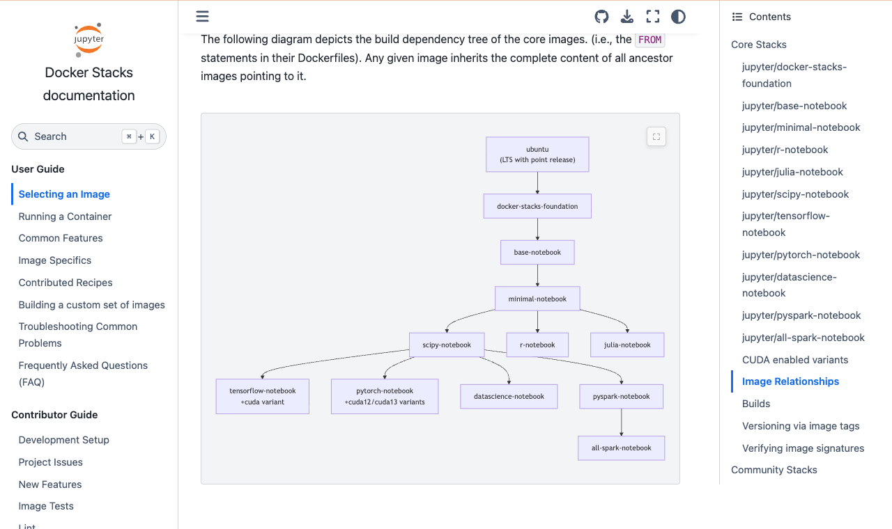
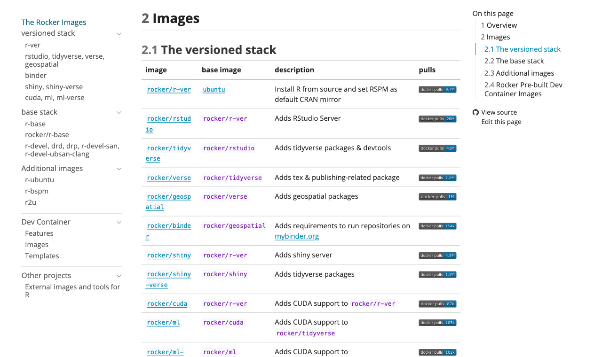
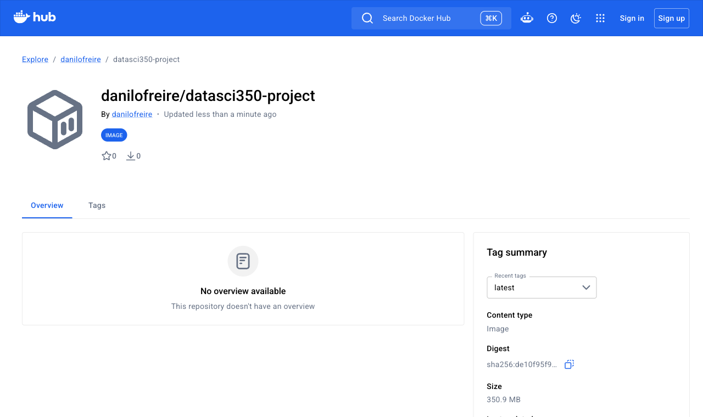

# Hello again! 😊 {background-color="#1B3A6B"}

# Brief recap 📚 {background-color="#1B3A6B"}

## Dependencies, environments, and one small container

:::{style="margin-top: 40px; font-size: 21px;"}
:::{.columns}
:::{.column width="54%"}
- We wrote dependencies down and [pinned]{.alert} them with `==`
- `venv` and `pip` gave us an isolated Python
  - The project starter builds the same thing at [`/opt/venv`]{.alert}
- Docker's three main concepts:
  - An [image]{.alert} is the recipe
  - A [container]{.alert} is a running instance
  - A [registry]{.alert} is where images live
- We built a [six-instruction Dockerfile]{.alert} from `python:3.14-slim` in about two minutes
- Layer caching brought the rebuild down to [0.754 seconds]{.alert}
- We pushed the result to `danilofreire/datasci350-example`
- Today we also install Quarto and render a report
:::

:::{.column width="46%"}
- Lecture 23's cached rebuild, the output we finished on:

:::{style="font-size: 20px;"}
```text
docker build -t datasci350-example .

#5 [1/5] FROM docker.io/library/python:3.14-slim
#5 DONE 0.0s

#6 [3/5] COPY requirements.txt .
#6 CACHED

#7 [4/5] RUN pip install --no-cache-dir -r
    requirements.txt
#7 CACHED

#8 [2/5] WORKDIR /app
#8 CACHED

#9 [5/5] COPY hello.py .
#9 CACHED
```
:::

- I ran today's build once before class, so the project image is already on this laptop (to save time)
:::
:::
:::

# Today's agenda {background-color="#1B3A6B"}

## Lecture overview

:::{style="margin-top: 40px; font-size: 24px;"}
:::{.columns}
:::{.column width="50%"}
[1. The project starter]{.alert}

- The five commands I run when I mark your container
- Six files, keeping the API and your keys out of the image

[2. The Dockerfile, instruction by instruction]{.alert}

- One instruction at a time, from `FROM` to `CMD`
- `.dockerignore`, `docker history`, and the cold build timed on this laptop
:::

:::{.column width="50%"}
[3. Run, change, rebuild]{.alert}

- The `-v` flag that decides whether you ever see the report
- Layer caching on a real project: 3 minutes 12 seconds down to 0.666 seconds

[4. What breaks, and the wider world]{.alert}

- Two failures, an inspection session, and cleaning up
- Ready-made images and Docker Hub
:::
:::
:::

# The project starter 📦 {background-color="#1B3A6B"}

## What the grader will do
### You should test your container before submission

:::{style="margin-top: 40px; font-size: 22px;"}
:::{.columns}
:::{.column width="54%"}
- [My whole grading procedure for the container:]{.alert}

:::{style="margin-top: 20px; margin-bottom: 20px; font-size: 22px;"}
```text
git clone <your repo url> fresh-test
cd fresh-test
docker build -t datasci350-project .
docker run --rm \
  -v "$(pwd)/output:/project/output" \
  datasci350-project
open output/report.html
```
:::

- My machine has Docker installed and nothing else: no Python, no Quarto, no packages
- It has internet during the build
- These five commands are [30% of the project grade]{.alert}
- Run them tonight on your own repository, and you know your mark for that criterion
:::

:::{.column width="46%"}
- The full rubric, from [project/project-instructions.pdf](https://github.com/danilofreire/datasci350/blob/main/project/project-instructions.pdf) (page 5):

:::{style="text-align: center; font-size: 19px; margin-top: 10px; margin-bottom: 10px;"}
| Criterion | Weight |
|:---|:---:|
| Reproducibility: the container builds and the report renders from a clean `docker run` | 30% |
| Analysis quality: the research question, the method, the interpretation | 30% |
| Communication: clarity of the writing and the visualisations | 20% |
| Code quality: organised, readable, no dead code | 10% |
| Git workflow: meaningful commits from all members, sensible repository structure | 10% |
:::

:::{style="background: rgba(230, 57, 70, 0.1); padding: 15px; border-radius: 10px; font-size: 19px; margin-top: 10px;"}
A report that calls the API at render time fails on the day the API is down. Pull once, commit `data/raw/`, and leave it alone
:::
:::
:::
:::

## The starter repository

:::{style="margin-top: 40px; font-size: 20px;"}
:::{.columns}
:::{.column width="50%"}
- Clone it from [github.com/danilofreire/datasci350-project-starter](https://github.com/danilofreire/datasci350-project-starter):

```text
datasci350-project-starter/
├── Dockerfile
├── .dockerignore
├── requirements.txt
├── report.qmd
├── README.md
├── .gitignore
├── data/
│   └── raw/
│       ├── life_expectancy.csv
│       └── life_expectancy_raw.json
└── scripts/
    └── pull_data.py
```

- The [split]{.alert} that matters: `scripts/pull_data.py` talks to the API, and `report.qmd` reads only `data/raw/`
:::

:::{.column width="50%"}
:::{style="text-align: center; font-size: 17px; margin-top: 0px; margin-bottom: 10px;"}
| Path | What it does |
|---|---|
| `scripts/pull_data.py` | Calls the World Bank API once and saves the response |
| `data/raw/` | The saved snapshot, committed on purpose |
| `report.qmd` | The Quarto report, headings matching the rubric |
| `requirements.txt` | Some Python packages, pinned |
| `Dockerfile` | The recipe that builds the container |
| `.dockerignore` | What stays out of the image |
:::

:::{style="text-align: center; margin-top: 10px;"}
[{width="72%"}](#){data-modal-type="image" data-modal-url="figures/starter-repo-github-2026.png"}

<https://github.com/danilofreire/datasci350-project-starter>
:::
:::
:::
:::

## The pull script and the snapshot
### Why `data/raw/` is committed

:::{style="margin-top: 40px; font-size: 20px;"}
:::{.columns}
:::{.column width="52%"}
- `scripts/pull_data.py` asks the World Bank for one indicator and writes two files:

```text
python scripts/pull_data.py

data/raw/life_expectancy_raw.json
data/raw/life_expectancy.csv
```

- The tidy CSV is 97 lines: a header and [96 rows]{.alert}
  - Four countries, 2000 to 2023

```text
head -5 data/raw/life_expectancy.csv

country_code,country,indicator,year,value
BRA,Brazil,SP.DYN.LE00.IN,2000,69.584
BRA,Brazil,SP.DYN.LE00.IN,2001,69.98
BRA,Brazil,SP.DYN.LE00.IN,2002,70.396
BRA,Brazil,SP.DYN.LE00.IN,2003,70.884
```

- Same API as Lectures 18 and 19, where we parsed the JSON by hand
:::

:::{.column width="48%"}
- The starter's `.gitignore` contains a note:

```text
# NOTE: data/raw/ is deliberately NOT ignored.
# The saved API snapshot must be committed so
# that the report renders from the same data on
# every machine, in every month.
```

- The raw JSON lets you fix a tidying mistake without calling the API again
- 33 kB of JSON and 4 kB of CSV. Git handles that without complaint

:::{style="background: rgba(230, 57, 70, 0.1); padding: 15px; border-radius: 10px; font-size: 19px; margin-top: 10px;"}
Add `data/raw/` to `.gitignore` and your build still succeeds. The failure arrives later, in my clone, when the report tries to read a file that never left your laptop: [[see it happen]{.button}](#sec-failure-one)
:::
:::
:::
:::

## `requirements.txt` for a report
### The nine packages the report needs

:::{style="margin-top: 40px; font-size: 20px;"}
:::{.columns}
:::{.column width="48%"}
- The file, comments and all:

:::{style="font-size: 20px;"}
```text
# Talking to web APIs
requests==2.32.5

# Data processing (use either, or both)
# DuckDB runs SQL over your CSV files and
# hands the answer back as a pandas
# DataFrame when you call .df() on it.
pandas==3.0.5
duckdb==1.5.5

# Plotting
matplotlib==3.10.8

# Quarto needs these to run Python code
# inside report.qmd
ipykernel==7.2.0
jupyter-client==8.8.0
nbclient==0.10.4
nbformat==5.10.4
pyyaml==6.0.3
```
:::
:::

:::{.column width="52%"}
:::{style="text-align: center; font-size: 17px; margin-top: 0px; margin-bottom: 10px;"}
| Package | Why it is there |
|---|---|
| `requests` | The pull script calls the API with it |
| `pandas` | The pull script tidies the API response with it, and DuckDB hands results back as pandas DataFrames |
| `duckdb` | Lecture 22's SQL over files, used in the demo chunk |
| `matplotlib` | Draws the figure |
| `ipykernel` | Quarto starts a Python kernel through it |
| `jupyter-client` | Talks to that kernel |
| `nbclient`, `nbformat` | Execute and store the notebook Quarto builds |
| `pyyaml` | Quarto's Python helper imports it |
:::

- Students forget the last five. Quarto runs Python through [Jupyter]{.alert}, so the image needs a kernel
- Nine pinned lines produce [53 installed packages]{.alert} inside the image
  - `pip freeze | wc -l` printed 53, because every dependency brings its own
:::
:::
:::

## `report.qmd` and what it needs from the image
### Python inside Quarto inside Ubuntu

:::{style="margin-top: 40px; font-size: 20px;"}
:::{.columns}
:::{.column width="52%"}
- The demo chunk (trimmed):

:::{style="font-size: 20px;"}
```python
import duckdb
import matplotlib.pyplot as plt

data = duckdb.sql(
    "SELECT country, year, value "
    "FROM 'data/raw/life_expectancy.csv' "
    "ORDER BY country, year"
).df()

print(f"Loaded {len(data)} rows covering "
      f"{data['country'].nunique()} countries.")

fig, ax = plt.subplots(figsize=(7, 4))
for country, subset in data.groupby("country"):
    ax.plot(subset["year"], subset["value"])
[...]
plt.show()
```
:::

:::{style="text-align: center; margin-top: 5px;"}
[{width="56%"}](#){data-modal-type="image" data-modal-url="figures/starter-report-rendered-2026.png"}
:::
:::{style="font-size: 17px; text-align: center;"}
`output/report.html`
:::
:::

:::{.column width="48%"}
- Three things the image has to provide:
  - A Python that has `duckdb`, `pandas` and `matplotlib`, and a kernel Quarto can start
  - The `quarto` binary itself
  - The file `data/raw/life_expectancy.csv` at that exact relative path
- `embed-resources: true` puts the figures inside the HTML
  - `output/report.html` is one file you can email, [1.3 MB]{.alert} for mine
- Rendered inside the container, that print statement says `Loaded 96 rows covering 4 countries.`
- The header sets [`echo: true`]{.alert}, which shows your code in the report
  - The rubric asks for visible code, so leave that setting alone
:::
:::
:::

# The Dockerfile 🐳 {background-color="#1B3A6B"}

## The whole file

:::{style="margin-top: 40px; font-size: 20px;"}
:::{.columns}
:::{.column width="56%"}
:::{style="font-size: 20px;"}
```dockerfile
# 1. Base image
FROM ubuntu:24.04

# 2. Build-time settings
ENV DEBIAN_FRONTEND=noninteractive
SHELL ["/bin/bash", "-c"]

# 3. System packages
RUN apt-get update && apt-get install -y [...]

# 4. Quarto
RUN ARCH=$(dpkg --print-architecture) && [...]

# 5. Python environment
RUN python3 -m venv /opt/venv
ENV PATH="/opt/venv/bin:$PATH"
COPY requirements.txt /project/requirements.txt
RUN pip install --no-cache-dir -r /project/requirements.txt

# 6. Project files
WORKDIR /project
COPY . /project

# 7. Default command
ENV QUARTO_PYTHON=/opt/venv/bin/python
CMD ["bash", "-c", "quarto render report.qmd && [...]"]
```
:::
:::

:::{.column width="44%"}
- Thirteen instructions in seven commented blocks
- Eight of them get a step number in the build log, `[1/8]` to `[8/8]`
- `ENV`, `SHELL`, and `CMD` set metadata, so BuildKit does not number them
- The comments in the real file are longer than the instructions
  - Read them once, and change only what you need
- Lecture 23's file had six instructions and one job: install two packages, run a script
  - These thirteen install an operating system, a document engine, and a Python environment

:::{style="text-align: center; margin-top: 12px;"}
[[Full listing]{.button}](#sec-appendix-03)
:::
:::
:::
:::

## Blocks 1 and 2: `FROM`, `ENV`, `SHELL`

:::{style="margin-top: 40px; font-size: 20px;"}
:::{.columns}
:::{.column width="52%"}
:::{style="font-size: 20px;"}
```dockerfile
# We pin the tag to "24.04" rather than "latest".
# "latest" changes over time, and a base image
# that changes breaks reproducibility.
FROM ubuntu:24.04

# DEBIAN_FRONTEND=noninteractive stops apt-get
# from asking questions during the build.
# Nobody is at the keyboard to answer them.
ENV DEBIAN_FRONTEND=noninteractive

# Use bash for the RUN steps below. Docker uses
# the simpler "sh" shell by default.
SHELL ["/bin/bash", "-c"]
```
:::

- `latest` on the Ubuntu repository resolved to 24.04 last year, and today to [26.04]{.alert}
- `FROM ubuntu:latest` in September builds a different operating system in December
- `tzdata` is the package that would otherwise stop and ask you for a time zone
- `ubuntu:24.04` is [about 29MB compressed]{.alert}, and 108MB once unpacked
:::

:::{.column width="48%"}
:::{style="text-align: center; margin-top: -10px;"}
[{width="46%"}](#){data-modal-type="image" data-modal-url="figures/docker-hub-ubuntu-2026.png"}
:::
:::{style="font-size: 17px; text-align: center;"}
[hub.docker.com/_/ubuntu](https://hub.docker.com/_/ubuntu)
:::

- `ENV` persists into the running container, so `docker run` sees it too
- `SHELL` makes every `RUN` below it use `bash` instead of the simpler `sh`
- `-c` lets you pass a string of commands to the shell
- The `ubuntu` image has no Python, so block 3 installs it
- Quarto comes as a `.deb` file, which needs a Debian-based system like Ubuntu
:::
:::
:::

## Block 3: `RUN apt-get install`
### System packages in one layer

:::{style="margin-top: 40px; font-size: 20px;"}
:::{.columns}
:::{.column width="52%"}
:::{style="font-size: 20px;"}
```dockerfile
RUN apt-get update && apt-get install -y --no-install-recommends \
    ca-certificates \
    wget \
    git \
    python3.12 \
    python3.12-venv \
    python3-pip && \
    apt-get clean && rm -rf /var/lib/apt/lists/*
```
:::

- One `RUN` is one [layer]{.alert}
  - Six `RUN` lines here would give six layers and a bigger image
- Clean up [in the same `RUN`]{.alert}: a later layer cannot shrink an earlier one
- `--no-install-recommends` skips optional extras
- This step took [36.0 seconds]{.alert} cold
:::

:::{.column width="48%"}
:::{style="text-align: center; font-size: 22px; margin-top: 0px; margin-bottom: 50px;"}
| Package | Why |
|---|---|
| `ca-certificates` | HTTPS downloads fail without it |
| `wget` | Fetches the Quarto `.deb` |
| `git` | Some Quarto extensions want it |
| `python3.12` | The interpreter, version 3.12.3 here |
| `python3.12-venv` | Ubuntu ships `venv` separately |
| `python3-pip` | Installs into the virtual environment |
:::
:::
:::
:::

## Block 4: Quarto
### `dpkg --print-architecture` and a `.deb`

:::{style="margin-top: 40px; font-size: 20px;"}
:::{.columns}
:::{.column width="54%"}
:::{style="font-size: 20px;"}
```dockerfile
RUN ARCH=$(dpkg --print-architecture) && \
    wget -q "https://github.com/quarto-dev/quarto-cli/releases/download/v1.10.18/quarto-1.10.18-linux-${ARCH}.deb" && \
    apt-get update && \
    apt-get install -y --no-install-recommends ./quarto-1.10.18-linux-${ARCH}.deb && \
    rm quarto-1.10.18-linux-${ARCH}.deb && \
    apt-get clean && rm -rf /var/lib/apt/lists/*
```
:::

- Quarto is absent from the Ubuntu package list, so we download the `.deb` from GitHub
- The build printed this near the end of the step:

:::{style="font-size: 20px;"}
```text
#7 91.74 Setting up quarto (1.10.18) ...
#7 DONE 92.0s
```
:::

- [92.0 seconds]{.alert}, the slowest step in the whole build, well ahead of pip's 51.4
- The `./` in front of the filename tells apt to install a local file rather than search the archive
- `apt-get update` runs a second time because block 3 deleted the package lists
:::

:::{.column width="46%"}
- The version [1.10.18]{.alert} is written out in full, so everyone builds the same file
  - It appears four times on that line, so change all four when you move to a new Quarto
- `dpkg --print-architecture` printed `arm64` on my Mac, `amd64` on most Windows and Linux laptops
  - The same Dockerfile fetches the other file
- This laptop has Quarto [1.9.38]{.alert} and the image has [1.10.18]{.alert}
  - The image's version renders your report, and it is the one I will run
:::
:::
:::

## Block 5: the virtual environment and `pip`
### The layer order that makes rebuilds fast

:::{style="margin-top: 40px; font-size: 20px;"}
:::{.columns}
:::{.column width="52%"}
:::{style="font-size: 20px;"}
```dockerfile
# Ubuntu protects its own Python installation,
# so we create a virtual environment at
# /opt/venv and install our packages there.
RUN python3 -m venv /opt/venv

# PATH tells the shell where to look for
# programs. Putting /opt/venv/bin first means
# "python" and "pip" refer to the virtual
# environment, without activating it by hand.
ENV PATH="/opt/venv/bin:$PATH"

# We copy requirements.txt on its own, before
# the rest of the project.
COPY requirements.txt /project/requirements.txt
RUN pip install --no-cache-dir -r /project/requirements.txt
```
:::

- Lecture 23's `venv`, inside an image: [`ENV PATH`]{.alert} replaces `source .venv/bin/activate`
- Ubuntu refuses a system-wide `pip install` and tells you to make a virtual environment
  - The error is [`externally-managed-environment`]{.alert}: [[Appendix 02]{.button}](#sec-appendix-02)
:::

:::{.column width="48%"}
- `requirements.txt` is the hand-written file in your repository, the one we read a few slides ago
  - `COPY` takes it from the build context and puts a copy inside the image, and `pip` reads that copy
- `--no-cache-dir` stops pip keeping a copy of every wheel inside the image
- The install took [51.4 seconds]{.alert} and produced 53 packages
- `COPY requirements.txt` comes before `COPY . /project`, so editing `report.qmd` keeps this slow step cached
  - The most useful ordering in the file, and it pays off on the rebuild slide
:::
:::
:::

## Blocks 6 and 7: `WORKDIR`, `COPY .`, `CMD`
### Rendering into /project, copying into output/

:::{style="margin-top: 40px; font-size: 20px;"}
:::{.columns}
:::{.column width="54%"}
:::{style="font-size: 19px;"}
```dockerfile
# WORKDIR sets the folder that later
# instructions run inside.
WORKDIR /project

# Copy everything else from your repository into
# the image, including report.qmd and the saved
# data snapshot in data/raw/.
# The .dockerignore file next to this one lists
# what stays out.
COPY . /project

# QUARTO_PYTHON points Quarto at the virtual
# environment's Python.
ENV QUARTO_PYTHON=/opt/venv/bin/python
CMD ["bash", "-c", "quarto render report.qmd && mkdir -p output && cp -a report.html output/ && echo 'Rendered report is in output/report.html'"]
```
:::
:::

:::{.column width="46%"}
- `COPY . /project` copies the [build context]{.alert}: the folder named by the `.` in `docker build`
  - The next slide keeps things out of it
- `ENV PATH` already points Quarto at `/opt/venv`. `QUARTO_PYTHON` makes it explicit
- The `CMD` is three commands joined with `&&`: render, make `output/`, copy the HTML in
- Quarto clears its output folder before writing, but it cannot clear a folder mounted from outside
  - Rendering into `/project` and copying afterwards avoids that
- Lecture 23's `CMD ["python", "hello.py"]` used the same [exec form]{.alert}: a list of strings, with no shell
  - Here the array starts `bash`, which gives us the shell we need for `&&`
:::
:::
:::

## `.dockerignore`
### What never enters the image

:::{style="margin-top: 40px; font-size: 19px;"}
:::{.columns}
:::{.column width="50%"}
:::{style="font-size: 19px;"}
```text
# Version control
.git

# Python environments and caches
.venv/
venv/
__pycache__/

# API keys never enter the image
.env

# Quarto working files and rendered output
.quarto/
*.quarto_ipynb
report.html
report_files/
output/

# Operating system clutter
.DS_Store

# NOTE: data/raw/ is deliberately absent. The
# snapshot must reach the image, because
# report.qmd reads it.
```
:::
- The file lives in the root of the build context, next to the `Dockerfile`, and is committed with it
:::

:::{.column width="50%"}
- Before the first instruction, Docker sends the [build context]{.alert} to the engine. The same folder, with and without the file:

:::{style="font-size: 20px;"}
```text
=== WITHOUT .dockerignore ===
#3 load .dockerignore:      2B done
#5 load build context:      1.42MB done

=== WITH .dockerignore ===
#3 load .dockerignore:      578B done
#5 load build context:      59.36kB done
```
:::

- [1.42MB down to 59.36kB]{.alert}. Both folders held `.git`, the data, and a rendered report
- `.gitignore` keeps files out of your repository, and `.dockerignore` keeps them out of your image
  - `data/raw/` belongs in neither
- Leave `report.html` out of the list and every render changes the context
  - That breaks the cache on `COPY . /project` even when your source did not move
:::
:::
:::

## The first build

:::{style="margin-top: 40px; font-size: 20px;"}
:::{.columns}
:::{.column width="54%"}
:::{style="font-size: 18px;"}
```text
time docker build --no-cache --progress=plain -t datasci350-project .

#5 [1/8] FROM docker.io/library/ubuntu:24.04
#5 CACHED
#6 [2/8] RUN apt-get update && apt-get install [...]
#6 DONE 36.0s
#7 [3/8] RUN ARCH=$(dpkg --print-architecture) [...]
#7 91.74 Setting up quarto (1.10.18) ...
#7 DONE 92.0s
#8 [4/8] RUN python3 -m venv /opt/venv
#8 DONE 1.3s
#9 [5/8] COPY requirements.txt /project/requirements.txt
#9 DONE 0.0s
#10 [6/8] RUN pip install --no-cache-dir -r [...]
#10 50.70 Successfully installed asttokens-3.0.2 [...]
#10 DONE 51.4s
#11 [7/8] WORKDIR /project
#11 DONE 0.1s
#12 [8/8] COPY . /project
#12 DONE 0.1s
#13 exporting to image
#13 DONE 10.5s

docker build [...]  3:11.77 total
```
:::
- `--progress=plain` prints the whole log instead of the animated summary
  - Use it when a build misbehaves
:::

:::{.column width="46%"}
- `--no-cache` forces every step to run again, which is how I timed this
- Read the log as eight numbered steps matching the eight layer-making instructions
- Three steps carry the time: Quarto at [92.0s]{.alert}, pip at [51.4s]{.alert}, apt at [36.0s]{.alert}
- Step `[1/8]` says `CACHED` because `ubuntu:24.04` was already on my laptop
  - Pulling that base (about 29MB) took 38.6 seconds, once per machine
- Total wall clock: [3 minutes 11.77 seconds]{.alert}

:::{style="font-size: 18px;"}
```text
docker images datasci350-project
IMAGE                      DISK USAGE  CONTENT SIZE
datasci350-project:latest      1.52GB         347MB
```
:::

- On an amd64 laptop, the same Dockerfile fetches amd64 files and gives the same report
:::
:::
:::

## Layer sizes
### `docker history` shows what each instruction cost

:::{style="margin-top: 40px; font-size: 20px;"}
:::{.columns}
:::{.column width="54%"}
:::{style="font-size: 20px;"}
```text
docker history --format "{{.Size}}\t{{.CreatedBy}}" \
  datasci350-project

0B       CMD ["bash" "-c" "quarto render [...]
0B       ENV QUARTO_PYTHON=/opt/venv/bin/python
81.9kB   COPY . /project
0B       WORKDIR /project
421MB    RUN pip install --no-cache-dir -r [...]
4.1kB    COPY requirements.txt [...]
0B       ENV PATH=/opt/venv/bin:/usr/local/sbin:[...]
15.6MB   RUN python3 -m venv /opt/venv
459MB    RUN ARCH=$(dpkg --print-architecture) [...]
169MB    RUN apt-get update && apt-get install [...]
0B       SHELL [/bin/bash -c]
0B       ENV DEBIAN_FRONTEND=noninteractive
108MB    ADD file:0387b3d029de8fa08[...] in /
0B       [...]
```
:::
:::

:::{.column width="46%"}
- `docker history` lists one row per [layer]{.alert}, newest at the top
- [Quarto]{.alert} is the biggest layer at 459MB, ahead of pip's 421MB
  - apt adds 169MB, and the `ubuntu:24.04` base is only 108MB
- `ENV`, `SHELL` and `CMD` only set metadata. `WORKDIR` gets a step number but adds 0B
- A `CACHED` step skips the download as well as the work
- `docker images` reports 1.52GB on disk and 347MB content, because content size is measured compressed
:::
:::
:::

# Run, change, rebuild {background-color="#1B3A6B"}

## Running the container
### One flag decides whether you ever see the report

:::{style="margin-top: 40px; font-size: 20px;"}
:::{.columns}
:::{.column width="54%"}
:::{style="font-size: 20px;"}
```text
time docker run --rm \
  -v "$(pwd)/output:/project/output" \
  datasci350-project

Starting python3 kernel...Done

Executing 'report.quarto_ipynb'
  Cell 1/1: 'fig-demo'...Done
[...]
Output created: report.html

Rendered report is in output/report.html
docker run [...]  3.237 total

ls -la output

-rw-r--r--  1 dafreir  staff  1314625  report.html
```
:::

- Three seconds, because the slow work happened at build time
:::

:::{.column width="46%"}
:::{style="text-align: center; font-size: 17px; margin-top: 0px; margin-bottom: 10px;"}
| Part | What it does |
|---|---|
| `--rm` | Deletes the container when it exits |
| `-v host:container` | Connects a folder on your machine to one inside the container |
| `datasci350-project` | The image to start |
:::

- [`-v`]{.alert} is short for volume: left of the colon is your laptop, right of it is the container
- `$(pwd)` is your current folder
  - PowerShell wants `${PWD}`, the old Windows terminal `%cd%`
- `$(pwd)` gives an absolute path, which works everywhere. Recent Docker also accepts `-v ./output:...`
- `docker run` creates a container from the image and starts it
  - [`--rm`]{.alert} deletes it again before you finish reading the output
- The report is the only thing that survives the container, and it survives because of the mount
:::
:::
:::

## Forgetting the mount
### The report renders and then vanishes

:::{style="margin-top: 40px; font-size: 20px;"}
:::{.columns}
:::{.column width="52%"}
:::{style="font-size: 20px;"}
```text
docker run --rm datasci350-project

[...]
Output created: report.html

Rendered report is in output/report.html

ls output
ls: output: No such file or directory
exit code: 1
```
:::

- The container said it succeeded, and it did succeed
- It wrote the report inside itself. `--rm` then deleted the container, and the file went with it
- Nothing on your laptop changed
:::

:::{.column width="48%"}
- The file really existed:

:::{style="font-size: 20px;"}
```text
docker run --rm datasci350-project bash -c \
  "quarto render report.qmd >/dev/null 2>&1 \
   && mkdir -p output && cp report.html output/ \
   && ls -la output"

-rw-r--r-- 1 root root [...] report.html
```
:::

- Listed from inside the container before it exited, the file is there
- It is the same file the mounted run produced
- This is the most common Docker mistake in the course, and the terminal gives you no warning at all

:::{style="background: rgba(230, 57, 70, 0.1); padding: 15px; border-radius: 10px; font-size: 19px; margin-top: 15px;"}
A render inside a container that has already been deleted leaves nothing on your laptop. Check `ls output` after every run, and check the timestamp on the file
:::
:::
:::
:::

## Change one line, rebuild {#sec-rebuild}
### Layer caching on a real project

:::{style="margin-top: 40px; font-size: 20px;"}
:::{.columns}
:::{.column width="52%"}
- I changed the title in `report.qmd` and built again:

:::{style="font-size: 20px;"}
```text
time docker build --progress=plain -t datasci350-project .

#4 transferring context: 4.95kB done
#5 [1/8] FROM docker.io/library/ubuntu:24.04
#5 DONE 0.0s
#6 [3/8] RUN ARCH=$(dpkg --print-architecture) [...]
#6 CACHED
#7 [2/8] RUN apt-get update && apt-get install [...]
#7 CACHED
#8 [5/8] COPY requirements.txt /project/requirements.txt
#8 CACHED
#9 [4/8] RUN python3 -m venv /opt/venv
#9 CACHED
#10 [6/8] RUN pip install --no-cache-dir -r [...]
#10 CACHED
#11 [7/8] WORKDIR /project
#11 CACHED
#12 [8/8] COPY . /project
#12 DONE 0.0s

docker build [...]  0.666 total
```
:::
:::

:::{.column width="48%"}
- Seven steps cached, one rebuilt: [0.666 seconds]{.alert}, against 3 minutes 11.77 seconds cold
- Only `COPY . /project` saw new input, because only `report.qmd` changed
- `requirements.txt` was untouched, so the 51-second `pip install` above it stayed cached
- The `#` numbers are log IDs. The `[n/8]` labels give the real order
- Edit `requirements.txt` instead, and the cache misses at `[5/8]`: pip and everything below run again
- Rebuild after every edit. A second is cheap, and it keeps the image and your source in step

:::{style="text-align: center; margin-top: 12px;"}
[[Try it yourself]{.button}](#sec-exercise-01)
:::
:::
:::
:::

# When something goes wrong ⚠️ {background-color="#1B3A6B"}

## Failure one: the data is not in the repository {#sec-failure-one}
### What my clone sees

:::{style="margin-top: 40px; font-size: 20px;"}
:::{.columns}
:::{.column width="52%"}
- I added `data/raw/` to `.gitignore`, committed, and cloned the result into a fresh folder:

:::{style="font-size: 20px;"}
```text
ls data
ls: data: No such file or directory

git ls-files data/raw
(nothing)

docker build -t datasci350-project-nodata .
#13 DONE 0.2s
```
:::

- [The build succeeded]{.alert}. Nothing in the Dockerfile mentions the CSV, so nothing complained
- The failure waits until someone runs it

:::{style="background: rgba(230, 57, 70, 0.1); padding: 15px; border-radius: 10px; font-size: 19px; margin-top: 10px;"}
Test from a fresh clone in an empty folder. The folder where you wrote the code already has everything, including the files you forgot to commit
:::
:::

:::{.column width="48%"}
- The run, with the traceback trimmed to its last lines:

:::{style="font-size: 19px;"}
```text
docker run --rm -v "$(pwd)/output:/project/output" \
  datasci350-project-nodata
Starting python3 kernel...Done
Executing 'report.quarto_ipynb'
  Cell 1/1: 'fig-demo'...

An error occurred while executing the following cell:
[...]
data = duckdb.sql("SELECT country, year, value "
  "FROM 'data/raw/life_expectancy.csv' [...]").df()
[...]
IOException: IO Error: No files found that match
the pattern "data/raw/life_expectancy.csv"

WARN: Error encountered when rendering files
exit code: 1
```
:::

- The fix is two commands: `git add data/raw/` and `git commit`
- Check it worked with `git ls-files data/raw`, which should print two file names
:::
:::
:::

## Failure two: a pin that does not exist
### pip fails, the build stops, nothing below it is cached

:::{style="margin-top: 40px; font-size: 20px;"}
:::{.columns}
:::{.column width="54%"}
- I changed `duckdb==1.5.5` to `duckdb==1.5.9` and built:

:::{style="font-size: 19px;"}
```text
#10 [6/8] RUN pip install --no-cache-dir -r [...]
#10 0.818 Collecting pandas==3.0.5 [...]
#10 1.302 ERROR: Could not find a version that
    satisfies the requirement duckdb==1.5.9
    (from versions: [...] 1.5.4, 1.5.5, 1.5.6.dev36,
    1.6.0.dev379, 2.0.0.dev2609121639)
#10 1.302 ERROR: No matching distribution found
    for duckdb==1.5.9

Dockerfile:85
--------------------
  84 |     COPY requirements.txt /project/requirements.txt
  85 | >>> RUN pip install --no-cache-dir -r /project/requirements.txt
--------------------
ERROR: failed to build: failed to solve: process
"/bin/bash -c pip install [...]" did not complete
successfully: exit code: 1
```
:::
:::

:::{.column width="46%"}
- A BuildKit error has three useful parts:
  - The step number `[6/8]` names the instruction
  - `Dockerfile:85` with the `>>>` marker names the line
  - The message above it is pip's own output
- The image is never created, so `docker images` shows no new entry
- Layers `[1/8]` to `[5/8]` stay cached, so fixing the pin costs you the pip step and nothing more
- Lecture 23's appendix warned about `No matching distribution found`. Here it is in a real build
- Check a version before you pin it:

:::{style="font-size: 20px;"}
```text
pip index versions duckdb

duckdb (1.5.5)
Available versions: 1.5.5, 1.5.4, 1.5.3, [...]
  INSTALLED: 1.5.5
  LATEST:    1.5.5
```
:::
:::
:::
:::

## Inspecting a container that misbehaves
### `docker run -it` and what it tells you

:::{style="margin-top: 40px; font-size: 20px;"}
:::{.columns}
:::{.column width="52%"}
- Anything after the image name replaces the `CMD`, so this starts a shell instead of rendering:

```text
docker run --rm -it datasci350-project bash
```

- Then look around, the way you would on any Linux machine:

:::{style="font-size: 20px;"}
```text
quarto --version
1.10.18

which python
/opt/venv/bin/python

python -c "import pandas, duckdb, matplotlib; \
  print(pandas.__version__, duckdb.__version__, \
        matplotlib.__version__)"
3.0.5 1.5.5 3.10.8

ls data/raw
life_expectancy.csv
life_expectancy_raw.json

pwd
/project

whoami
root
```
:::
:::

:::{.column width="48%"}
- It answers the usual questions: which Quarto, which Python, which packages, is the data there?
- `-i` keeps input open and `-t` gives you a terminal: an [interactive session]{.alert}
- `docker exec -it <container> bash` does the same on a container already running
- Anything you install in there is lost on exit. Fix `requirements.txt` and rebuild instead
- `docker logs <container>` prints the output of a container you started without watching
- Ten seconds inside the container settles whether a package is in the image
:::
:::
:::

## Cleaning up
### Images are big, and Docker never deletes anything by itself

:::{style="margin-top: 40px; font-size: 20px;"}
:::{.columns}
:::{.column width="52%"}
```text
$ docker ps -a
CONTAINER ID   IMAGE         STATUS
5594bb583fbd   hello-world   Exited (0) 2 hours ago

$ docker system df
TYPE          TOTAL  ACTIVE  SIZE      RECLAIMABLE
Images        7      1       10.88GB   4.029GB (37%)
Containers    1      0       0B        0B
Build Cache   37     0       3.046GB   1.403GB

$ docker rm 5594bb583fbd
$ docker rmi datasci350-project-nodata
[...]
$ docker system prune
[...]
Total reclaimed space: 1.931GB

$ docker system df
Images        4      0       3.217GB   1.97GB (61%)
Containers    0      0       0B        0B
Build Cache   8      0       1.643GB   0B
```

- One project image is [1.52GB on disk]{.alert}. A few experiments and failed builds soon reach 10GB or more
:::

:::{.column width="48%"}
:::{style="text-align: center; font-size: 17px; margin-top: 0px; margin-bottom: 10px;"}
| Command | What it removes |
|---|---|
| `docker ps -a` | Nothing, it lists containers including exited ones |
| `docker rm <id>` | One stopped container |
| `docker rmi <image>` | One image |
| `docker system df` | Nothing, it reports what is using space |
| `docker system prune` | Stopped containers, unused networks, dangling images, build cache |
| `docker system prune -a` | All of the above plus [every image not in use]{.alert} |
:::

- A [dangling image]{.alert} has no tag, usually left behind when you rebuild a tag
- `--rm` on `docker run` is what stops the container list growing in the first place

:::{style="background: rgba(230, 57, 70, 0.1); padding: 15px; border-radius: 10px; font-size: 19px; margin-top: 10px;"}
`docker system prune -a` deletes every image no running container is using, including the one you spent three minutes building. Read the prompt before you type `y`
:::
:::
:::
:::

# Beyond one Dockerfile {background-color="#1B3A6B"}

## Ready-made images
### Jupyter Docker Stacks and rocker

:::{style="margin-top: 30px; font-size: 19px;"}
:::{.columns}
:::{.column width="52%"}
- The [Jupyter Docker Stacks](https://jupyter-docker-stacks.readthedocs.io/) are official images with JupyterLab and scientific Python, on [Quay.io](https://quay.io/organization/jupyter)
- `quay.io/jupyter/scipy-notebook` is [5.28GB on disk]{.alert} (1.24GB of content), and took 23 minutes to pull here
- It carries NumPy, pandas, SciPy, scikit-learn, matplotlib, and JupyterLab
- Start it and it prints a URL with a token, on port 8888:

:::{style="font-size: 20px;"}
```text
docker run --rm -p 8888:8888 \
  quay.io/jupyter/scipy-notebook
[...]
Executing: jupyter lab
Jupyter Server 2.20.0 is running at:
http://localhost:8888/lab?token=d59aac5d7a7e...
Serving notebooks from local directory:
  /home/jovyan
```
:::

- [rocker](https://rocker-project.org/) does the same for R: `r-ver`, `rstudio`, `tidyverse`, `verse`, `geospatial`
:::

:::{.column width="48%"}
:::{style="text-align: center; margin-top: -10px;"}
[{width="40%"}](#){data-modal-type="image" data-modal-url="figures/jupyter-docker-stacks-2026.png"}
:::
:::{style="font-size: 17px; text-align: center;"}
The stack builds on itself: `ubuntu` → `docker-stacks-foundation` → `base-notebook` → `minimal-notebook` → `scipy-notebook`. [Docs](https://jupyter-docker-stacks.readthedocs.io/en/latest/using/selecting.html)
:::

:::{style="text-align: center; margin-top: 8px;"}
[{width="40%"}](#){data-modal-type="image" data-modal-url="figures/rocker-images-2026.png"}
:::
:::{style="font-size: 17px; text-align: center;"}
[rocker-project.org](https://rocker-project.org/images/)
:::

:::
:::

:::{style="background: rgba(27, 58, 107, 0.08); padding: 12px; border-radius: 10px; font-size: 19px; margin-top: 0px;"}
For the project, write your own Dockerfile: a 5GB image for one CSV reader is a poor trade
:::
:::

## Where to put a built image
### Docker Hub is optional for the project

:::{style="margin-top: 40px; font-size: 20px;"}
:::{.columns}
:::{.column width="52%"}
- Push it with Lecture 23's `buildx` command, which builds for both kinds of chip:

:::{style="font-size: 20px;"}
```text
docker buildx build --platform linux/amd64,linux/arm64 \
  -t danilofreire/datasci350-project:latest --push .

[...]
 => => pushing manifest for docker.io/danilofreire/
    datasci350-project:latest@sha256:3136ee8fff92...
```
:::

- Docker Hub stores one image per chip: [334 MB for amd64 and 331 MB for arm64]{.alert}
- Anyone with Docker can then `docker pull` and `docker run` it, on Windows, Linux or any Mac, with no build
- [For the project, you never need to push]{.alert}: I build your image from your repository
- A pushed image freezes today's apt versions along with everything else
:::

:::{.column width="48%"}
:::{style="text-align: center; margin-top: -10px;"}
[{width="90%"}](#){data-modal-type="image" data-modal-url="figures/docker-hub-project-2026.png"}
:::
:::{style="font-size: 17px; text-align: center;"}
[hub.docker.com/r/danilofreire/datasci350-project](https://hub.docker.com/r/danilofreire/datasci350-project)

:::
:::
:::
:::

## Try it yourself! 🧠 {#sec-exercise-01}
### At home, after class

:::{style="margin-top: 40px; font-size: 20px;"}
:::{.columns}
:::{.column width="54%"}
Do this at home with your clone of the starter. Step 2 takes about a minute.

1. Add `seaborn==0.13.2` under `duckdb==1.5.5` in `requirements.txt`
2. Run `docker build -t datasci350-project .`
3. Read the log. Note which steps say `CACHED`
4. In the demo chunk of `report.qmd`, add `import seaborn as sns` under `import duckdb`
5. Add `print(f"seaborn {sns.__version__}")` under the `Loaded` print
6. Build again, then run `docker run --rm -v "$(pwd)/output:/project/output" datasci350-project`
7. Open `output/report.html` and find the line `seaborn 0.13.2`

:::{style="margin-top: 12px;"}
Solution and captured output: [[Appendix 01]{.button}](#sec-appendix-01)
:::
:::

:::{.column width="46%"}
What to look for:

- Steps `[1/8]` to `[4/8]` stay `CACHED`: Ubuntu, apt, Quarto, and the empty venv
- The miss lands at `[5/8] COPY requirements.txt`, because that file changed
- Everything below the miss rebuilds, and `pip install` runs again for [50.0 seconds]{.alert}
- The second build rebuilds only `COPY . /project`, so it finishes in seconds
- The report gains one line, and the image's content grows from [347MB to 348MB]{.alert}
- `pip freeze` inside the image goes from 53 packages to 54
:::
:::
:::

# Summary {background-color="#1B3A6B"}

## What we learned today
### The container part of your project

:::{style="margin-top: 40px; font-size: 20px;"}
:::{.columns}
:::{.column width="50%"}
- [Starter]{.alert}: pull script, committed snapshot, report, Dockerfile
- [Marker's test]{.alert}: five commands from a fresh clone, 30% of the project grade
- [Dockerfile]{.alert}: seven blocks, base image to `CMD`
- [`.dockerignore`]{.alert}: keeps `.git`, `output/`, and `.env` out of the image
- [Secrets]{.alert}: `.env` stays out of the image, through `.dockerignore`
- [Layer order]{.alert}: `COPY requirements.txt` above `COPY . /project`, so a rebuild takes a second
:::

:::{.column width="50%"}
- [`-v`]{.alert}: without it the report dies with the container
- [Failure one]{.alert}: an uncommitted snapshot builds fine, fails at run time
- [Failure two]{.alert}: a pin that does not exist stops the build
- [`docker run -it ... bash`]{.alert}: look inside when a render fails
- [`docker system prune`]{.alert}: keeps the disk under control
- [Ready-made images]{.alert} and [Docker Hub]{.alert}: for exploring and sharing
- The [appendices]{.alert} have the exercise solution and the common errors
:::
:::

:::{style="background: rgba(27, 58, 107, 0.08); padding: 15px; border-radius: 10px; font-size: 20px; margin-top: 15px;"}
The whole lecture fits in one sentence: `git clone`, `docker build`, `docker run -v`, open the report. If that works from a fresh folder, the container part of your project is finished
:::
:::

## Next class
### What happens between now and 8 December

:::{style="margin-top: 40px; font-size: 21px;"}
:::{.columns}
:::{.column width="50%"}
[Thursday 26 November]{.alert} is Thanksgiving. No class

[Lecture 26]{.alert}, on 1 December, is revision. Bring your project repository and your questions, and we will build containers together in class

[Quiz 05]{.alert}, on 3 December, covers Lectures 21, 22, 23, and 25. [Assignment 10]{.alert} is due the same day
:::

:::{.column width="50%"}
Before then:

1. Clone your own repository into a new, empty folder
2. Run the five commands from the marking slide
3. Run `git ls-files data/raw`. It should print two file names
4. Run `git shortlog -sn`. Every group member should appear

:::
:::
:::

# And that's all for today! 🎉 {background-color="#1B3A6B"}

# Appendix 📚 {background-color="#1B3A6B"}

## Appendix 01: Exercise solution {#sec-appendix-01}
### What the rebuild printed

:::{style="margin-top: 40px; font-size: 20px;"}
:::{.columns}
:::{.column width="50%"}
[Step 1]{.alert}, in `requirements.txt`:

```text
# Data processing (use either, or both)
pandas==3.0.5
duckdb==1.5.5
seaborn==0.13.2
```

[Steps 4 and 5]{.alert}, in the demo chunk of `report.qmd`:

```python
import duckdb
import seaborn as sns
import matplotlib.pyplot as plt

data = duckdb.sql(
    "SELECT country, year, value "
    "FROM 'data/raw/life_expectancy.csv' "
    "ORDER BY country, year"
).df()

print(f"Loaded {len(data)} rows covering "
      f"{data['country'].nunique()} countries.")
print(f"seaborn {sns.__version__}")
```

[Step 7]{.alert}, in the rendered report:

```text
grep -o "seaborn 0.13.2" output/report.html
seaborn 0.13.2
```

- Reverting both files and rebuilding took 2.06 seconds, all `CACHED`, back to 347MB and 53 packages
:::

:::{.column width="50%"}
[Steps 2 and 3]{.alert}, the rebuild on my laptop:

```text
#5 [1/8] FROM docker.io/library/ubuntu:24.04
#5 DONE 0.0s
#6 [3/8] RUN ARCH=$(dpkg --print-architecture) [...]
#6 CACHED
#7 [2/8] RUN apt-get update && apt-get install [...]
#7 CACHED
#8 [4/8] RUN python3 -m venv /opt/venv
#8 CACHED
#9 [5/8] COPY requirements.txt /project/requirements.txt
#9 DONE 0.0s
#10 [6/8] RUN pip install --no-cache-dir -r [...]
#10 18.77 Downloading seaborn-0.13.2-[...].whl (294 kB)
#10 49.45 Successfully installed [...] seaborn-0.13.2 [...]
#10 DONE 50.0s
#11 [7/8] WORKDIR /project
#11 DONE 0.1s
#12 [8/8] COPY . /project
#12 DONE 0.1s

docker build [...]  57.726 total
```

- Four steps cached, four rebuilt. The miss at `#9` forced everything below it to run again
- pip reinstalled all 54 packages, because the layer is rebuilt from nothing

:::{style="margin-top: 12px;"}
[[Back to the exercise]{.button}](#sec-exercise-01)
:::
:::
:::
:::

## Appendix 02: When something goes wrong {#sec-appendix-02}
### Errors from this lecture's build

:::{style="margin-top: 40px; font-size: 19px;"}
:::{.columns}
:::{.column width="50%"}
[`IOException: No files found that match [...] life_expectancy.csv`]{.alert}

The snapshot never reached the repository. Run `git add data/raw/`, commit, and check with `git ls-files data/raw`.

[`No matching distribution found for duckdb==1.5.9`]{.alert}

That version does not exist on PyPI. Run `pip index versions duckdb` and pin one it lists.

[`ls: output: No such file or directory`]{.alert}

You ran the container without `-v`. Add `-v "$(pwd)/output:/project/output"`, or `${PWD}` in PowerShell. On Linux the message reads `ls: cannot access 'output'`.

[`error: externally-managed-environment`]{.alert}

You ran `pip install` against Ubuntu's own Python. Create a virtual environment and put `/opt/venv/bin` first in `PATH`.
:::

:::{.column width="50%"}
[`failed to read dockerfile: open Dockerfile`]{.alert}

You are in the wrong folder. The `.` in `docker build -t name .` is where Docker looks, so `cd` into the folder with the `Dockerfile`.

[`NoSuchKernel: No such kernel named python3`]{.alert}

`ipykernel` is missing from `requirements.txt`, so Quarto cannot start a kernel. Put `ipykernel==7.2.0` back and rebuild.

[`toomanyrequests: pull rate limit`]{.alert}

Docker Hub allows 100 anonymous pulls every six hours from one address, and 200 once you log in. Run `docker login` and build again.
:::
:::
:::

## Appendix 03: The complete Dockerfile {#sec-appendix-03}
### As shipped in the starter

:::{style="margin-top: 30px; font-size: 18px;"}
:::{.columns}
:::{.column width="50%"}
```dockerfile
# 1. Base image
# FROM chooses the starting point: Ubuntu 24.04,
# the system you saw in the containers lecture.
# We pin the tag to "24.04" rather than "latest".
FROM ubuntu:24.04

# 2. Build-time settings
ENV DEBIAN_FRONTEND=noninteractive
SHELL ["/bin/bash", "-c"]

# 3. System packages
# We do not pin apt versions here. Ubuntu replaces
# a version whenever it ships a security fix, and a
# pin that no longer exists stops the build. The
# base image tag and requirements.txt carry the pins.
RUN apt-get update && apt-get install -y --no-install-recommends \
    ca-certificates \
    wget \
    git \
    python3.12 \
    python3.12-venv \
    python3-pip && \
    apt-get clean && rm -rf /var/lib/apt/lists/*

# 4. Quarto
# Quarto is not in the Ubuntu package list, so we
# download the .deb from GitHub. The version is
# written out in full, so the image you build is
# the image everyone else builds.
RUN ARCH=$(dpkg --print-architecture) && \
    wget -q "https://github.com/quarto-dev/quarto-cli/releases/download/v1.10.18/quarto-1.10.18-linux-${ARCH}.deb" && \
    apt-get update && \
    apt-get install -y --no-install-recommends ./quarto-1.10.18-linux-${ARCH}.deb && \
    rm quarto-1.10.18-linux-${ARCH}.deb && \
    apt-get clean && rm -rf /var/lib/apt/lists/*
```
:::

:::{.column width="50%"}
```dockerfile
# 5. Python environment
# Ubuntu protects its own Python installation, so
# we create a virtual environment at /opt/venv and
# install our packages there.
RUN python3 -m venv /opt/venv

# PATH tells the shell where to look for programs.
ENV PATH="/opt/venv/bin:$PATH"

# We copy requirements.txt on its own, before the
# rest of the project. Docker caches each layer.
COPY requirements.txt /project/requirements.txt
RUN pip install --no-cache-dir -r /project/requirements.txt

# 6. Project files
# WORKDIR sets the folder that later instructions
# run inside.
WORKDIR /project

# Copy everything else from your repository into
# the image, including report.qmd and the saved
# data snapshot in data/raw/.
# The .dockerignore file next to this one lists
# what stays out.
COPY . /project

# 7. Default command
# We render first and copy afterwards. Quarto
# clears its output folder before writing, and it
# cannot clear a folder Docker mounted from outside.
# QUARTO_PYTHON points Quarto at the venv's Python.
ENV QUARTO_PYTHON=/opt/venv/bin/python
CMD ["bash", "-c", "quarto render report.qmd && mkdir -p output && cp -a report.html output/ && echo 'Rendered report is in output/report.html'"]
```

- The starter is at commit `eb4b6f8`
- Comments are trimmed here. The file in your clone explains every line
:::
:::
:::

## Appendix 04: Docker Compose {#sec-appendix-04}
### The same build and run, written down once

:::{style="margin-top: 40px; font-size: 20px;"}
:::{.columns}
:::{.column width="50%"}
- Typing `docker run --rm -v "$(pwd)/output:/project/output" datasci350-project` twenty times is how typos happen:

:::{style="font-size: 20px;"}
```yaml
services:
  report:
    build: .
    image: datasci350-project
    volumes:
      - ./output:/project/output
```
:::

- Save it as [`compose.yaml`]{.alert} next to your `Dockerfile`, though `docker-compose.yml` still works:

```text
docker compose up --build
docker compose down
```

- Compose reads the relative path `./output` for you, so `$(pwd)` never appears
- Compose is really for [several containers]{.alert} working together: a database, an API, a notebook
:::

:::{.column width="50%"}
- `down` removes the container and the network it created
- `docker compose` with a space is the current command, while `docker-compose` with a hyphen is the legacy one
  - This laptop runs [Compose v5.1.2]{.alert}
- The starter ships no compose file, so write your own
- What it printed on this laptop:

:::{style="font-size: 20px;"}
```text
docker compose up --build
[...]
 Image datasci350-project Built
 Network starter_default Created
 Container starter-report-1 Started
report-1  | Rendered report is in output/report.html
report-1 exited with code 0

docker compose down
 Container starter-report-1 Removed
 Network starter_default Removed
```
:::
:::
:::
:::
