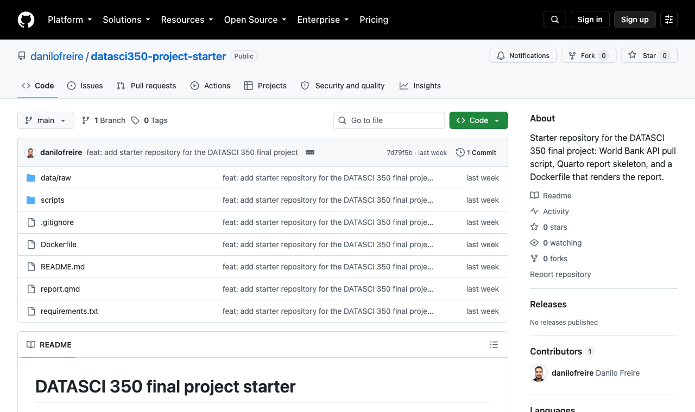
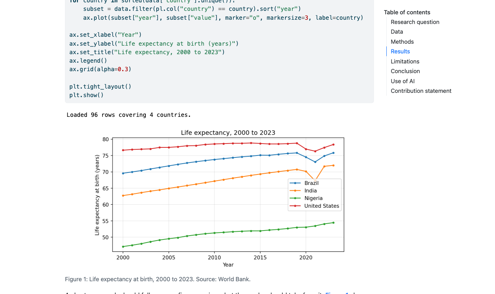
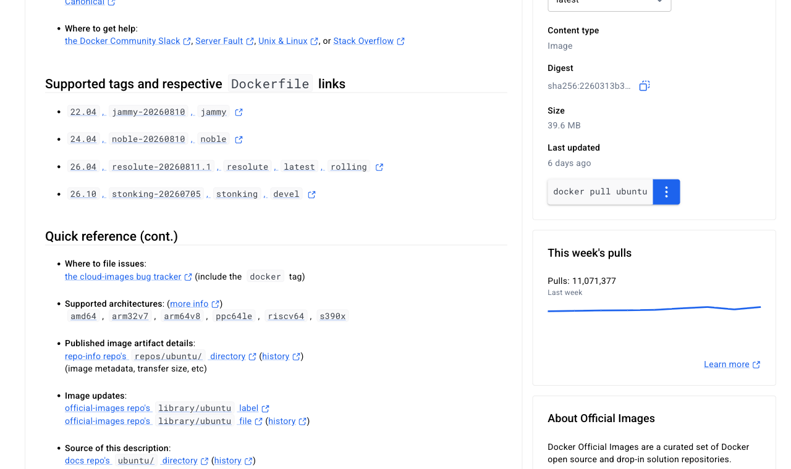
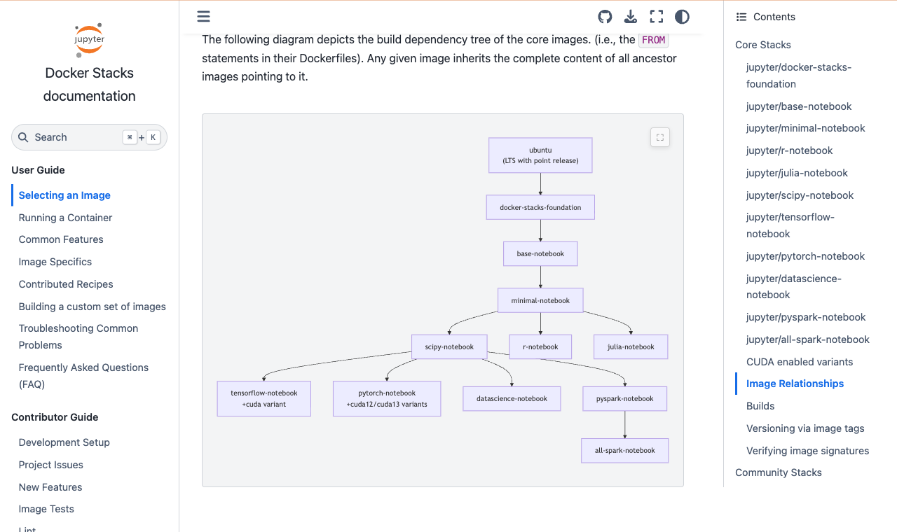
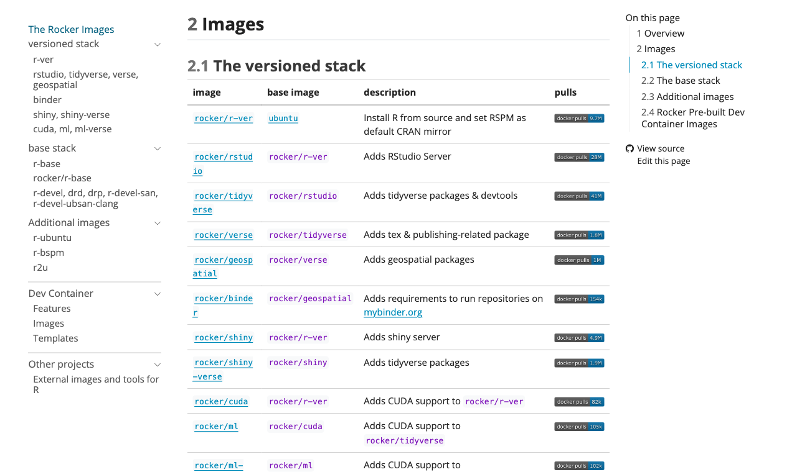
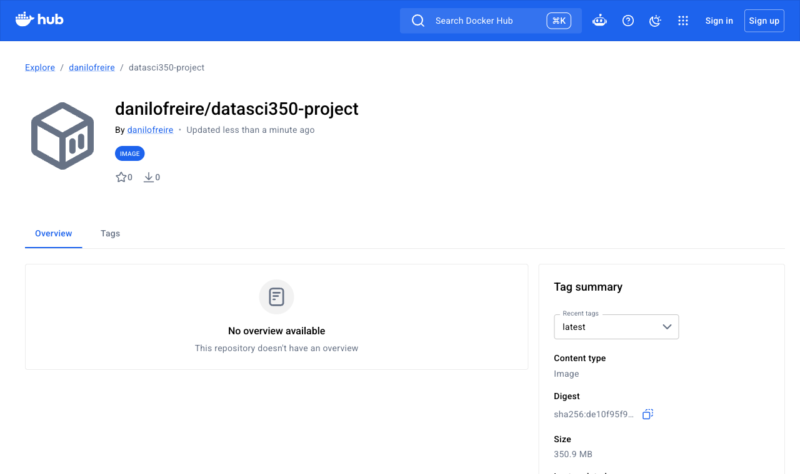

# Hello again! 😊 {background-color="#1B3A6B"}

# Brief recap 📚 {background-color="#1B3A6B"}

## Dependencies, environments, and containers

:::{style="margin-top: 40px; font-size: 21px;"}
:::{.columns}
:::{.column width="54%"}
- We [pinned]{.alert} dependencies with `==`
- [`venv`](https://docs.python.org/3/library/venv.html), [`pip`](https://pip.pypa.io/) and [`uv`](https://docs.astral.sh/uv/) gave us an isolated Python
  - The project starter builds one at [`/opt/venv`]{.alert}
- [Docker's three main concepts](https://docs.docker.com/learn/content/what-is-a-container/):
  - An [image]{.alert} is the recipe
  - A [container]{.alert} is a running instance
  - A [registry]{.alert} is where images live
- A [six-instruction Dockerfile]{.alert} from `python:3.14-slim` built in 13 seconds
- The cached rebuild took [less than 1 second]{.alert}
- We pushed it to [`danilofreire/datasci350-example`](https://hub.docker.com/r/danilofreire/datasci350-example) on [Docker Hub](https://hub.docker.com/)
- [Today we install Quarto in the image and render a report]{.alert}
:::

:::{.column width="46%"}
- What we did last time:

:::{style="font-size: 20px;"}
```text
docker build -t datasci350-example .

#5 [1/5] FROM docker.io/library/python:3.14-slim
#5 DONE 0.0s
#6 [2/5] WORKDIR /app
#6 CACHED
#7 [3/5] COPY requirements.txt .
#7 CACHED
#8 [4/5] RUN pip install --no-cache-dir -r
    requirements.txt
#8 CACHED
#9 [5/5] COPY hello.py .
#9 CACHED
#10 exporting to image
#10 DONE 0.1s
```
:::

- I built today's image before class, so it is already on my laptop
:::
:::
:::

## The Dockerfile from Lecture 23

:::{style="margin-top: 40px; font-size: 21px;"}
:::{.columns}
:::{.column width="58%"}
:::{style="font-size: 23px;"}
```dockerfile
# Start from an official Python image
FROM python:3.14-slim

# Create /app inside the image and move into it
WORKDIR /app

# Copy requirements.txt from your computer
# into /app (the "."), then install it
COPY requirements.txt .
RUN pip install --no-cache-dir -r requirements.txt

# Copy hello.py from your computer into /app
COPY hello.py .

# The command that runs when the container starts
CMD ["python", "hello.py"]
```

```text
# Build an image called datasci350-example
# from the files in this folder
docker build -t datasci350-example .

# Start a container from the image, and
# delete the container when it exits
docker run --rm datasci350-example
```
:::
:::

:::{.column width="42%"}
- `FROM` picks the base image, here [Python 3.14 on a slim Debian Linux](https://hub.docker.com/_/python)
  - Base images live on [Docker Hub](https://hub.docker.com/), where you can search for one
- `WORKDIR` creates `/app` and runs every later step inside it
- `COPY` brings a file from your folder into the image
- `RUN` executes a command while the image is built
- `CMD` sets the command the container runs when it starts
- `requirements.txt` is copied before `hello.py`, so editing the script does not reinstall the packages
- Today's Dockerfile adds `ENV`, which sets a variable such as `PATH`, and `SHELL`, which picks the shell for `RUN`
:::
:::
:::

# Today's agenda {background-color="#1B3A6B"}

## Lecture overview

:::{style="margin-top: 40px; font-size: 24px;"}
:::{.columns}
:::{.column width="50%"}
[1. The project starter]{.alert}

- How I will grade your container
- Why `data/raw/` is in the repository

[2. The Dockerfile]{.alert}

- What each line of the Dockerfile does
- How long the first build takes

[3. Run, change, rebuild]{.alert}

- Use `-v` to get the report out
- Why rebuilds take under a second
:::

:::{.column width="50%"}
[4. When something goes wrong]{.alert}

- I break the project twice and fix it
- Open a shell inside a container
- Clean up old images

[5. Beyond one Dockerfile]{.alert}

- Ready-made images for Python and R
- Share your image on Docker Hub
:::
:::
:::

# The project starter {background-color="#1B3A6B"}

## How I will grade your container
### Test it yourself before you submit

:::{style="margin-top: 40px; font-size: 22px;"}
:::{.columns}
:::{.column width="54%"}
- [The commands I run:]{.alert}

:::{style="margin-top: 20px; margin-bottom: 20px; font-size: 27px;"}
```text
git clone <your repo url> fresh-test
cd fresh-test
docker build -t datasci350-project .
docker run --rm \
  -v "$(pwd)/output:/project/output" \
  datasci350-project
open output/report.html
```
:::

- I only have Docker installed, so your image must bring everything else
- These commands are [30% of the project grade]{.alert}
- Run them on your own repository first
:::

:::{.column width="46%"}
- The rubric (page 5 of [project-instructions.pdf](https://github.com/danilofreire/datasci350/blob/main/project/project-instructions.pdf)):

:::{style="text-align: center; font-size: 19px; margin-top: 5px; margin-bottom: 5px;"}
| Criterion | Weight |
|:---|:---:|
| Reproducibility: the container builds and the report renders from a clean `docker run` | 30% |
| Analysis quality: the research question, the method, the interpretation | 30% |
| Communication: clarity of the writing and the visualisations | 20% |
| Code quality: organised, readable, no dead code | 10% |
| Git workflow: meaningful commits from all members, sensible repository structure | 10% |
:::

:::{style="background: rgba(230, 57, 70, 0.1); padding: 12px; border-radius: 10px; font-size: 19px; margin-top: 5px;"}
Run the pull script once and commit `data/raw/`. If `report.qmd` calls the API itself, it fails whenever the API is down
:::
:::
:::
:::

## The starter repository

:::{style="margin-top: 40px; font-size: 20px;"}
:::{.columns}
:::{.column width="50%"}
- Clone it from [github.com/danilofreire/datasci350-project-starter](https://github.com/danilofreire/datasci350-project-starter):

:::{style="font-size: 23px; margin-bottom: 20px;"}
```text
datasci350-project-starter/
├── Dockerfile
├── .dockerignore
├── requirements.txt
├── report.qmd
├── README.md
├── .gitignore
├── .gitattributes
├── data/
│   └── raw/
│       ├── life_expectancy.csv
│       └── life_expectancy_raw.json
└── scripts/
    └── pull_data.py
```
:::

- Only `scripts/pull_data.py` calls the API. `report.qmd` reads the saved files in `data/raw/`
:::

:::{.column width="50%"}
:::{style="text-align: center; font-size: 17px; margin-top: 0px; margin-bottom: 10px;"}
| Path | What it does |
|---|---|
| `scripts/pull_data.py` | Calls the World Bank API once and saves the response |
| `data/raw/` | The saved snapshot, committed on purpose |
| `report.qmd` | The Quarto report, with headings that follow the rubric |
| `requirements.txt` | The pinned Python packages |
| `Dockerfile` | The instructions that build the image |
| `.dockerignore` | What stays out of the image |
| `.gitattributes` | Keeps Linux line endings inside the container |
:::

:::{style="text-align: center; margin-top: 10px;"}
[{width="58%"}](#){data-modal-type="image" data-modal-url="figures/starter-repo-github-2026.png"}

<https://github.com/danilofreire/datasci350-project-starter>
:::
:::
:::
:::

## The pull script and the saved data

:::{style="margin-top: 40px; font-size: 24px;"}
:::{.columns}
:::{.column width="52%"}
- Run the pull script once on your laptop. It downloads the data from the World Bank API:

```text
python scripts/pull_data.py
```

- It saves two files in `data/raw/`: the raw JSON and a tidy CSV
- The CSV has [96 rows]{.alert}: four countries, 2000 to 2023

```text
head -5 data/raw/life_expectancy.csv

country_code,country,indicator,year,value
BRA,Brazil,SP.DYN.LE00.IN,2000,69.584
BRA,Brazil,SP.DYN.LE00.IN,2001,69.98
BRA,Brazil,SP.DYN.LE00.IN,2002,70.396
BRA,Brazil,SP.DYN.LE00.IN,2003,70.884
```
:::

:::{.column width="48%"}
- Life expectancy is only an example. Change the indicator, countries and years at the top of `scripts/pull_data.py`
- Commit both files, so the report uses the same data on every machine
- The raw JSON lets you fix a tidying mistake without calling the API again

:::{style="background: rgba(230, 57, 70, 0.1); padding: 15px; border-radius: 10px; font-size: 22px; margin-top: 20px;"}
If you add `data/raw/` to `.gitignore`, the build still works. The report fails later, in my clone, because the CSV never reached GitHub: [[see it happen]{.button}](#sec-failure-one)
:::
:::
:::
:::

## `requirements.txt` for a report

:::{style="margin-top: 40px; font-size: 20px;"}
:::{.columns}
:::{.column width="48%"}
- The file, comments and all:

:::{style="font-size: 20px;"}
```text
# Talking to web APIs
requests==2.32.5

# Data processing (use either, or both)
# DuckDB runs SQL over your CSV files and
# hands the answer back as a pandas
# DataFrame when you call .df() on it.
pandas==3.0.5
duckdb==1.5.5

# Plotting
matplotlib==3.10.8

# Quarto needs these to run Python code
# inside report.qmd
ipykernel==7.2.0
jupyter-client==8.8.0
nbclient==0.10.4
nbformat==5.10.4
pyyaml==6.0.3
```
:::
:::

:::{.column width="52%"}
:::{style="text-align: center; font-size: 22px; margin-top: 0px; margin-bottom: 10px;"}
| Package | What it does |
|---|---|
| `requests` | Calls the World Bank API |
| `pandas` | Tidies the data and holds DuckDB's results |
| `duckdb` | Runs SQL on the CSV, as in Lecture 22 |
| `matplotlib` | Draws the figure |
| `ipykernel` | Starts the Python kernel for Quarto |
| `jupyter-client` | Sends your code to the kernel |
| `nbclient`, `nbformat` | Run and save the notebook Quarto builds |
| `pyyaml` | Quarto needs it to run Python code |
:::

- Don't forget the last five! Quarto runs Python through [Jupyter]{.alert}, so the image needs a kernel
- Nine pinned lines produce [53 installed packages]{.alert} inside the image
:::
:::
:::

## What `report.qmd` needs to render

:::{style="margin-top: 40px; font-size: 20px;"}
:::{.columns}
:::{.column width="52%"}
:::{style="font-size: 19px;"}
```python
import duckdb
import matplotlib.pyplot as plt

data = duckdb.sql(
    "SELECT country, year, value "
    "FROM 'data/raw/life_expectancy.csv' "
    "ORDER BY country, year"
).df()

print(f"Loaded {len(data)} rows covering "
      f"{data['country'].nunique()} countries.")

fig, ax = plt.subplots(figsize=(7, 4))
for country, subset in data.groupby("country"):
    ax.plot(subset["year"], subset["value"])
[...]
plt.show()
```
:::

:::{style="text-align: center; margin-top: 5px;"}
[{width="40%"}](#){data-modal-type="image" data-modal-url="figures/starter-report-rendered-2026.png"}
:::
:::{style="font-size: 17px; text-align: center;"}
`output/report.html`
:::

:::

:::{.column width="48%"}
- [Three things]{.alert} the image has to provide:
  - A Python that has `duckdb`, `pandas` and `matplotlib`, and a kernel Quarto can start
  - The `quarto` binary itself
  - The file `data/raw/life_expectancy.csv` at that exact relative path
- `embed-resources: true` puts the figures inside the HTML
  - `output/report.html` is [the single file your container must produce, and the one I grade]{.alert}
- Rendered inside the container, that print statement says `Loaded 96 rows covering 4 countries.`
- The header sets [`echo: true`]{.alert}, which shows your code in the report
  - The rubric asks for visible code, so leave that setting alone
:::
:::
:::

# The Dockerfile 🐳 {background-color="#1B3A6B"}

## The whole `Dockerfile` {#sec-whole-dockerfile}

:::{style="margin-top: 40px; font-size: 20px;"}
:::{.columns}
:::{.column width="56%"}
:::{style="font-size: 20px;"}
```dockerfile
# 1. Base image
FROM ubuntu:24.04

# 2. Environment and shell
ENV DEBIAN_FRONTEND=noninteractive
SHELL ["/bin/bash", "-c"]

# 3. System packages
RUN apt-get update && apt-get install -y [...]

# 4. Quarto
RUN ARCH=$(dpkg --print-architecture) && [...]

# 5. Python environment
RUN python3 -m venv /opt/venv
ENV PATH="/opt/venv/bin:$PATH"
COPY requirements.txt /project/requirements.txt
RUN pip install --no-cache-dir -r /project/requirements.txt

# 6. Project files
WORKDIR /project
COPY . /project

# 7. Default command
ENV QUARTO_PYTHON=/opt/venv/bin/python
CMD ["bash", "-c", "quarto render report.qmd && [...]"]
```
:::
:::

:::{.column width="44%"}
- [13 instructions]{.alert} in seven blocks
- The build log numbers eight of them, `[1/8]` to `[8/8]`
- `ENV`, `SHELL` and `CMD` only record settings, so they get no number
- The real file has a comment above every line. Read them before you change anything
- Lecture 23's file ran one script. This one installs Ubuntu packages, Quarto and a Python environment

:::{style="text-align: center; margin-top: 12px;"}
[[Full listing]{.button}](#sec-appendix-03)
:::
:::
:::
:::

## Blocks 1 and 2: `FROM`, `ENV`, `SHELL`

:::{style="margin-top: 40px; font-size: 20px;"}
:::{.columns}
:::{.column width="52%"}
:::{style="font-size: 20px;"}
```dockerfile
# We pin the tag to "24.04" rather than "latest".
# "latest" changes over time, and a base image
# that changes breaks reproducibility.
FROM ubuntu:24.04

# DEBIAN_FRONTEND=noninteractive stops apt-get
# from asking questions during the build.
# Nobody is at the keyboard to answer them.
ENV DEBIAN_FRONTEND=noninteractive

# Use bash for the RUN steps below. Docker uses
# the simpler "sh" shell by default.
SHELL ["/bin/bash", "-c"]
```
:::

- `ubuntu:latest` meant 24.04 last year and means [26.04]{.alert} today, so we pin the tag
- `tzdata` is the Ubuntu package that would otherwise stop and ask you for a time zone
- `ubuntu:24.04` is a [29MB]{.alert} download, 108MB once unpacked
:::

:::{.column width="48%"}
:::{style="text-align: center; margin-top: -10px;"}
[{width="46%"}](#){data-modal-type="image" data-modal-url="figures/docker-hub-ubuntu-2026.png"}
:::
:::{style="font-size: 17px; text-align: center;"}
[hub.docker.com/_/ubuntu](https://hub.docker.com/_/ubuntu)
:::

- `ENV` also applies when the container runs
- `SHELL` makes every later `RUN` use `bash`, and `-c` passes it a string of commands
- The `ubuntu` image has no Python, so block 3 installs it
- Quarto ships as a `.deb` file, which needs a Debian-based system like Ubuntu
:::
:::
:::

## Block 3: `RUN apt-get install`

:::{style="margin-top: 40px; font-size: 20px;"}
:::{.columns}
:::{.column width="52%"}
:::{style="font-size: 20px;"}
```dockerfile
RUN apt-get update && apt-get install -y --no-install-recommends \
    ca-certificates \
    wget \
    git \
    python3.12 \
    python3.12-venv \
    python3-pip && \
    apt-get clean && rm -rf /var/lib/apt/lists/*
```
:::

- One `RUN` is one [layer]{.alert}
  - Six `RUN` lines here would give six layers and a bigger image
- Clean up [in the same `RUN`]{.alert}: a later layer cannot shrink an earlier one
- `--no-install-recommends` skips optional extras
- This step took [less than a minute]{.alert}
:::

:::{.column width="48%"}
:::{style="text-align: center; font-size: 22px; margin-top: 0px; margin-bottom: 50px;"}
| Package | Why |
|---|---|
| `ca-certificates` | HTTPS downloads fail without it |
| `wget` | Fetches the Quarto `.deb` |
| `git` | Some Quarto extensions want it |
| `python3.12` | The interpreter, version 3.12.3 here |
| `python3.12-venv` | Ubuntu ships `venv` separately |
| `python3-pip` | Installs into the virtual environment |
:::
:::
:::
:::

## Block 4: Quarto

:::{style="margin-top: 40px; font-size: 20px;"}
:::{.columns}
:::{.column width="54%"}
:::{style="font-size: 20px;"}
```dockerfile
RUN ARCH=$(dpkg --print-architecture) && \
    wget -q "https://github.com/quarto-dev/quarto-cli/releases/download/v1.10.18/quarto-1.10.18-linux-${ARCH}.deb" && \
    apt-get update && \
    apt-get install -y --no-install-recommends ./quarto-1.10.18-linux-${ARCH}.deb && \
    rm quarto-1.10.18-linux-${ARCH}.deb && \
    apt-get clean && rm -rf /var/lib/apt/lists/*
```
:::

- Quarto is not in Ubuntu's package list, so we download the `.deb` from GitHub

:::{style="font-size: 20px;"}
```text
#7 91.74 Setting up quarto (1.10.18) ...
#7 DONE 92.0s
```
:::

- [92 seconds]{.alert}, the slowest step in the build
- `./` tells apt to install the downloaded file, not search its list
- `apt-get update` runs again because block 3 deleted the package lists
:::

:::{.column width="46%"}
- The version [1.10.18]{.alert} is written out, so everyone builds the same image
  - It appears four times in this step. Change all four to update Quarto
- `dpkg --print-architecture` gives `arm64` on a Mac and `amd64` on most Windows and Linux laptops, so each downloads the right file
- My laptop has Quarto 1.9.38, but your report renders with the image's [1.10.18]{.alert}
:::
:::
:::

## Block 5: the virtual environment and `pip` {#sec-block-5}

:::{style="margin-top: 40px; font-size: 20px;"}
:::{.columns}
:::{.column width="52%"}
:::{style="font-size: 20px;"}
```dockerfile
# Ubuntu protects its own Python installation,
# so we create a virtual environment at
# /opt/venv and install our packages there.
RUN python3 -m venv /opt/venv

# PATH tells the shell where to look for
# programs. Putting /opt/venv/bin first means
# "python" and "pip" refer to the virtual
# environment, without activating it by hand.
ENV PATH="/opt/venv/bin:$PATH"

# We copy requirements.txt on its own, before
# the rest of the project.
COPY requirements.txt /project/requirements.txt
RUN pip install --no-cache-dir -r /project/requirements.txt
```
:::

- [`ENV PATH`]{.alert} replaces Lecture 23's `source .venv/bin/activate`
- Ubuntu blocks a system-wide `pip install` with [`externally-managed-environment`]{.alert}, so we use a virtual environment: [[Appendix 02]{.button}](#sec-appendix-02)
:::

:::{.column width="48%"}
- `COPY` puts your `requirements.txt` inside the image, and `pip` installs from that copy
- `--no-cache-dir` keeps pip's downloads out of the image
- The install took [less than a minute]{.alert} and produced 53 packages
- `COPY requirements.txt` comes before `COPY . /project`, so editing `report.qmd` does not rerun this step
:::
:::
:::

## Blocks 6 and 7: `WORKDIR`, `COPY .`, `CMD`

:::{style="margin-top: 40px; font-size: 20px;"}
:::{.columns}
:::{.column width="54%"}
:::{style="font-size: 19px;"}
```dockerfile
# WORKDIR sets the folder that later
# instructions run inside.
WORKDIR /project

# Copy everything else from your repository into
# the image, including report.qmd and the saved
# data snapshot in data/raw/.
# The .dockerignore file next to this one lists
# what stays out.
COPY . /project

# QUARTO_PYTHON points Quarto at the virtual
# environment's Python.
ENV QUARTO_PYTHON=/opt/venv/bin/python
CMD ["bash", "-c", "quarto render report.qmd && mkdir -p output && cp -a report.html output/ && echo 'Rendered report is in output/report.html'"]
```
:::
:::

:::{.column width="46%"}
- `COPY . /project` copies the folder you build from, the `.` in `docker build`
  - The next slide shows what stays out
- `QUARTO_PYTHON` tells Quarto which Python to use
- The `CMD` joins [four commands]{.alert} with `&&`: render, create `output/`, copy the report there, print a message
- Quarto renders in `/project` first, because it cannot clear a folder mounted from your laptop
- The `CMD` list starts with `bash`, which gives us the shell that `&&` needs
:::
:::
:::

## `.dockerignore`

:::{style="margin-top: 40px; font-size: 19px;"}
:::{.columns}
:::{.column width="50%"}
:::{style="font-size: 19px;"}
```text
# Version control
.git

# Python environments and caches
.venv/
venv/
__pycache__/

# API keys never enter the image
.env

# Quarto working files and rendered output
.quarto/
*.quarto_ipynb
report.html
report_files/
output/

# Operating system clutter
.DS_Store

# NOTE: data/raw/ is deliberately absent. The
# snapshot must reach the image, because
# report.qmd reads it.
```
:::
- Save it next to your `Dockerfile` and commit it
:::

:::{.column width="50%"}
- Before it builds, Docker sends your folder (the [build context]{.alert}) to the engine. The same folder, with and without the file:

:::{style="font-size: 20px;"}
```text
=== WITHOUT .dockerignore ===
#3 load .dockerignore:      2B done
#5 load build context:      1.42MB done

=== WITH .dockerignore ===
#3 load .dockerignore:      578B done
#5 load build context:      59.36kB done
```
:::

- [1.42MB down to 59.36kB]{.alert}, with `.git` and the rendered report left out
- `.gitignore` keeps files out of Git, and `.dockerignore` keeps them out of the image
  - [Never list `data/raw/` in either file]{.alert}
- Without `report.html` in the list, every render breaks the cache on `COPY . /project`
:::
:::
:::

## The first build

:::{style="margin-top: 40px; font-size: 20px;"}
:::{.columns}
:::{.column width="54%"}
:::{style="font-size: 18px;"}
```text
time docker build --no-cache --progress=plain -t datasci350-project .

#5 [1/8] FROM docker.io/library/ubuntu:24.04
#5 CACHED
#6 [2/8] RUN apt-get update && apt-get install [...]
#6 DONE 36.0s
#7 [3/8] RUN ARCH=$(dpkg --print-architecture) [...]
#7 91.74 Setting up quarto (1.10.18) ...
#7 DONE 92.0s
#8 [4/8] RUN python3 -m venv /opt/venv
#8 DONE 1.3s
#9 [5/8] COPY requirements.txt /project/requirements.txt
#9 DONE 0.0s
#10 [6/8] RUN pip install --no-cache-dir -r [...]
#10 50.70 Successfully installed asttokens-3.0.2 [...]
#10 DONE 51.4s
#11 [7/8] WORKDIR /project
#11 DONE 0.1s
#12 [8/8] COPY . /project
#12 DONE 0.1s
#13 exporting to image
#13 DONE 10.5s

docker build [...]  3:11.77 total
```
:::
- `--progress=plain` prints the full log. Use it when a build fails
:::

:::{.column width="46%"}
- `--no-cache` runs every step again, which is how I timed it
- The log has eight numbered steps, one per layer
- Quarto ([92s]{.alert}), pip ([51s]{.alert}) and apt ([36s]{.alert}) take most of the time
- `[1/8]` says `CACHED` because Ubuntu was already on my laptop. Its first download took 38.6 seconds
- Total: [about 3 minutes]{.alert}

:::{style="font-size: 18px;"}
```text
docker images datasci350-project
IMAGE                      DISK USAGE  CONTENT SIZE
datasci350-project:latest      1.52GB         347MB
```
:::

- An amd64 laptop downloads amd64 files and gets the same report
:::
:::
:::

## `docker history` shows the size of each layer

:::{style="margin-top: 40px; font-size: 20px;"}
:::{.columns}
:::{.column width="54%"}
:::{style="font-size: 20px;"}
```text
docker history --format "{{.Size}}\t{{.CreatedBy}}" \
  datasci350-project

0B       CMD ["bash" "-c" "quarto render [...]
0B       ENV QUARTO_PYTHON=/opt/venv/bin/python
81.9kB   COPY . /project
0B       WORKDIR /project
421MB    RUN pip install --no-cache-dir -r [...]
4.1kB    COPY requirements.txt [...]
0B       ENV PATH=/opt/venv/bin:/usr/local/sbin:[...]
15.6MB   RUN python3 -m venv /opt/venv
459MB    RUN ARCH=$(dpkg --print-architecture) [...]
169MB    RUN apt-get update && apt-get install [...]
0B       SHELL [/bin/bash -c]
0B       ENV DEBIAN_FRONTEND=noninteractive
108MB    ADD file:0387b3d029de8fa08[...] in /
0B       [...]
```
:::
:::

:::{.column width="46%"}
- `docker history` lists one row per [layer]{.alert}, newest at the top
- [Quarto]{.alert} is the biggest layer at 459MB, ahead of pip's 421MB
  - apt adds 169MB, and the `ubuntu:24.04` base is only 108MB
- `ENV`, `SHELL` and `CMD` only set metadata. `WORKDIR` gets a step number but adds 0B
- A `CACHED` step skips the download as well as the work
- `docker images` reports 1.52GB on disk and 347MB content, because content size is measured compressed
:::
:::
:::

# Run, change, rebuild {background-color="#1B3A6B"}

## Running the container {#sec-run}

:::{style="margin-top: 40px; font-size: 20px;"}
:::{.columns}
:::{.column width="54%"}
:::{style="font-size: 20px;"}
```text
time docker run --rm \
  -v "$(pwd)/output:/project/output" \
  datasci350-project

Starting python3 kernel...Done

Executing 'report.quarto_ipynb'
  Cell 1/1: 'fig-demo'...Done
[...]
Output created: report.html

Rendered report is in output/report.html
docker run [...]  3.237 total

ls -la output

-rw-r--r--  1 dafreir  staff  1314625  report.html
```
:::

- It takes three seconds, because the slow work happened during the build
:::

:::{.column width="46%"}
:::{style="text-align: center; font-size: 22px; margin-top: 0px; margin-bottom: 10px;"}
| Part | What it does |
|---|---|
| `--rm` | Deletes the container when it exits |
| `-v host:container` | Connects a folder on your machine to one inside the container |
| `datasci350-project` | The image to start |
:::

- [`-v`]{.alert} (volume): your laptop's folder goes left of the colon, the container's on the right
- `$(pwd)` is your current folder. Use `${PWD}` in PowerShell or `%cd%` in the old Windows terminal
- Recent Docker also accepts `-v ./output:...`
- [`--rm`]{.alert} deletes the container as soon as it finishes
- Only the report survives, because it was saved to the mounted folder
:::
:::
:::

## Forgetting the mount

:::{style="margin-top: 40px; font-size: 20px;"}
:::{.columns}
:::{.column width="52%"}
:::{style="font-size: 20px;"}
```text
docker run --rm datasci350-project

[...]
Output created: report.html

Rendered report is in output/report.html

ls output
ls: output: No such file or directory
exit code: 1
```
:::

- The render worked, but the report stayed inside the container
- `--rm` then deleted the container, and the report with it
:::

:::{.column width="48%"}
- Listing `output/` inside the container shows the report was there:

:::{style="font-size: 20px;"}
```text
docker run --rm datasci350-project bash -c \
  "quarto render report.qmd >/dev/null 2>&1 \
   && mkdir -p output && cp report.html output/ \
   && ls -la output"

-rw-r--r-- 1 root root [...] report.html
```
:::

- `>/dev/null 2>&1` hides Quarto's messages, so only the file listing shows
- This is the most common Docker mistake in the course, and Docker gives no warning

:::{style="background: rgba(230, 57, 70, 0.1); padding: 15px; border-radius: 10px; font-size: 19px; margin-top: 15px;"}
Without `-v`, the report is deleted with the container. After every run, check `ls output` and the file's timestamp
:::
:::
:::
:::

## Rebuilding after a one-line change {#sec-rebuild}

:::{style="margin-top: 40px; font-size: 20px;"}
:::{.columns}
:::{.column width="52%"}
- I changed the title in `report.qmd` and built again:

:::{style="font-size: 20px;"}
```text
time docker build --progress=plain -t datasci350-project .

#4 transferring context: 4.95kB done
#5 [1/8] FROM docker.io/library/ubuntu:24.04
#5 DONE 0.0s
#6 [3/8] RUN ARCH=$(dpkg --print-architecture) [...]
#6 CACHED
#7 [2/8] RUN apt-get update && apt-get install [...]
#7 CACHED
#8 [5/8] COPY requirements.txt /project/requirements.txt
#8 CACHED
#9 [4/8] RUN python3 -m venv /opt/venv
#9 CACHED
#10 [6/8] RUN pip install --no-cache-dir -r [...]
#10 CACHED
#11 [7/8] WORKDIR /project
#11 CACHED
#12 [8/8] COPY . /project
#12 DONE 0.0s

docker build [...]  0.666 total
```
:::
:::

:::{.column width="48%"}
- Seven steps cached and one rebuilt: [less than 1 second]{.alert}, against about 3 minutes cold
- Only `report.qmd` changed, so only `COPY . /project` ran again
- `pip install` stayed cached, because `requirements.txt` did not change
- The `[n/8]` labels show the real order. The `#` numbers are just log IDs
- Change `requirements.txt` instead, and the cache misses at `[5/8]`, so pip and every later step run again
- Rebuild after every edit. It takes a second and keeps the image up to date

:::{style="text-align: center; margin-top: 12px;"}
[[Try it yourself]{.button}](#sec-exercise-01)
:::
:::
:::
:::

# When something goes wrong ⚠️ {background-color="#1B3A6B"}

## Failure one: the data is not in the repository {#sec-failure-one}

:::{style="margin-top: 40px; font-size: 20px;"}
:::{.columns}
:::{.column width="52%"}
- I added `data/raw/` to `.gitignore`, committed, and cloned the repository into a new folder:

:::{style="font-size: 20px;"}
```text
ls data
ls: data: No such file or directory

git ls-files data/raw
(nothing)

docker build -t datasci350-project-nodata .
#13 DONE 0.2s
```
:::

- [The build succeeded]{.alert}, because the Dockerfile never mentions the CSV
- It fails only when you run it

:::{style="background: rgba(230, 57, 70, 0.1); padding: 15px; border-radius: 10px; font-size: 19px; margin-top: 10px;"}
Always test from a fresh clone. Your own folder still has the files you forgot to commit
:::
:::

:::{.column width="48%"}
- The run, with the traceback trimmed:

:::{style="font-size: 19px;"}
```text
docker run --rm -v "$(pwd)/output:/project/output" \
  datasci350-project-nodata
Starting python3 kernel...Done
Executing 'report.quarto_ipynb'
  Cell 1/1: 'fig-demo'...

An error occurred while executing the following cell:
[...]
data = duckdb.sql("SELECT country, year, value "
  "FROM 'data/raw/life_expectancy.csv' [...]").df()
[...]
IOException: IO Error: No files found that match
the pattern "data/raw/life_expectancy.csv"

WARN: Error encountered when rendering files
exit code: 1
```
:::

- Fix it with `git add data/raw/` and `git commit`
- `git ls-files data/raw` should then print two file names
:::
:::
:::

## Failure two: a pin that does not exist

:::{style="margin-top: 40px; font-size: 20px;"}
:::{.columns}
:::{.column width="54%"}
- I changed `duckdb==1.5.5` to `duckdb==1.5.9` and built:

:::{style="font-size: 19px;"}
```text
#10 [6/8] RUN pip install --no-cache-dir -r [...]
#10 0.818 Collecting pandas==3.0.5 [...]
#10 1.302 ERROR: Could not find a version that
    satisfies the requirement duckdb==1.5.9
    (from versions: [...] 1.5.4, 1.5.5, 1.5.6.dev36,
    1.6.0.dev379, 2.0.0.dev2609121639)
#10 1.302 ERROR: No matching distribution found
    for duckdb==1.5.9

Dockerfile:85
--------------------
  84 |     COPY requirements.txt /project/requirements.txt
  85 | >>> RUN pip install --no-cache-dir -r /project/requirements.txt
--------------------
ERROR: failed to build: failed to solve: process
"/bin/bash -c pip install [...]" did not complete
successfully: exit code: 1
```
:::
:::

:::{.column width="46%"}
- The error tells you three things:
  - `[6/8]` is the step that failed
  - `Dockerfile:85` and the `>>>` marker point to the line
  - The message above them comes from pip
- No image is created
- Steps `[1/8]` to `[5/8]` stay cached, so the fix only reruns pip
- Check that a version exists before you pin it:

:::{style="font-size: 20px;"}
```text
pip index versions duckdb

duckdb (1.5.5)
Available versions: 1.5.5, 1.5.4, 1.5.3, [...]
  INSTALLED: 1.5.5
  LATEST:    1.5.5
```
:::
:::
:::
:::

## Inspecting a container that misbehaves

:::{style="margin-top: 40px; font-size: 20px;"}
:::{.columns}
:::{.column width="52%"}
- Anything after the image name replaces the `CMD`. Here, `bash` opens a shell instead of rendering:

```text
docker run --rm -it datasci350-project bash
```

- Then look around as on any Linux machine:

:::{style="font-size: 20px;"}
```text
quarto --version
1.10.18

which python
/opt/venv/bin/python

python -c "import pandas, duckdb, matplotlib; \
  print(pandas.__version__, duckdb.__version__, \
        matplotlib.__version__)"
3.0.5 1.5.5 3.10.8

ls data/raw
life_expectancy.csv
life_expectancy_raw.json

pwd
/project

whoami
root
```
:::
:::

:::{.column width="48%"}
- Check which Quarto, Python and packages you have, and whether the data is there
- `-it` opens an [interactive session]{.alert}: `-i` keeps input open and `-t` gives you a terminal
- `docker exec -it <container> bash` opens a shell in a container that is already running
- Anything you install inside is lost when you exit. Fix `requirements.txt` and rebuild instead
- `docker logs <container>` shows the output of a container running in the background
:::
:::
:::

## Cleaning up

:::{style="margin-top: 40px; font-size: 20px;"}
:::{.columns}
:::{.column width="52%"}
```text
$ docker ps -a
CONTAINER ID   IMAGE         STATUS
5594bb583fbd   hello-world   Exited (0) 2 hours ago

$ docker system df
TYPE          TOTAL  ACTIVE  SIZE      RECLAIMABLE
Images        7      1       10.88GB   4.029GB (37%)
Containers    1      0       0B        0B
Build Cache   37     0       3.046GB   1.403GB

$ docker rm 5594bb583fbd
$ docker rmi datasci350-project-nodata
[...]
$ docker system prune
[...]
Total reclaimed space: 1.931GB

$ docker system df
Images        4      0       3.217GB   1.97GB (61%)
Containers    0      0       0B        0B
Build Cache   8      0       1.643GB   0B
```

- One project image takes [1.52GB]{.alert}. A few failed builds can reach 10GB
- Docker never deletes images by itself
:::

:::{.column width="48%"}
:::{style="text-align: center; font-size: 17px; margin-top: 0px; margin-bottom: 10px;"}
| Command | What it removes |
|---|---|
| `docker ps -a` | Nothing, it lists all containers |
| `docker rm <id>` | One stopped container |
| `docker rmi <image>` | One image |
| `docker system df` | Nothing, it reports what is using space (`df` = disk free) |
| `docker system prune` | Stopped containers, unused networks, dangling images, build cache |
| `docker system prune -a` | All of the above plus [every image not in use]{.alert} |
:::

- The ID comes from `docker ps -a`, and the first few characters are enough
- A [dangling image]{.alert} has no tag. Rebuilding a tag leaves the old image behind
- `docker run --rm` keeps old containers from piling up

:::{style="background: rgba(230, 57, 70, 0.1); padding: 15px; border-radius: 10px; font-size: 19px; margin-top: 5px;"}
`docker system prune -a` deletes every image no running container is using. Read the prompt before you type `y`
:::
:::
:::
:::

# Beyond one Dockerfile {background-color="#1B3A6B"}

## Ready-made images

:::{style="margin-top: 30px; font-size: 19px;"}
:::{.columns}
:::{.column width="52%"}
- The [Jupyter Docker Stacks](https://jupyter-docker-stacks.readthedocs.io/) are official images with JupyterLab and Python packages, hosted on [Quay.io](https://quay.io/organization/jupyter)
- `scipy-notebook` takes [5.28GB]{.alert} on disk
- It includes NumPy, pandas, SciPy, scikit-learn and matplotlib
- Start it and open the URL it prints, on port 8888:

:::{style="font-size: 20px;"}
```text
docker run --rm -p 8888:8888 \
  quay.io/jupyter/scipy-notebook
[...]
Executing: jupyter lab
Jupyter Server 2.20.0 is running at:
http://localhost:8888/lab?token=d59aac5d7a7e...
Serving notebooks from local directory:
  /home/jovyan
```
:::

- [rocker](https://rocker-project.org/) offers the same for R: `r-ver`, `rstudio`, `tidyverse`, `verse`, `geospatial`
:::

:::{.column width="48%"}
:::{style="text-align: center; margin-top: -10px;"}
[{width="40%"}](#){data-modal-type="image" data-modal-url="figures/jupyter-docker-stacks-2026.png"}
:::
:::{style="font-size: 17px; text-align: center;"}
Like our project, `scipy-notebook` starts `FROM` Ubuntu, with a few smaller Jupyter images in between. [Docs](https://jupyter-docker-stacks.readthedocs.io/en/latest/using/selecting.html)
:::

:::{style="text-align: center; margin-top: 8px;"}
[{width="40%"}](#){data-modal-type="image" data-modal-url="figures/rocker-images-2026.png"}
:::
:::{style="font-size: 17px; text-align: center;"}
[rocker-project.org](https://rocker-project.org/images/)
:::

:::
:::

:::{style="background: rgba(27, 58, 107, 0.08); padding: 12px; border-radius: 10px; font-size: 19px; margin-top: 0px; text-align: center;"}
For the project, write your own Dockerfile. A 5GB image to read one CSV is far more than you need
:::
:::

## Where to put a built image

:::{style="margin-top: 40px; font-size: 20px;"}
:::{.columns}
:::{.column width="52%"}
- The [`buildx`](https://docs.docker.com/build/building/multi-platform/) command builds for both chip types and pushes the image:

:::{style="font-size: 20px;"}
```text
docker buildx build --platform linux/amd64,linux/arm64 \
  -t danilofreire/datasci350-project:latest --push .

[...]
 => => pushing manifest for docker.io/danilofreire/
    datasci350-project:latest@sha256:3136ee8fff92...
```
:::

- Docker Hub keeps one image per chip: [334 MB for amd64, 331 MB for arm64]{.alert}
- Anyone with Docker can then pull and run it, with no build
- [You don't need to push for the project]{.alert}. I build your image from your repository
- A pushed image also freezes today's Ubuntu package versions
:::

:::{.column width="48%"}
:::{style="text-align: center; margin-top: -10px;"}
[{width="90%"}](#){data-modal-type="image" data-modal-url="figures/docker-hub-project-2026.png"}
:::
:::{style="font-size: 17px; text-align: center;"}
[hub.docker.com/r/danilofreire/datasci350-project](https://hub.docker.com/r/danilofreire/datasci350-project)

:::
:::
:::
:::

## Try it yourself at home {#sec-exercise-01}

:::{style="margin-top: 40px; font-size: 20px;"}
:::{.columns}
:::{.column width="54%"}
Use your clone of the starter. Step 2 takes about a minute

1. Add `seaborn==0.13.2` under `duckdb==1.5.5` in `requirements.txt`
2. Run `docker build -t datasci350-project .`
3. Read the log. Note which steps say `CACHED`
4. In the demo chunk of `report.qmd`, add `import seaborn as sns` under `import duckdb`
5. Add `print(f"seaborn {sns.__version__}")` under the `Loaded` print
6. Build again, then run `docker run --rm -v "$(pwd)/output:/project/output" datasci350-project`
7. Open `output/report.html` and find the line `seaborn 0.13.2`

:::{style="margin-top: 12px;"}
Solution and captured output: [[Appendix 01]{.button}](#sec-appendix-01)
:::
:::

:::{.column width="46%"}
What to look for:

- Steps `[1/8]` to `[4/8]` stay `CACHED`
- The cache misses at `[5/8]`, because `requirements.txt` changed
- Every later step rebuilds, so `pip install` runs again for [less than a minute]{.alert}
- The second build reruns only `COPY . /project` and takes seconds
- The image grows from [347MB to 348MB]{.alert}, and from 53 packages to 54
:::
:::
:::

# Summary {background-color="#1B3A6B"}

## What we learned today

:::{style="margin-top: 40px; font-size: 20px;"}
:::{.columns}
:::{.column width="50%"}
- The starter has a pull script, the saved data, the report and a `Dockerfile`
- I grade your container with five commands from a fresh clone ([30%]{.alert} of the project)
- The `Dockerfile` has seven blocks, from the base image to `CMD`
- `.dockerignore` keeps `.git`, `output/` and `.env` out of the image
- `COPY requirements.txt` comes before `COPY . /project`, so rebuilds take [less than 1 second]{.alert}
:::

:::{.column width="50%"}
- Without [`-v`]{.alert}, the report is deleted with the container
- If `data/raw/` is not committed, the build works but the run fails
- A pin that does not exist stops the build
- `docker run -it ... bash` lets you look inside the container
- `docker system prune` frees disk space
- [Ready-made images]{.alert} help you explore, and [Docker Hub]{.alert} lets you share
- The appendices have the exercise solution and common errors
:::
:::

:::{style="background: rgba(27, 58, 107, 0.08); padding: 15px; border-radius: 10px; font-size: 20px; margin-top: 15px;"}
If `git clone`, `docker build` and `docker run -v` work from a fresh folder and the report opens, the container part of your project is done
:::
:::

## Next class

:::{style="margin-top: 40px; font-size: 21px;"}
:::{.columns}
:::{.column width="50%"}
No class on [Thursday 26 November]{.alert} (Thanksgiving)

[Lecture 26]{.alert} (1 December) is revision. Bring your repository and questions, and we will build containers together

[Quiz 05]{.alert} (3 December) covers Lectures 21, 22, 23 and 25. [Assignment 10]{.alert} is due the same day

The final project is due on [8 December]{.alert}
:::

:::{.column width="50%"}
Before then:

1. Clone your own repository into a new, empty folder
2. Run the five commands from the grading slide
3. Run `git ls-files data/raw`. It should print two file names
4. Run `git shortlog -sn`. Every group member should appear

:::
:::
:::

# And that's all for today! 🎉 {background-color="#1B3A6B"}

# Appendix 📚 {background-color="#1B3A6B"}

## Appendix 01: Exercise solution {#sec-appendix-01}

:::{style="margin-top: 40px; font-size: 16px;"}
:::{.columns}
:::{.column width="50%"}
[Step 1]{.alert}, in `requirements.txt`:

```text
# Data processing (use either, or both)
pandas==3.0.5
duckdb==1.5.5
seaborn==0.13.2
```

[Steps 4 and 5]{.alert}, in the demo chunk of `report.qmd`:

```python
import duckdb
import seaborn as sns
import matplotlib.pyplot as plt

data = duckdb.sql(
    "SELECT country, year, value "
    "FROM 'data/raw/life_expectancy.csv' "
    "ORDER BY country, year"
).df()

print(f"Loaded {len(data)} rows covering "
      f"{data['country'].nunique()} countries.")
print(f"seaborn {sns.__version__}")
```

[Step 7]{.alert}, in the rendered report:

```text
grep -o "seaborn 0.13.2" output/report.html
seaborn 0.13.2
```

- Undo both edits and rebuild: everything is `CACHED` (2 seconds), back to 347MB and 53 packages
:::

:::{.column width="50%"}
[Steps 2 and 3]{.alert}, the rebuild:

```text
#5 [1/8] FROM docker.io/library/ubuntu:24.04
#5 DONE 0.0s
#6 [3/8] RUN ARCH=$(dpkg --print-architecture) [...]
#6 CACHED
#7 [2/8] RUN apt-get update && apt-get install [...]
#7 CACHED
#8 [4/8] RUN python3 -m venv /opt/venv
#8 CACHED
#9 [5/8] COPY requirements.txt /project/requirements.txt
#9 DONE 0.0s
#10 [6/8] RUN pip install --no-cache-dir -r [...]
#10 18.77 Downloading seaborn-0.13.2-[...].whl (294 kB)
#10 49.45 Successfully installed [...] seaborn-0.13.2 [...]
#10 DONE 50.0s
#11 [7/8] WORKDIR /project
#11 DONE 0.1s
#12 [8/8] COPY . /project
#12 DONE 0.1s

docker build [...]  57.726 total
```

- Four steps cached and four rebuilt, starting at `[5/8]`
- pip reinstalled all 54 packages, not just seaborn

:::{style="margin-top: 0px;"}
[[Back to the exercise]{.button}](#sec-exercise-01)
:::
:::
:::
:::

## Appendix 02: When something goes wrong {#sec-appendix-02}

:::{style="margin-top: 40px; font-size: 18px;"}
:::{.columns}
:::{.column width="50%"}
[`IOException: No files found that match [...] life_expectancy.csv`]{.alert}

`data/raw/` was never committed. Run `git add data/raw/` and commit, then check with `git ls-files data/raw`.

[`No matching distribution found for duckdb==1.5.9`]{.alert}

That version does not exist. Pin one that `pip index versions duckdb` lists.

[`ls: output: No such file or directory`]{.alert}

You forgot `-v`. Add `-v "$(pwd)/output:/project/output"` (`${PWD}` in PowerShell). Linux prints `ls: cannot access 'output'`.

[`error: externally-managed-environment`]{.alert}

You ran `pip install` on Ubuntu's own Python. Use a virtual environment, as in block 5.
:::

:::{.column width="50%"}
[`failed to read dockerfile: open Dockerfile`]{.alert}

You are in the wrong folder. `cd` into the folder that has the `Dockerfile`.

[`NoSuchKernel: No such kernel named python3`]{.alert}

`ipykernel` is missing from `requirements.txt`. Add `ipykernel==7.2.0` back and rebuild.

[`toomanyrequests: pull rate limit`]{.alert}

Docker Hub allows 100 pulls every six hours without an account, 200 with one. Run `docker login` and build again

:::{style="margin-top: 12px;"}
[[Back to block 5]{.button}](#sec-block-5)
:::
:::
:::
:::

## Appendix 03: The complete Dockerfile {#sec-appendix-03}

:::{style="margin-top: 30px; font-size: 16px;"}
:::{.columns}
:::{.column width="50%"}
```dockerfile
# 1. Base image
# FROM chooses the starting point: Ubuntu 24.04,
# the system you saw in the containers lecture.
# We pin the tag to "24.04" rather than "latest".
FROM ubuntu:24.04

# 2. Environment and shell
ENV DEBIAN_FRONTEND=noninteractive
SHELL ["/bin/bash", "-c"]

# 3. System packages
# We do not pin apt versions here. Ubuntu replaces
# a version whenever it ships a security fix, and a
# pin that no longer exists stops the build. The
# base image tag and requirements.txt carry the pins.
RUN apt-get update && apt-get install -y --no-install-recommends \
    ca-certificates \
    wget \
    git \
    python3.12 \
    python3.12-venv \
    python3-pip && \
    apt-get clean && rm -rf /var/lib/apt/lists/*

# 4. Quarto
# Quarto is not in the Ubuntu package list, so we
# download the .deb from GitHub. The version is
# written out in full, so the image you build is
# the image everyone else builds.
RUN ARCH=$(dpkg --print-architecture) && \
    wget -q "https://github.com/quarto-dev/quarto-cli/releases/download/v1.10.18/quarto-1.10.18-linux-${ARCH}.deb" && \
    apt-get update && \
    apt-get install -y --no-install-recommends ./quarto-1.10.18-linux-${ARCH}.deb && \
    rm quarto-1.10.18-linux-${ARCH}.deb && \
    apt-get clean && rm -rf /var/lib/apt/lists/*
```

- Starter commit `cb64771`, with comments trimmed. Your clone has them all
:::

:::{.column width="50%"}
```dockerfile
# 5. Python environment
# Ubuntu protects its own Python installation, so
# we create a virtual environment at /opt/venv and
# install our packages there.
RUN python3 -m venv /opt/venv

# PATH tells the shell where to look for programs.
ENV PATH="/opt/venv/bin:$PATH"

# We copy requirements.txt on its own, before the
# rest of the project. Docker caches each layer.
COPY requirements.txt /project/requirements.txt
RUN pip install --no-cache-dir -r /project/requirements.txt

# 6. Project files
# WORKDIR sets the folder that later instructions
# run inside.
WORKDIR /project

# Copy everything else from your repository into
# the image, including report.qmd and the saved
# data snapshot in data/raw/.
# The .dockerignore file next to this one lists
# what stays out.
COPY . /project

# 7. Default command
# We render first and copy afterwards. Quarto
# clears its output folder before writing, and it
# cannot clear a folder Docker mounted from outside.
# QUARTO_PYTHON points Quarto at the venv's Python.
ENV QUARTO_PYTHON=/opt/venv/bin/python
CMD ["bash", "-c", "quarto render report.qmd && mkdir -p output && cp -a report.html output/ && echo 'Rendered report is in output/report.html'"]
```

:::{style="margin-top: 0px;"}
[[Back to the whole Dockerfile]{.button}](#sec-whole-dockerfile)
:::
:::
:::
:::

## Appendix 04: Docker Compose {#sec-appendix-04}

:::{style="margin-top: 40px; font-size: 20px;"}
:::{.columns}
:::{.column width="50%"}
- Compose saves the long `docker run` command in a file:

:::{style="font-size: 20px;"}
```yaml
services:
  report:
    build: .
    image: datasci350-project
    volumes:
      - ./output:/project/output
```
:::

- Save it as [`compose.yaml`]{.alert} next to your `Dockerfile` (`docker-compose.yml` also works):

```text
docker compose up --build
docker compose down
```

- Compose handles the relative path `./output`, so you don't need `$(pwd)`
- Compose is mainly for [several containers]{.alert} working together, such as a database and an API
:::

:::{.column width="50%"}
- `down` removes the container and the network it created
- Use `docker compose` (with a space). `docker-compose` (with a hyphen) is the old command
  - I ran this with [Compose v5.1.2]{.alert}
- The starter has no compose file, so write your own
- What it printed on my laptop:

:::{style="font-size: 20px;"}
```text
docker compose up --build
[...]
 Image datasci350-project Built
 Network starter_default Created
 Container starter-report-1 Started
report-1  | Rendered report is in output/report.html
report-1 exited with code 0

docker compose down
 Container starter-report-1 Removed
 Network starter_default Removed
```
:::

:::{style="margin-top: 12px;"}
[[Back to running the container]{.button}](#sec-run)
:::
:::
:::
:::
